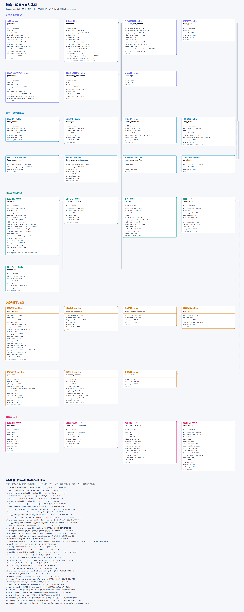
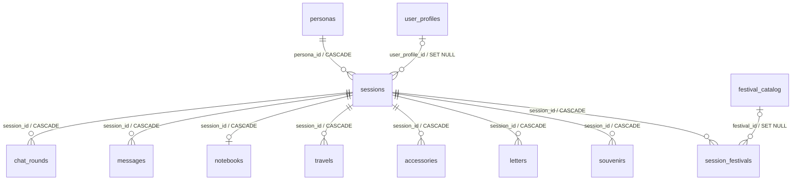
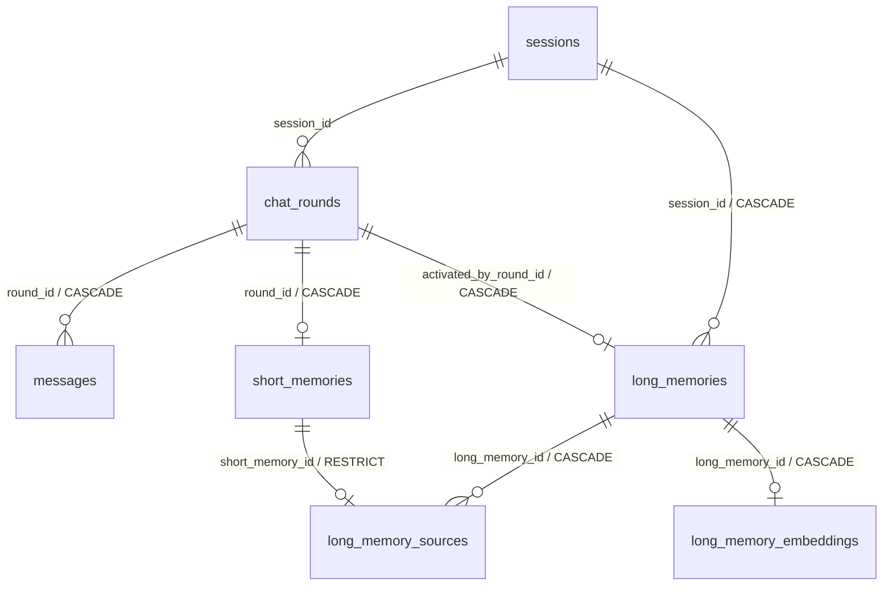
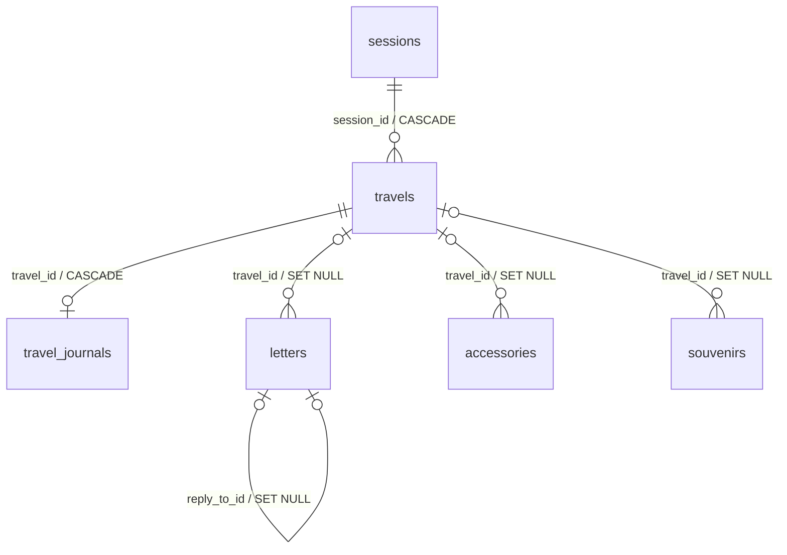
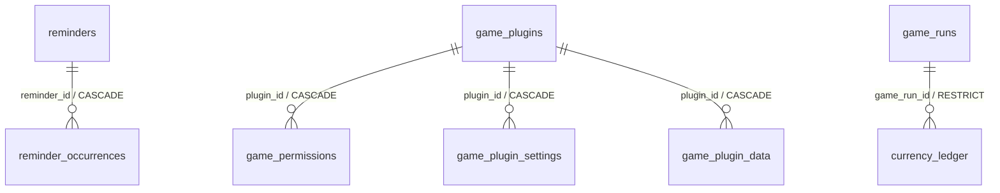

# 颜喵 YanMew 数据库与持久化设计

[打开完整数据库类图（离线交互页面）](./数据库完整类图.html)：包含全部 30 张业务表、1 张 FTS5 虚拟表、262 个字段及表间关系。支持模块切换、表名与字段搜索、缩放、关联跳转，以及完整约束和索引查看。用浏览器打开 HTML 文件即可，无须启动应用。

[完整类图 SVG](./数据库完整类图.svg) · [Mermaid 类图源文件](./数据库完整类图.mmd)。图从 `db/schema.sql` 生成；结构修改后运行 `python -B db/tools/generate_database_diagram.py` 更新。实线为物理外键，虚线为逻辑关联；以下图片是完整类图的静态预览。

- 日期：2026-09-19
- 范围：SQLite 结构、事务、后台任务恢复与备份协议。
- 结构唯一来源：`db/schema.sql`。本文描述该结构的写入与恢复规则；产品交互见前端设计文档。

## 1. 建库与升级

### 平台与存储边界

当前 schema 与阶段 0–18 仍以 Windows 首版为基线。未来 Android 复用业务表、外键和事务规则，不为手机复制一套记忆或钱包表。本次架构预留不新增列、不改变 SQL 类型与既有默认值。

数据库文件位置由 `AppPaths` 注入：Windows 为便携 `data/`，Android 为应用私有目录；资源存受管相对引用。系统文件选择得到的 URI 不直接当作数据库或模型路径。`crypto.rs` 经平台密钥保护接口读写：本文及 SQL 注释中的 DPAPI 表示当前 Windows 实现，未来 Android 使用 Keystore 管理的密钥保护凭据，其密文格式在移动端阶段版本化确定；不可跨设备复制密文作为有效凭据。

跨平台迁移使用版本化逻辑备份，索引重新建立，凭据重新填写；不共享运行中的 SQLite 文件。桌面位置偏好在 Android 不执行，系统授权、原生设备句柄和绝对路径不可从 Windows 备份转成手机有效状态。Android FTS5/trigram、资源读写及跨端备份往返须单独验证，当前不宣称兼容已完成。任务恢复契约见《项目架构与代码职责》第 9 节。

### 初始化与迁移规则

当前结构版本为 `user_version=4`，支持空白新库及版本 1、2、3 依次迁移。1→2 增加会话桌宠状态；2→3 保护亲密度整数 0–999 并收敛旧超限值和不可达档位；3→4 原地增加提供商输出预算、可选上下文覆盖与回合停止原因，旧 interrupted 回填 unknown，保留消息、记忆、密钥及其他业务数据。磁盘旧库升级前生成 `yanwenzi-before-v4-*.db` SQLite 一致性备份，备份失败不升级，迁移失败整体回滚；已有 002/003 不改写。无版本但已含业务对象的库及未知版本拒绝初始化。配置默认值由 `config.rs` 提供；`get_settings/save_settings` 不暴露上下文和密钥，天气凭据使用独立入口且只返回配置状态。

- 新库在一个事务内执行 `db/schema.sql`，写入 `is_builtin=1` 的默认人设、全局钱包、内置本地 Embedding 配置及版本号后提交。随包石头剪刀布只有在清单和程序资源校验通过后才登记为可用；开发阶段尚无插件资源时不制造可启动条目，完整 V1 发布必须包含并验收该资源。初始化阶段即创建完整结构，后续功能阶段只接入读写，不再重复增加同名字段。
- 使用 `PRAGMA user_version` 管理结构版本。已有旧库必须先迁移，再执行种子逻辑；`CREATE TABLE IF NOT EXISTS` 不能用来更新已有表。
- 未带版本的旧库仅在其表和列清单与已支持迁移样本匹配时升级；未知结构或高于当前版本的库停止启动并提示，不猜测修复。新库与迁移完成库应具有相同的字段、外键、CHECK 和索引。修改 CHECK 或外键需要重建表并复制数据，不能只 ADD COLUMN。
- 迁移前关闭后台写入并制作数据库备份。升级失败回滚并停止启动业务任务；不清空、不静默丢弃旧数据。新增 NOT NULL 列先回填，再验证约束；发现重复当前项、负余额或无法恢复的业务状态时报告具体冲突，不自动猜测保留哪条。
- 历史短期聊天摘要没有回合或消息关联时，不能推测精确来源；迁移需要明确处理这些不可追溯记录。迁移方案必须基于实际旧库版本编写并单独验证，不在应用启动时临时推断。
- 每个连接建立后、开启任何事务前执行 `PRAGMA foreign_keys=ON`，再读取 `PRAGMA foreign_keys`，必须返回 `1`，否则拒绝使用该连接。建表语句声明外键不能替代这一步；不得在运行中的事务内尝试切换外键开关。时间统一存 UTC RFC3339，采用一致精度；签到、游戏次数、节日与重复提醒的本地日期由 Rust 转换。

## 2. 数据层级与当前表清单

`db/schema.sql` 是当前结构的唯一来源。当前结构包含 30 张普通业务表和 1 张 FTS5 虚拟索引表。理解这些表时先区分“全局数据”“会话级数据”和“保留快照的历史记录”：

### 2.1 全局资源与全局状态

- `providers`：聊天提供商和可选的记忆整合专用提供商；独立于人设和会话。
- `embedding_providers`：长期记忆向量模型配置；内置本地模型与用户联网模型共用此表。
- `settings`：全局键值设置，包括当前会话、窗口位置、主题和各项数值配置。键值表中的逻辑引用由 Rust 校验，不使用数据库外键。
- `user_state`：固定 `id=1` 的全局状态行，当前只保存喵币余额。
- `currency_ledger`：全局喵币流水。历史流水不随人设、会话、饰品或插件删除。
- `game_plugins`：当前小游戏插件登记；随包石头剪刀布和用户本地安装插件共用。
- `game_permissions`：用户对插件权限申请的当前状态，按插件、权限名和权限作用域保存；联网权限按 HTTPS origin 分项记录。状态为 `pending/allowed/denied`，独立插件数据导入后统一为 `pending`。
- `game_plugin_settings`：插件自己的键值设置，不占用主程序 `settings`。
- `game_plugin_data`：插件全局私有 JSON 存档，只按插件 ID 隔离。
- `game_runs`：全局游戏局历史，保存插件身份和结算快照，不绑定人设或会话。
- `reminders`：全局提醒规则，不属于某个人设或会话。
- `reminder_occurrences`：每条提醒规则的具体触发记录。
- `user_profiles`：用户设定库；一份用户设定可被多个会话引用，也可以暂时不被引用。
- `festival_catalog`：系统内置节日母表；使用稳定 `code`，不随业务数据删除。

### 2.2 人设与会话根节点

- `personas`：人设根节点。非内置人设删除后，它名下的全部会话级数据一起删除；唯一内置默认人设由 Rust 禁止删除。
- `sessions`：会话级数据的真正边界。每个会话必须属于一个人设，可以选择绑定一个 `user_profiles` 记录。
- 会话级表包括：`session_pet_states`、`chat_rounds`、`messages`、`short_memories`、`long_memories`、`long_memory_embeddings`、`notebooks`、`travels`、`travel_journals`、`accessories`、`letters`、`souvenirs` 和 `session_festivals`。小游戏插件表全部属于全局层。
- `long_memory_sources` 没有单独的 `session_id`，通过它连接的长期记忆和短期记忆间接归属会话；Rust 必须验证两端属于同一会话。

### 2.2.1 会话桌宠状态与时间

`session_pet_states` 通过主键兼外键 `session_id` 与 `sessions` 一对一关联。创建会话时由数据库触发器建立初始状态，删除会话时级联删除。已有版本 1 会话迁移时补初始记录，未知的历史喂食、互动时间保持 NULL，不编造过去的行为。

- `hunger_elapsed_ms`：距上次喂食累计的有效运行毫秒数；普通点击、摸摸不能归零。
- `idle_elapsed_ms`：本段无互动累计的有效运行毫秒数；合法互动、醒来后归零。
- `idle_branch`：`none`=本周期尚未选择，`bored`=已经选择无聊，`sleeping`=已经选择睡眠。分支跨切换和重启保留，不因再次读取而重新随机。
- `sleep_until`：睡眠结束的 UTC RFC3339 时刻，仅 sleeping 时非空。进入睡眠只抽取一次持续时间，保存后不重抽；即使应用关闭或该会话不是当前会话，真实时间仍自然经过。
- `last_fed_at`、`last_interacted_at`：最近真实操作的 UTC 时刻，可空；只作记录，不能用当前时刻减去它们推导有效运行时长。
- `state_revision`：桌宠状态自己的并发版本，每次状态写入递增，拒绝迟到计时和重复提交；独立于会话的 memory_revision，不触发记忆重建。
- `updated_at`：最近一次状态提交时刻，UTC RFC3339。

饥饿与无聊只累计当前会话的有效运行区间。关闭、系统暂停、非当前会话的时间不补累计；切换恢复目标会话自己的数值。后端调度根据平台运行许可和实际活动计算有效区间，使用单调时钟测量，事件切换前先提交旧区间；不能接收前端自报的计时增量。定时检查点与切换/退出提交共同保证恢复，异常终止最多损失尚未提交区间，不通过墙上时钟补算。

恢复时读取已保存的 sleep_until：未到期继续睡眠；已到期清除睡眠、idle_branch 改为 none、idle_elapsed_ms 归零，开始新无互动周期；不补算离线饥饿或无聊。提供商连接错误属于独立运行健康状态，不存入本表，也不因切换会话清除错误。

全量备份及包含会话的完整包携带该状态记录；人设资料包和插件使用数据包不带。导入重映射 session_id 后保留计时和睡眠结束时刻，按恢复规则检查到期，不因导入重抽。数据库版本 1 到 2 的升级为既有会话补零计时、none 分支和空睡眠时刻。

### 2.3 聊天与记忆

- `chat_rounds`：一轮“用户消息 + AI 回复”的生命周期，区分 pending、completed、interrupted。
- `messages`：消息原文。完整回合的两条消息绑定同一个 `round_id`；主动消息使用 `round_id=NULL`。
- `short_memories`：每个 completed 回合至多一条短期记忆，整合后仍永久保留。
- `long_memories`：由前 `k` 条待整合短期记忆生成；记录标题、正文、实际来源数量及触发它的第 `k+1` 回合。覆盖边界从 `long_memory_sources` 的最后一条来源所对应的回合推导，不重复保存消息 ID。
- `long_memory_sources`：长期记忆与短期记忆的来源关联表，同时保存来源顺序。每条短期记忆最多只能成为一条长期记忆的来源。
- `long_memory_embeddings`：当前 Embedding 模型为每条长期记忆生成的一份向量缓存，可删除重建。
- `long_memories_fts`：长期记忆标题和正文的 FTS5 全文索引，是可重建数据，不进入逻辑备份。
- `notebooks`：一个会话至多一行，整行保存该会话的记事本正文。

### 2.4 旅行、内容与节日

- `travels`：出行记录表，保存一次旅行的状态和生成任务游标；一个会话同时最多一条 away 旅行。
- `travel_journals`：正常返回后的一篇旅行游记；一个旅行至多一篇。
- `letters`：用户信、途中信、回来信和回复；使用 `reply_to_id` 自关联，每封信最多被回复一次。
- `accessories`：制作或旅行带回的饰品；一个会话同时最多佩戴一件。
- `souvenirs`：旅行带回的普通文字伴手礼；可保留来源旅行引用。
- `session_festivals`：当前会话的节日、生日、纪念日和自定义日期；可以关联系统节日母表，也可以完全自定义。

出行记录是关联根节点，游记、信件、伴手礼与旅行饰品是并列子项。删除子项不会反向级联到 travels，也不删除同次出行的其他子项；只有删除根记录时才按外键规则处理子项。不能把“生成时读取其他结果”解释为这些记录之间存在删除级联。

### 2.5 小游戏插件与历史审计

- `game_plugins`、`game_permissions`、`game_plugin_settings`、`game_plugin_data` 保存当前登记、授权、设置和私有存档；删除登记时级联删除后三类当前数据。
- `game_plugin_data` 保存插件全局私有 JSON 数据。同一插件和数据键不能重复；它不绑定人设或会话。
- `game_runs` 保存每局游戏的插件 ID、名称、版本、钱包授权快照、结果和累计喵币变化。它不外键关联 `game_plugins`，卸载插件后仍保留历史，也不保存人设或会话引用。
- `currency_ledger` 的 `plugin_game` 流水保存游戏局、插件 ID、版本、显示原因和钱包请求 ID。已记账游戏局受 `RESTRICT` 保护，不能先于账单删除。
- 石头剪刀布是随包插件，首次初始化由种子逻辑登记到 `game_plugins`，并和第三方插件共用全部表与钱包流程。

### 2.6 尚未进入当前 schema 的规划表

- 语音扩展的 `voice_models`、`voice_providers`、`voice_profiles`、`voice_profile_references`、`persona_voice_settings`、`persona_wake_words` 仍属于后续方案，首版阶段 0–18 不创建空表。
- 文档提到规划表时必须明确标为“预定结构”；只有写入 `db/schema.sql` 并提供旧库迁移后，才算当前数据库结构。

### 2.7 `settings` 完整键清单

`settings` 不是自由写入的插件式配置表。`key` 是非空文本主键，保存下面登记的稳定英文设置名；`value` 是非空文本，保存该键的规范字符串值。类图中的 `PK key: TEXT` 和 `value: TEXT` 是所有全局设置共用的两列，不是两项具体设置。Rust、前端、初始化和迁移必须共用这份清单，不得自行增加同义键或维护另一套默认值。

Rust 只通过强类型设置仓储读写本表，不向前端或插件提供任意字符串写库接口。整数使用无空格、无单位、无小数点、无前导正号的十进制字符串；枚举使用清单列出的固定小写值；URL 必须是完整 HTTPS URL；密钥只保存 Windows DPAPI 密文的 Base64。可选设置未配置时删除整行，不用空字符串表示。保存时先完成单项和成对校验，再在一个事务内写入；读取或导入时不认识的键必须按备份版本兼容规则处理，不能静默当成有效配置。

#### 桌宠与空闲计时

- `hungry_minutes`：正整数，默认 `120`；达到后进入饥饿状态。
- `bored_minutes`：正整数，默认 `45`；无互动达到阈值后参与无聊/睡眠分支。
- `sleep_idle_minutes`：正整数，默认 `45`；无互动达到阈值后参与无聊/睡眠分支。
- `sleep_min_minutes`：正整数，默认 `60`；每次睡眠持续时间下限。
- `sleep_max_minutes`：正整数，默认 `120`；睡眠持续时间上限，必须不小于 `sleep_min_minutes`。

`bored_minutes` 与 `sleep_idle_minutes` 同时到达时各 50% 随机选择一次；用户将二者改为不同值时，先到达的状态先触发。互动重置无互动周期，但不重抽旅行倒计时。

#### 记忆、上下文与记事本

- `short_memory_min_chars`：正整数，短期记忆最小汉字数；默认 `12`。
- `short_memory_max_chars`：正整数，短期记忆最大汉字数，必须不小于最小值；默认 `100`。
- `long_memory_min_chars`：正整数，长期记忆最小汉字数；默认 `150`。
- `long_memory_max_chars`：正整数，长期记忆最大汉字数，必须不小于最小值；默认 `250`。
- `memory_merge_count`：正整数，默认 `20`；生成一条长期记忆使用的短期记忆数量 `k`。
- `recent_message_count`：正整数，默认 `30`；正常容量下进入上下文的最近消息原文数量。
- `recent_long_memory_count`：正整数，默认 `30`；直接进入上下文的最近长期记忆数量 `m`。
- `travel_journal_min_chars`：正整数，旅行游记最小汉字数；默认 `250`。
- `travel_journal_max_chars`：正整数，旅行游记最大汉字数，必须不小于最小值；默认 `350`。
- `tool_call_rounds`：正整数，默认 `3`；AI 单次回复最多执行的工具调用轮数。
- `notebook_max_chars`：正整数，默认 `4000`；一个会话记事本的 AI 维护建议上限。它不形成数据库长度约束，超限内容不截断、不丢弃，AI 在后续修改时优先压缩回范围内。

字数范围用于约束提示词和校验生成结果，不对正文做无提示硬截断。上下文超限时只减少本次携带的较旧内容，不修改全局设置。恢复默认值时，短期记忆恢复为 `12–100` 字、长期记忆恢复为 `150–250` 字、旅行游记恢复为 `250–350` 字。

#### 亲密度、饰品与签到

- `intimacy_threshold_1`、`intimacy_threshold_2`、`intimacy_threshold_3`、`intimacy_threshold_4`：1–999 内的整数，默认依次为 `10`、`50`、`150`、`300`，必须严格递增。亲密度上限固定为 999，不另设 settings 键。
- `sessions.intimacy`：整数 0–999，点击/摸摸/喂食和后续聊天成功奖励共用后端封顶规则，与触发行为同事务保存；满值不阻止行为本身。导入的亲密度必须在此范围内，非法包拒绝导入，不能绕过触发器。
- `accessory_cost_1`、`accessory_cost_2`、`accessory_cost_3`、`accessory_cost_4`：非负整数，默认依次为 `20`、`50`、`120`、`300` 喵币；第四档及以后重复制作使用第四档价格。
- `sign_in_min_coins`：非负整数，默认 `1`；普通每日签到随机奖励下限。
- `sign_in_max_coins`：非负整数，默认 `10`；普通每日签到随机奖励上限，必须不小于下限。

修改阈值或价格不恢复前三档已经使用的制作机会，也不重算历史喵币流水。命中节日时签到奖励固定为 `10`，不读取普通签到随机范围。

#### 出行与回信

- `travel_min_online_hours`：正整数，默认 `2`；下一轮旅行有效在线等待时间抽取下限。
- `travel_max_online_hours`：正整数，默认 `4`；等待时间抽取上限，必须不小于下限。
- `travel_min_duration_minutes`：正整数，默认 `60`；实际旅行时长抽取下限。
- `travel_max_duration_minutes`：正整数，默认 `180`；实际旅行时长抽取上限，必须不小于下限。
- `travel_accessory_chance_percent`：`0`～`100` 的整数，默认 `10`；正常返回时带回可佩戴饰品的概率百分比。
- `letter_reply_min_minutes`：正整数，默认 `10`；用户信件自动回信延迟下限。
- `letter_reply_max_minutes`：正整数，默认 `30`；回信延迟上限，必须不小于下限。

修改出行等待范围只影响以后新抽取的 `sessions.travel_trigger_remaining_seconds`，不能重抽或改写会话中已保存的倒计时。

#### 天气、当前上下文与窗口

- `weather_qweather_api_host`：可选 HTTPS URL，无默认值；保存用户在和风天气控制台获得的专属 API Host。
- `weather_qweather_api_key_encrypted`：可选 DPAPI Base64 密文，无默认值；Host 与 Key 都有效时才启用和风天气兜底。
- `current_session_id`：正整数文本，无默认值；当前会话的逻辑引用。无可用会话时删除该键；启动、导入、删除和切换时由 Rust 验证会话存在且属于当前人设。
- `window_pos_x`：有符号整数，无固定默认行；主宠窗左上角逻辑像素 X，缺失时使用当前工作区右下角默认位置。
- `window_pos_y`：有符号整数，无固定默认行；主宠窗左上角逻辑像素 Y，允许负数以支持位于主显示器左侧或上方的副屏。
- `theme_mode`：枚举 `system`、`light`、`dark`，默认 `system`；只影响颜喵主程序界面，不传递给小游戏插件。

窗口恢复时按当前显示器工作区和 DPI 修正不可见位置，但不把临时修正写成用户主动设置。天气 Host 与 Key 不进入任何导出包；设置 DTO 只返回密钥是否已配置，不能返回密文或历史明文。

#### 不属于 `settings` 的内容

- 当前聊天、记忆和 Embedding 提供商保存在对应提供商表的当前项字段；当前人设、颜色、背景和自调开关保存在 `personas`。
- 会话亲密度和旅行倒计时保存在 `sessions`；插件权限、设置和存档保存在 `game_permissions`、`game_plugin_settings`、`game_plugin_data`。
- 开机自启以 Windows/Tauri autostart 的实际注册状态为准；普通二级窗口临时大小由窗口系统管理；后续语音配置使用人设级语音设置及语音模型表。

全量备份导出并替换 `settings`；人设资料包、人设完整包、会话包、用户设定包和插件使用数据包都不携带全局设置。API Key 即使已加密也不导出。导入后必须验证所有已知键并重新映射 `current_session_id`。

## 3. 表间关系图

### 3.1 人设、会话与会话内容

主链是 `personas → sessions → 会话级数据`。删除非内置人设会先级联删除其会话，再由会话继续级联删除聊天、记忆、旅行和养成内容。`user_profiles` 与 `festival_catalog` 是可复用的全局资料，删除后只解除引用，不删除会话或会话节日。

### 3.2 回合与记忆来源

这里有三种不同含义：`round_id` 表示原始回合，`long_memory_sources` 按 `source_order` 保存长期记忆实际使用的短期记忆，`activated_by_round_id` 表示哪一轮触发了这条长期记忆。删除最后一轮时先按触发关系回退长期记忆，再删除该轮消息和短期记忆；来源短期记忆上的 `RESTRICT` 防止长期记忆仍存在时单独删除来源。

例如 `k=20` 时，来源表的第 1～20 项就是完整覆盖范围；取 `source_order` 最大的一项，经 `short_memories.round_id` 打开对应回合及 AI 消息，就能得到实际覆盖边界。第 21 轮保存在 `activated_by_round_id`，表示它的出现触发了前 20 条的整合。来源清单是覆盖关系的唯一事实。

`long_memories_fts` 和 `long_memory_embeddings` 都属于检索派生数据。FTS5 由触发器同步标题和正文；向量由后台任务生成。它们不能成为业务事实来源，丢失后应从 `long_memories` 重建。

### 3.3 旅行、信件、礼物与游记

删除旅行会删除只属于该旅行的游记，但不会删除用户仍应看到的信件、饰品和伴手礼；这些记录只把 `travel_id` 置空。删除会话则会删除整组旅行及其所有会话级内容。`letters.reply_to_id` 置空只解除现存引用，`has_been_replied` 仍保存历史回复资格，不能因为回复被删而重置。

### 3.4 全局提醒、插件与喵币

`user_state` 与 `currency_ledger` 没有外键连接，这是有意设计：余额是当前汇总，流水是永久审计记录。每次变动必须在一个事务中同时检查余额、更新 `user_state.coins` 并插入 `currency_ledger`。`currency_ledger.ref_id` 是饰品等业务的历史引用，不设外键；插件流水使用明确的 `game_run_id` 外键。`game_runs.plugin_id` 和账单中的插件信息是历史快照，不外键指向当前 `game_plugins`，因此卸载插件不会破坏审计记录。

## 4. 外键、删除与逻辑完整性

### 4.1 `CASCADE`：父对象消失，子对象也没有独立意义

- `personas → sessions`：删除非内置人设会删除它的完整会话树。
- `sessions →` 回合、消息、短期/长期记忆、向量、记事本、旅行、游记、饰品、信件、伴手礼、会话节日。
- `chat_rounds → messages/short_memories`：删除回合时删除该轮原文和对应短期记忆。
- `chat_rounds → long_memories`：只通过 `activated_by_round_id` 删除由该回合触发的长期记忆。
- `long_memories → long_memory_sources/long_memory_embeddings`：长期记忆删除后，来源连接与向量缓存一起删除。
- `reminders → reminder_occurrences`：永久删除提醒规则时删除它的触发记录。
- `travels → travel_journals`：旅行记录删除后，该旅行游记不再独立存在。
- `game_plugins → game_permissions/game_plugin_settings/game_plugin_data`：清除插件登记时清除当前授权、设置和私有存档。

### 4.2 `SET NULL`：被引用对象可删除，业务记录仍应保留

- 删除 `user_profiles`：会话保留并变成未绑定用户设定。
- 删除 `festival_catalog` 引用：会话节日保留为独立记录。正常产品流程不删除内置母表，但迁移仍需可恢复。
- 删除 `travels`：信件、旅行来源饰品和普通伴手礼保留，只失去来源旅行链接。
- 删除被回复的 `letters`：回复信保留，`reply_to_id` 置空；历史上的 `has_been_replied` 不重置。

### 4.3 `RESTRICT`：必须先执行业务回退

- `long_memory_sources.short_memory_id → short_memories.id` 使用 `RESTRICT`，防止来源短期记忆在长期记忆仍存在时被删掉。
- `currency_ledger.game_run_id → game_runs.id` 使用 `RESTRICT`，防止已经产生喵币账单的历史游戏局被删除。
- 尾部删除必须在同一事务内先读取并保存触发长期记忆的来源 ID，将这些短期记忆恢复为 `pending`，再删除触发长期记忆（来源关联与向量自动级联删除），最后删除回合及其消息、短期记忆。不能先删来源关联再查来源，也不能绕过回退规则直接删消息。
- 整会话删除、整人设删除及导入覆盖共用删除服务：先删除目标会话范围内的长期记忆，解除短期来源上的 `RESTRICT` 引用，再删除会话或人设，由外键清理剩余子记录。全部步骤必须在同一事务内完成，不能依赖多条级联路径的内部执行顺序，也不能关闭外键绕过检查。

### 4.4 逻辑引用与外键之外的业务校验

- `settings.current_session_id` 是键值设置中的逻辑引用；启动、切换、导入和删除人设后都由 Rust 验证并修正。
- 多张表同时保存 `session_id` 和更具体的 `round_id`、`long_memory_id` 或 `travel_id`，目的是快速按会话查询。出行子项已使用 (travel_id, session_id) 复合外键证明同会话归属，父表提供 UNIQUE(id, session_id)。原有单列外键负责 CASCADE/SET NULL，附加复合外键用 NO ACTION 在语句结束时检查，避免 SET NULL 意外清空非空 session_id。聊天/记忆关联尚使用单列外键，Rust 仍必须检查其同会话关系。
- `currency_ledger.ref_id` 会指向不同业务类型，结合 `reason` 解释；这是多态历史引用，不设单一外键。
- `game_runs.plugin_id` 以及插件账单里的 `plugin_id`、`plugin_version` 是历史快照，不设到当前插件登记的外键；Rust 只能从它们追溯来源，不能据此判断插件当前已安装。
- `long_memories_fts` 与 `long_memory_embeddings` 是可重建索引，不能作为业务事实来源；前者由触发器同步，后者通过外键随长期记忆删除。
- FTS5 的日常触发器更新必须与长期记忆写入处于同一事务。全量 rebuild 单独安排，并在完成前避免使用未就绪索引；Embedding 推理、AI 请求、文件复制和网络调用在业务事务外执行，按“读取快照 → 外部处理 → 短事务校验版本后提交”处理。

### 4.5 关键唯一约束

- 内置 Embedding 配置最多一条且必须为 local；向量 BLOB 字节数必须等于 dimensions × 4，有限数值及归一化由 Rust 检查。
- 插件账单同时以 (game_run_id, plugin_id, plugin_version) 引用游戏局快照，防止账单冒用另一插件身份。
- 全局最多一个聊天当前提供商、一个记忆专用提供商、一个当前 Embedding 提供商、一个当前人设和一个内置默认人设。
- 每个回合每种角色最多一条消息；每个回合最多一条短期记忆。
- 每条短期记忆最多成为一条长期记忆的来源；同一长期记忆的来源顺序不能重复。
- 每个触发回合最多激活一条长期记忆；每条长期记忆只有一份当前模型向量缓存。
- 每个旅行最多一篇游记；每个会话同时最多一条 away 旅行、最多一件佩戴饰品。
- 每封信最多有一条现存回复；同一旅行的途中信和回来信各最多一封。
- 同一提醒规则的同一原定时间最多一条 occurrence，防止启动恢复或重试重复入队。
- 同一插件、权限名和权限作用域最多一条授权决定；同一插件的设置键和私有数据键各最多一条。`network.fetch` 以单个 HTTPS origin 作为权限作用域。
- 同一插件的同一个 `wallet_request_id` 最多产生一条账单，防止插件重试造成重复到账或扣款。

所有数据库连接都必须执行 `PRAGMA foreign_keys=ON`。前端校验只改善交互，不能替代 SQLite 约束和 Rust 事务检查。

## 5. 通用事务与约束

- 写入事务只包含数据库操作，不包含 AI、网络请求或等待用户确认。运行时按会话/业务对象串行执行冲突任务。
- 需要 AI 的任务：读取输入快照 → 释放数据库锁 → 请求 AI → 开启短事务 → 校验记录仍存在且状态/版本未变化 → 写入结果与完成状态 → 提交。过期结果丢弃；可重试任务保持 pending。
- 当前聊天提供商、显式记忆提供商、当前人设分别最多一条；无显式记忆提供商时跟随聊天提供商。切换时先验证目标，再在同一事务中清除旧项、启用新项。
- 正被聊天或记忆整合使用的提供商禁止删除，必须先切换；当前联网 Embedding 项同样必须先切换，内置本地 Embedding 项永远不可删除。
- `personas.is_builtin=1` 的默认人设永远不可删除且最多一条。删除当前非内置人设时，在同一事务内级联删除其会话级数据、切换到默认人设并修正 `settings.current_session_id`；事务提交后再广播上下文变化。
- Embedding 提供商与聊天/记忆整合提供商独立，最多一条当前项。首次启动写入并启用随应用打包的 `BAAI/bge-small-zh-v1.5` 本地项；联网项的 API Key 使用 DPAPI 加密。
- 一个会话最多一件佩戴饰品、一条 away 旅行，由部分唯一索引保证；换装先卸载旧项再佩戴新项，并在同一事务提交。
- 余额非负、布尔值、枚举及数值范围由 CHECK 约束；Rust 还需检查设置最小值不大于最大值、亲密度档位递增、日期有效、重复规则合法和饰品字符限制。
- `settings.theme_mode` 是全局主程序主题偏好，只允许 `system`、`light`、`dark`，缺失时默认 `system`，非法值按配置错误处理并回退到 `system`。`system` 保存的是跟随系统偏好，不持久化当时解析出的亮色或暗色结果。
- 主题设置只由主程序窗口读取；小游戏插件宿主不把 `theme_mode`、解析后的主题或主题颜色变量加入插件上下文。
- 涉及回合、消息、短期记忆、长期记忆来源、`travel_id`、旅行游记和 `reply_to_id` 时，Rust 必须验证关联对象属于同一会话；出行归属由复合外键进一步保护；其余单列外键仅验证存在性，仍须服务层检查。
- 余额检查、每日签到/游戏次数检查、游戏局更新、余额更新和账单插入共用一个事务。石头剪刀布获授权的结算局平局以 `delta=0` 记录流水，纯玩局不写钱包流水，签到同时统计普通签到与节日签到原因，不能分别领取。
- 插件只能通过宿主服务修改钱包。每次请求必须同时校验当前登记、启用状态、包状态、版本、游戏局开局时的钱包授权快照与当前 `wallet.modify` 授权、游戏局归属、整数变化、非负余额和钱包请求 ID；数据库唯一索引负责最后一道幂等保护。中途授权不改变纯玩局，撤销立即阻止尚未提交的请求，已记账变化不回滚。
- 饰品制作同时检查余额和对应 `craft_tier_1_used/2_used/3_used`，扣款、写流水、插入饰品、标记档位均在同一事务内完成。卖出/删除饰品不重置档位；调整阈值/价格不重置已使用标记。第四档不设一次限制。
- 制作内容与简介在扣款前准备并校验；确认请求绑定会话和报价，提交时重新检查当前资格与余额。卖出事务同时删除未佩戴饰品、增加余额并写流水，重复提交不得再次到账。

全局设置新增 `sleep_idle_minutes`，默认 45，正整数，用户可修改；它与 sleep_min_minutes/sleep_max_minutes 的睡眠持续时间区间分开。上下文自动缩减只影响当次请求，不产生数据库删除或配置写回。

## 6. 当前会话与旅行

- Rust 维护唯一当前会话，并以 `settings.current_session_id` 保存；启动时验证归属当前人设，失效则按当前人设最近会话恢复，无会话时保持空。后台任务不得用执行时的新当前会话替代创建任务时绑定的会话。
- `sessions.travel_trigger_remaining_seconds` 是下一次出行还需等待的有效在线秒数。创建会话、正常返回或取消旅行后，从全局设置的 `travel_min_online_hours`～`travel_max_online_hours` 抽取一次并持久化；默认范围为 2–4 小时。它取代“累计秒数 + 随机阈值”两个字段，V1 不保存已经累计了多久的统计。
- 仅当前会话、应用运行、在家且桌宠空闲时递减该倒计时；聊天、互动、睡觉、休眠、隐藏宠窗或出门中不递减，其他会话和应用关闭期间暂停。应分批持久化剩余秒数，正常退出前再保存一次；本次扣减将达到零时，不保存零值，而是在同一事务创建 `away` 出行并把倒计时设为 `NULL`。
- 出行倒计时与无聊/睡眠的无互动计时完全独立。互动会重置无聊/睡眠周期，但只暂停旅行倒计时，不重新抽取旅行等待时间。
- 出发事务写入 `away`、出发/计划返回时间和行程中点 `midway_letter_at`；下一次回信时间在用户信保存时单独抽取。重启不能重新抽取已保存的期限。
- 切换会话或人设时，尚未出发的会话只暂停并保留 `travel_trigger_remaining_seconds`，再次成为当前会话后继续递减，不重新抽取。若离开会话已有 `away` 旅行，则先在事务内取消旅行，记录 `cancelled_at`，将未完成旅行生成状态和用户待回信置为 cancelled，再为该会话抽取并保存下一轮 2–4 小时倒计时。取消不生成回来信、礼物或总结，已经存在的信件和数据保留。
- `travels.status` 只允许三种枚举值：`away`=出门中，`returned`=正常返回，`cancelled`=切换会话或人设后取消。`cancelled` 是旅行历史状态；桌宠仍只有在家/出门中两种外观状态，取消不能伪装为正常返回。
- 正常返回事务将旅行标为 returned，记录实际返回时间，取消尚未完成的途中信和用户待回信，抽取并保存一次 `gift_kind`，并抽取、保存下一轮 2–4 小时的 `travel_trigger_remaining_seconds`。离线到期的正常返回时间使用 planned_return_at。
- 返回后的回来信、礼物、旅行游记分别用 `return_letter_state`、`gift_state`、`journal_state` 保存 pending/done/cancelled。先保存固定出行事实，再生成礼物并同事务保存实际礼物快照；回来信和游记依据事实及已完成快照生成，不能编造尚未发放的礼物。游记不要求信件或礼物展示行仍存在，详见第 6.1 节。
- 每个生成任务写入结果与 done 状态必须同一事务提交；失败保持 pending，后续调度或启动重试。同一任务不并发调用 AI，提交时再次检查仍 pending；删除已生成结果不重置 done。
- 正常关闭应用不等同于切换会话。启动时先恢复当前会话，再检查所有 away 和 returned 的未完成任务：未到期继续，已到期先正常返回；已取消的旅行不恢复。迟到的 AI 响应只有在事务检查允许时才能保存。

### 6.1 出行事实与实际礼物快照

出行事实直接属于 `travels`，不是临时缓存，不依赖信件、游记、伴手礼或饰品行继续存在。它们随会话级备份导出，删除子项不清除，删除出行/会话才按根节点生命周期清理。

字段契约：

- `facts_state`：pending / ready / cancelled。出发时 pending；事实完整写入才 ready；取消尚未生成事实的出行改为 cancelled。已经 ready 的事实在取消后保留作历史，但不得继续生成返回结果。
- `destination`：非空目的地文字，ready 时必填。
- `activities_json`：非空数组，每项 `{elapsed_minutes: 非负整数, description: 非空字符串}`。表示本次虚拟旅行固定的活动时间线；按 elapsed_minutes 递增且不超过计划行程分钟数。旅行中只把已到时间的活动作为已发生事实，未来项不能在途中信或回信中写成已经完成。
- `facts_version`：未生成为 0，成功固定为 1；首版不提供重新生成或编辑基础事实的入口。生成任务读取此版本和旅行状态，提交前复验；不把不同请求的目的地和活动分批拼接。
- `facts_ready_at`：事实完成落盘的 UTC 时间，不等于每项活动发生时间。
- `gift_snapshot_json`：实际发放礼物的不可变快照；礼物未完成时 NULL。普通礼物为 `{schema_version:1, kind:"text", content, note}`；旅行饰品为 `{schema_version:1, kind:"accessory", name, display_text, description}`，文本字段均非空。类型必须与 gift_kind 一致，饰品还须通过既有字符/长度限制。

生成与恢复顺序：

1. 出发事务保存时间与 pending 状态；在事务外请求地点与活动时间线。途中信和回信生成等候事实 ready，失败可重试，不另造一套经历。
2. 事实结果仅当目标仍存在、facts_state=pending 且 status 为 away/returned 时一次提交；已取消则丢弃。若离线回来时仍无事实，先补事实，再补返回结果，不能补发过期途中信。
3. 正常返回仍由事务固定 gift_kind，不能等 AI 成功才改变返回状态。事实 ready 后生成一种礼物，短事务同时写礼物/饰品行、完整快照及 gift_state=done；失败全部回滚。
4. 回来信读取固定事实和已发放礼物快照；游记读取相同事实、实际时间、快照及仍存在的往返信件。已删除信件不恢复，不将信件全文另存到事实字段。信件只提供可选交流细节，游记不等待某条展示信件存在。
5. 删除或卖出礼物、删除信件/游记不改事实及 done 标记；之后生成游记仍可描述历史上实际带回过的礼物，但不恢复它到当前列表，也不能据快照宣称用户仍持有该物品。
6. 用户手动编辑游记不反写基础事实；后续生成任务使用出行事实，不通过重新读取用户编辑后的游记改造历史。

SQLite 检查事实状态、必填字段、JSON 外形、快照版本/类型与生成状态组合；Rust 逐项校验活动内容、时间范围、礼物完整字段与不可变状态转移。状态的跨表转换仍必须由统一服务在事务中执行，不能只靠 CHECK 代替业务服务。

### 6.2 结构升级与验证

- 当前运行库版本为 4，已有 1→2 的会话桌宠状态、2→3 的亲密度约束及 3→4 的聊天预算/停止原因正式迁移。后续新约束按实际旧结构设计顺序迁移；不得声称尚无迁移，也不得为已存在的旅行表重复建表。真实旧库与当前 schema 的差异必须用对应历史结构核对，不能仅用当前 schema 构造的降版本样本推断全部历史兼容。
- 对已有旅行，缺少地点或经历时不能凭空补写成已知事实，也不能为了满足 CHECK 将旧 done 改回 pending 而重复发放。实际旧库迁移需有对应版本样本与缺失数据处理方案，无法无损升级时明确拒绝并保留备份。
- 图中的父子数量与删除方向不变；出行关联额外增加同会话复合外键。每次旅行普通礼物/饰品各有 travel_id 唯一索引；二者择一由 gift_kind 与返回服务保证。
- `python -B -m unittest discover -s db/tests -v` 在临时 SQLite 内测试结构、非法事实/快照、跨会话引用、重复发放、删除隔离和事务回滚，不访问实际数据。

## 7. 写信、回信与删除

- 只有当前会话仍在旅行中才允许用户写信或回复 AI 信；返回后邮箱只允许查看、收藏、删除。
- `letter_kind` 区分 user/midway/return/reply；用户信保存时生成一次 `reply_due_at` 并设为 pending，AI 信的自动回信状态为 none。
- AI 自动回信前、保存时均验证旅行仍 away、原信仍存在、reply_state=pending 且 has_been_replied=0。成功时同时插入回复、把原信设为 completed 和 has_been_replied=1。
- 用户回复 AI 信时，也在一个事务内检查原信未回复、插入用户信并把原信 has_been_replied 设为 1；这封用户信再按期限等待 AI 自动回信。
- `has_been_replied` 表示历史上已成功回复，删除回复不能清零。reply_to_id 唯一索引作为补充，不能单靠现存回复判断资格。
- 删除待回信的原信即取消该任务；后台提交发现原信不存在就丢弃结果。删除回复保留原信已回复标记；删除原信时回复保留但 reply_to_id 置空。
- 返回或切换会话后取消 pending 回信；重启时旅行仍 away 且回信已到期才补回。若旅行也已到期，先返回并取消待回信，不能先生成过期回信。

## 8. 聊天回合、记忆来源与事务

### 8.1 完整回合与短期记忆

- `chat_rounds` 是聊天回合主记录；`messages.round_id` 把一条用户消息和对应 AI 回复绑定到同一轮。`status` 完整枚举为：`pending`=只有用户消息、正在等待 AI；`completed`=AI 正常回复完成，可生成短期记忆；`interrupted`=回复被中断或只保存了部分回复，不生成短期记忆。`DEFAULT 'pending'` 只表示新建回合的初始值，不表示该字段只有一种状态。主动消息不属于回合，`round_id=NULL`。
- 一个 `completed` 回合只能有一条短期记忆，`short_memories.round_id` 唯一绑定来源回合。中断回合和主动消息不生成短期记忆。
- **短期记忆和长期记忆是中性事实记录，不使用人设口吻，不需要任何氛围总结或主观评价，必须只是如同剧本一样的叙事描述。**
- 短期记忆的 `integration_state` 完整枚举只有两种：`pending`=短期记忆已经生成，但尚未成为长期记忆来源；`integrated`=已经被 `long_memory_sources` 关联到一条长期记忆。`DEFAULT 'pending'` 只是新短期记忆的初始值，与“短期记忆生成任务是否等待执行”无关。整合成功只更新为 `integrated`，不删除原短期记忆。
- 自动生成读取固定回合、两条消息正文和 `memory_revision` 快照；AI 返回后在短事务内检查这些值及提供商/字数设置未变化，再插入缺失短期记忆并递增版本。已有短期记忆直接保留；更新由明确的编辑/重新生成入口处理。任何一步失败全部回滚。
- 如果 AI 返回时发现 `memory_revision` 或消息正文已变化，本次结果必须作为过期快照丢弃，不得写入。工作器随后使用最新回合内容重新排队；不能把“发现过期”当成任务已经完成，也不能只记录错误后永久跳过。
- 启动与失败恢复通过查询“`chat_rounds.status='completed'` 且不存在对应 `short_memories.round_id`”的回合补做，按来源回合顺序执行。缺失记录本身就是持久化待办标记，不另建易失的内存任务状态；即使版本冲突后立即关闭应用，下次启动仍能补做。`short_memories.round_id` 唯一约束保证重试最多落盘一条。
- `integration_state=pending` 只表示已有短期记忆尚未整合。长期整合因版本冲突或失败时不得把来源改为 `integrated`，因此下次调度仍能按来源顺序重试；长期整合不得跨过尚缺短期记忆的较早完整回合，不能按后台请求完成顺序分组。

Task 9.3 已使用现有表实现上述自动生成与缺失恢复，该任务实施时数据库版本为 3，当前已由 9.6 正式升级为 4，没有新任务表或临时 ALTER TABLE。每次扫描只返回每个会话最早的缺失回合；生成失败的重试次数在内存中有界维护，缺失关系作为重启恢复依据。状态统计分别查询当前会话短期记忆数与 completed 缺失数，不把 `integration_state` 当作生成进度。重试延迟、恢复条件及字数规则见《记忆与旅行游记设计》3.3。

### 8.2 长期记忆来源与 `k+1` 触发

- 全局设置 `memory_merge_count` 是每条长期记忆使用的短期记忆数量 `k`，默认 `20`。当同一会话出现第 `k+1` 条 `pending` 短期记忆时，固定读取此前连续 `k` 条生成长期记忆；触发整合的第 `k+1` 条仍为 `pending`。
- 长期记忆的非空标题和正文由同一次 AI 请求生成。长期记忆插入、`long_memory_sources` 来源关联写入和这 `k` 条短期记忆改为 `integrated` 必须在同一事务提交。`source_count` 保存当时的实际 `k`；修改全局 `k` 只影响以后尚未整合的数据。
- `long_memory_sources` 的最大 `source_order` 推导来源末轮和覆盖边界，`activated_by_round_id` 记录触发整合的第 `k+1` 轮。长期记忆正常生成后不删除旧长期记忆。
- 积压记录按来源回合顺序逐组整合，每组使用它自己的第 `k+1` 个回合作为触发回合。提交前同时校验本次读取的 `k`、来源及版本，设置已变化时重新计算未提交分组，不重算已有长期记忆。
- 长期记忆永久保存，不自动删除、覆盖、二次合并或压缩。最近 `recent_long_memory_count` 条直接进入上下文，更早记录由混合检索按需选取。

Task 9.4 已使用现有 long_memories、long_memory_sources 和 FTS 触发器实现自动整合，本任务未新增迁移，当前运行库已由 9.6 升为 4。来源选择按 roundId 排序，并限制在较早 completed 缺失短期回合之前；窗口前 k 条作为来源，第 k+1 条作为触发。提交时复核 k、来源正文/更新时间、提供商、字数配置和 memory_revision，来源状态更新与长期/FTS 写入原子完成。失败保留 pending，重启和明确恢复会继续扫描；没有新增持久任务表。底部完整回合回退由 memory::delete_completed_tail_round 统一服务完成，界面按阶段 10 接入。向量生成已由 9.5 接入，正文编辑与预览确认已由 9.7 接入；消息删除界面仍在阶段 10。

### 8.3 编辑、重新生成与回退

Task 9.7 管理服务复用既有表，数据库保持版本 4，没有新增迁移。手动编辑和确认预览在同一原位更新入口中比较目标/来源及 memory_revision，更新后递增版本；长期标题正文的 FTS 触发更新、旧向量删除与正文保存同事务提交。原始 ID、来源、整合状态、触发回合及创建时间不变。预览仅暂存在 Runtime，不进入持久化或备份；未确认、取消、过期和生成失败都保留旧记忆。

生成字数范围不限制用户手动编辑或修改预览，人工正文只要求非空，完整保存。长期标题要求非空单行，不新增长度硬上限。原文、来源或会话内容版本变化使预览失效；即使原文变化误漏递增版本，后端仍比较实际消息快照，防止覆盖。

- 编辑历史消息只改原文并递增 `memory_revision`，不自动修改或删除任何短期记忆、长期记忆或旅行游记。若该轮尚未生成短期记忆，后续任务读取编辑后的正文。
- 用户不能新建或删除短期、长期记忆，可以手动编辑。短期记忆“重新生成”使用其原回合；长期记忆“重新整合”严格使用原 `long_memory_sources` 并同时生成标题与正文。两者都先返回预览，确认时校验记录 ID、来源 ID 和版本，覆盖原记录且保持 ID 不变。
- 编辑或重新生成已整合短期记忆不自动改写长期记忆，界面提示用户按需重新整合相关长期记忆。
- 删除聊天只允许从底部删除。完整回合在一个事务内删除两条消息、回合和对应短期记忆；若该回合是 `activated_by_round_id`，还要删除对应长期记忆，并将其来源短期记忆恢复为 `pending`。底部只有待回复用户消息时，删除该消息和未完整回合。
- 底部为中断回合且存在部分 AI 回复时，同一事务删除该回合、用户消息与部分回复；中断回合没有短期记忆，不修改已有记忆。底部为主动消息（`round_id=NULL`）时只删除该消息，不修改任何既有记忆或前面的回合。
- 删除前取消目标回合尚未结束的请求，事务内重新验证实际底部及会话归属；主动消息未删除前不得越过它删除更早回合。以上删除均递增 `memory_revision`，使旧快照失效；迟到结果不得恢复已删除消息。
- 重说只处理最后一个完整回合。先在事务外生成新回复、新短期记忆以及通过 `long_memory_sources` 找到的受影响长期记忆；提交前校验最后回合和版本，随后在一个短事务内原位更新 AI 消息、短期记忆及受影响长期记忆。失败或快照过期不得留下部分更新。
- 每个会话的消息写入、回合状态、记忆生成或编辑、重说和回退都递增 `memory_revision`。不在 AI 或网络请求期间持有数据库事务。

### 8.4 长期记忆检索索引

- `long_memories` 是真实业务数据；`long_memories_fts` 和 `long_memory_embeddings` 都是可丢弃、可重建的派生索引。
- FTS5 外部内容表索引 `title` 与 `content`，使用 `trigram` tokenizer。插入、删除、编辑及重新整合长期记忆时由触发器同步全文索引；不足三个字符的检索词由 Rust 层补充普通匹配。
- `long_memory_embeddings` 每条长期记忆只保留当前 Embedding 配置的一份向量，保存 `model_key`、维度、归一化 float32 BLOB、标题与正文的内容哈希及更新时间。
- Task 9.5 已接入以上表，本任务无数据库迁移，当前运行库已由 9.6 正式升为 4。`model_key` 为 `local:<manifest SHA-256>:<维度>` 或 `online:<规范端点与模型名 SHA-256>:<维度>`，不含密钥；本地 manifest 固定权重、分词、预处理与运行库身份。`content_hash` 对带标题字节长度前缀的标题/正文计算 SHA-256，避免拼接歧义；同一正文的旧标题向量也视为过期。向量采用 float32 小端序 BLOB。
- 唯一 jobs 中的索引工作器检查缺失、内容过期与模型不匹配记录，按当前会话优先逐条补建；提交前重新验证提供商密文快照、恢复代次、所属会话及内容哈希。提供商切换事务清除旧向量；编辑配置后旧身份缓存不参与查询，补建时覆盖。测试当前项发现维度变化时清除不匹配身份缓存。数值无效、空向量、零范数或尺寸不符均拒绝。
- 新增长期记忆后后台生成向量；编辑或重新整合时在业务事务中使旧向量失效，提交后异步补建。删除长期记忆时向量随外键级联删除。
- 切换 Embedding 提供商时清除或标记全部不匹配 `model_key` 的向量，并按当前会话优先后台重建。重建过程可中断并在下次启动续建，FTS5 始终可独立工作。
- 每次检索限定当前 `session_id`。最近 `recent_long_memory_count` 条长期记忆不参与较旧记忆召回；FTS5 与向量通道并行取候选，经排名融合、去重、相关阈值、数量上限与上下文预算筛选后返回。
- 联网 Embedding 请求失败只让该次语义通道降级，不中断 FTS5 或聊天；错误保留给设置页和诊断记录，不进入桌宠休眠。

### 8.5 旅行游记

- 旅行游记存入独立的 `travel_journals`，每次正常返回的旅行最多一篇，通过 `travel_id` 唯一关联；它不是记忆，不参与长期记忆整合。
- 游记使用对应人设口吻和独立字数范围，标题用一句话概括时间、地点、活动、伴手礼和时长。用户可编辑标题与正文，也可确认后单独删除；不提供 AI 重新生成。删除保留 travels.journal_state=done，不影响出行记录及其他子项，不触发补生成。
- 删除游记只删除目标行并保留 journal_state=done；编辑目标不存在时返回 NOT_FOUND，生成服务只在 returned 且 pending 时插入，禁止 UPSERT 复活已删行。done 且无游记行是合法状态，导入和启动均不得改回 pending。
- 生成失败保持 `travels.journal_state=pending`，应用重启、配置有效提供商或测试连接成功后重试；写入游记与改为 done 同事务提交。取消旅行改为 cancelled，不生成游记。

## 9. 提醒规则与每次触发记录

- 循环提醒跟随电脑当前时区，以当地 `HH:MM` 和日/周/月日历计算；月度不存在日期与夏令时不存在时刻跳过，同一当地时刻重复时只采用第一次。一次性提醒保存带时区输入对应的绝对时间，不因切换时区改变触发瞬间。
- `schedule` JSON 版本为 1：每天 `{"version":1,"repeat":"daily","time":"09:00"}`；每周另有 `weekdays:[1,3,5]`（周一为 1）；每月另有 `days:[1,15]`。数组非空、无重复、范围分别为 1–7 与 1–31，不混用两种数组。每天不能带日期数组。
- 后端在 JSON 内维护 `next_local_at`，格式 `YYYY-MM-DDTHH:MM:SS`，表示下一次尚未入队的当地日历时刻。调度按当前时区将其换算为 UTC `fire_at`；界面不能修改此字段。旧 JSON 缺版本按 1 读取，缺当地游标暂沿用 `fire_at` 并在首次推进时补齐。UTC 写入统一使用毫秒精度 RFC3339。
- `reminders` 保存非空提醒名 `name`、提醒详情 `content`、规则和下一次尚未入队的 fire_at；`reminder_occurrences` 保存每次原定时间、完成状态、展示状态。以 `(reminder_id, scheduled_at)` 唯一防止重复入队。
- 在线到期：同一事务插入 queued occurrence，再推进重复规则 fire_at；一次性设为 NULL。即使前端未加载，本次提醒仍保存在数据库中。
- 启动同时恢复已经入队但未展示的 queued occurrence，不能只查询 missed；展示确认只改变 delivery_state，不表示用户已完成。事件丢失时由前端重新查询待展示记录。
- 在线 queued 文案由 AI 润色；失败固定使用“`{提醒名}事件提醒：{提醒详情}{提醒时间}`”。提醒气泡展示后把 delivery_state 改为 shown，不能因 AI 失败丢失触发记录。
- 离线错过一次性：为每次错过分别写 status=expired、delivery_state=missed 的 occurrence 并保留 scheduled_at，不再逐条询问“补提醒/标过期”。
- 离线错过重复提醒：每个提醒规则只为最近一次错过时间建立一条 status=expired、delivery_state=missed 的 occurrence，下一次 fire_at 指向未来，其余错过次数跳过；已入队记录不重复创建。
- 启动时查询全部 missed occurrence，汇总提醒名为“`你离开这段时间，{提醒名称1-n}过期了！`”。前端确认展示后批量改为 shown，避免每次启动重复弹出；用户未修改的 expired 记录继续留在提醒页面。
- 点击“完成”必须携带 occurrence ID，只完成这一次。重复规则保持 pending 并继续调度；永久停止只能删除 reminders，级联删除 occurrences。一次性只有最新触发记录且不存在重新安排的未来计划时，才同步规则状态；操作旧记录不能完成新计划。
- 用户编辑规则不能修改已经入队记录的 scheduled_at；提醒页面允许把本次 occurrence 手动改为 pending、done 或 expired，对未来时间/循环规则的编辑更新 reminders。月度日期按所选日期匹配，不存在的日期跳过，不自动改为月末。
- 只改名称和详情保留原游标、来源和状态；改时间或循环规则从修改时刻起重新计算未来计划。过期一次性提醒只改文字不重新触发，若重新安排时间则必须选未来时间。

## 10. 节日与共用上下文

- year 表示本年公历年份，不记录出生年或事件起始年。启动、跨年和系统日期变化后，根据内置 1950–2100 小型农历/节气日历更新当年映射；不能只在启动时更新。
- 公历月日保持不变，只更新 year；农历/节气按目标公历年查表，年初腊月对应上一农历年，不能直接把公历年当作农历年传入转换函数。
- 内置表没有本年对应日期时，本年不命中，不沿用旧年换算结果、不挪到其他日期。农历映射失效时清空 solar_month/solar_day 并更新 year；公历无效月日由当年日期有效性判断。超出覆盖范围按规格跳过农历与节气。
- 母表祝福词内置；AI 新增/编辑子表时必须提供非空 blessing，用户手动新增/编辑同样校验必填。关联母表时继承其纪念性标记；未关联自定义记录不额外猜测纪念性质。
- 日常聊天与无聊主动消息共用人设、用户设定、记忆、环境和当天母子表节日上下文；区别是后者由主动触发指令发起，不伪造用户消息。

## 11. 聊天写入、中断与恢复

- 正常发送由 Rust 在请求开始时保存用户消息，然后按消息 ID 顺序组装最近原文。条数读取全局设置 `recent_message_count`，默认 `30`；当前消息已经包含其中，不能再追加，前端不另行保存同一条。
- 以 request_id 区分流式请求，事件同时携带 session_id 和 request_id。前端仅渲染匹配当前请求的事件，切换/删除会话前取消请求；Rust 防止同会话同时发送。
- 中断覆盖表情生成、正文流式及工具调用边界。保留已经收到的正文，只保存一次 AI 消息；没有正文不插空消息。中断不计完整聊天轮次、不触发人设自调；已经成功提交的工具修改不回滚。
- Task 9.8 已在 `sessions::finish_round` 接通正常完成：同一事务保存 AI 正文与表情、首次把回合由 pending 改为 completed、递增 memory_revision，并复用 `pet::rewarded_intimacy` 给所属会话亲密度 +1，封顶 999；满值仍正常完成，重复完成和中断不发放。长度多次续写最终只奖励一次。亲密度更新失败时 AI 消息、回合状态与版本一并回滚；提交后才唤醒短期记忆任务，窗口关闭或事件丢失不影响已提交结果。
- 流式守卫复用现有 stop_reason 与唯一终态入口：重复保存 repetition，非法编码保存 invalid_encoding，首响应/无进展/整轮超时保存 timeout，工具无进展保存 tool_limit。中断保留已收到正文，不生成短期记忆或奖励，已提交工具副作用保留；前端重新查询即可恢复停止提示，仅 length_limit 满足继续条件。阈值为局部常量，细则见记忆设计 6.5；9.8 没有新表或迁移，数据库保持版本 4。
- 应用重启后，没有运行请求与之对应的 pending 回合改为 interrupted，保留已落盘消息，不自动续发或生成短期记忆。强制终止前未落盘的流式片段不承诺恢复。
- 重说使用独立 regenerate 命令，组装历史时排除被替换 AI 回复，保留原用户消息一次；成功后按本文第 8.3 节及《记忆与旅行游记设计》第 5.3 节原位更新回合相关消息与记忆。失败/中断保留旧回复，不重复增加亲密度，不重放已提交的有副作用工具调用。
- 尚未整合的短期记忆可进入当前会话上下文；若其原消息仍在最近原文范围内则本次跳过，避免重复。已整合短期记忆不直接进入。最近 `recent_long_memory_count` 条长期记忆直接注入，更早记录通过当前会话的 FTS5 与 Embedding 混合检索选取；最近 5 篇旅行游记只注入标题，正文由只读游记查询工具按需读取。
- 休眠时保留设置、刷新、测试连接入口。用户点刷新触发恢复尝试；配置有效提供商或当前聊天提供商测试成功也触发恢复。失败继续显示中文错误，状态循环不得自行清除 Dormant；不自动重发旧消息。

### 11.1 输出预算与继续生成（版本 4 已实现）

新库 `schema.sql` 与 `004_chat_budget.sql` 已一致接入以下字段。Rust/TypeScript DTO、同轮续写、启动恢复及数据库类图同步更新；阶段 17 逻辑备份按本节白名单保留用户预算与停止原因，不导出派生能力缓存。状态与停止原因通过插入/更新触发器保持一致：只有 interrupted 允许且必须持有非空原因。

- `providers.max_output_tokens`：INTEGER NOT NULL DEFAULT 32768，CHECK > 0；用户配置的聊天单次最大输出 token 数，实际生效值由模型能力和本次预算推导，不回写缩小用户设置。
- `providers.context_window_override`：INTEGER NULL，NULL 为自动识别/未知，非空 CHECK > 0；高级设置的手动上下文容量覆盖。不设统一 16384 默认容量，不要求输入预算与输出设置简单满足大小关系，由运行期解析实际生效值。
- 自动能力缓存属于可重建资料，不把服务商返回值当用户设置导出。来源、模型键、获取时间及是否估算由能力解析结果返回 UI；更换端点或模型后失效。
- `chat_rounds.stop_reason`：TEXT NULL；NULL 表示正常完成或进行中未停止；非空枚举为 `length_limit`、`user_cancelled`、`timeout`、`repetition`、`invalid_encoding`、`tool_limit`、`provider_error`、`context_changed`、`app_shutdown`、`recovered_after_restart`、`unknown`。仅 interrupted 持有停止原因；旧 interrupted 回填 unknown，不能推断为 length_limit。
- 继续资格不另存布尔值：由 interrupted + length_limit + 当前会话尾部 + 无运行请求共同判定。开始继续时原子校验资格，把同一回合转 pending、清空终态时间/原因，保留原 AI 消息；新 requestId 关联原 roundId。不得新增第二条用户消息或第二条该轮 AI 消息。
- 完成/中断更新同一 AI 消息的完整正文；唯一终态门禁防止重复完成。启动恢复续写中的 pending 为 interrupted/recovered_after_restart，保留此前落盘正文；尚未落盘增量不保证恢复。不自动重发。
- 原回合只有最终 completed 才进入短期记忆缺失扫描和完整轮次奖励；多次续写不是多个完整回合。删除沿用尾部中断回合删除规则。
- 部分备份/全量备份保留上述用户配置和停止原因；兼容旧逻辑备份时缺失最大输出使用 32768、容量覆盖用 NULL、旧中断原因用 unknown。包格式兼容与运行库迁移分别处理，不直接执行备份内 SQL。

## 12. 备份协议与导入事务

- ZIP 结构统一为 `manifest.json`、`data.json`、`files/`。manifest 包含 format_version、schema_version、包类型、导出时间、记录计数和文件清单；data.json 按表名分组。
- 全量包包括聊天/记忆/Embedding 提供商非密钥配置、人设、用户设定、会话、聊天回合、消息、短期记忆、带标题的长期记忆及来源关联、记事本、提醒及 occurrences、全局钱包/流水、小游戏插件登记与权限、逐 origin 联网授权、插件设置与私有存档、游戏局、settings、旅行、旅行游记、信件、饰品、伴手礼、节日子表和被引用背景图。插件登记快照包含 manifest 声明的联网来源。内置节日母表由目标端生成，不导出；石头剪刀布程序包由目标应用随包提供。用户自行安装的 `.yanmew-game` 程序包不进入备份。
- 独立插件使用数据包保存所选插件的登记快照、来源链接、manifest 权限与联网 origin 声明、设置和私有存档。它不含 `.yanmew-game` 程序包、`game_runs`、`currency_ledger` 或 `user_state`，因此不能恢复战绩、插件账单或历史喵币变化。
- 人设资料包仅含人设定义、外观、背景图和表情库；不含会话与私人数据。人设完整包包含其全部会话级数据，以及会话引用的用户设定。会话包包含所属人设定义、所绑用户设定及其背景图，确保可独立导入。用户设定包若携带会话，也携带这些会话的所属人设定义和所有会话级数据。
- 人设资料包、人设完整包、会话包和用户设定包不导入钱包、账单、全局设置、提醒、提供商配置或任何小游戏插件登记、授权、设置、存档、游戏局与插件账单。插件使用数据包是唯一可携带插件设置与存档的非全量包，但仍不携带钱包、账单或游戏局。档位使用字段属于会话，跟随会话包迁移，不从全局流水反推。
- 全量导入用备份替换全局钱包、账单、非密钥 settings、提醒及 occurrences、提供商非密钥配置，以及小游戏插件登记、权限、设置、私有存档和游戏局；它们保持全局唯一，不相加、不随人设复制。人设/会话仍按用户选择的新建副本或覆盖模式处理。钱包、插件游戏局和账单必须作为闭合的一组导入；导入摘要明确展示将替换的全局数据。
- 独立插件数据导入先按插件 ID 列出将覆盖的设置与存档，用户确认后在一个事务中替换所选插件的 `game_plugin_settings` 和 `game_plugin_data`。目标端没有程序包时写入登记快照并标为 `missing_package`；有程序包时仍须通过插件 ID、API 版本和存储版本兼容检查。
- 独立插件数据包中的 `wallet.modify` 与 `network.fetch` 只恢复为待确认申请：写入 `game_permissions.decision='pending'`、`decided_at=NULL`。导入前的允许或拒绝状态不得成为有效授权；用户重新决定前，宿主拒绝钱包与联网调用。
- `theme_mode` 随全量备份中的 settings 导出和替换；人设资料包、人设完整包、会话包与用户设定包均不携带或修改主题。
- 默认新建副本，名称冲突自动重命名；人设资料包只允许新建。其他包覆盖时按对象类型与父级范围列出同名候选，用户明确选择目标；不能仅凭名称覆盖多个对象或跨人设误匹配会话。覆盖会话时替换其完整会话级数据，覆盖人设时替换选定人设及其完整子树。
- 所有导入业务 ID 重新映射，包括 persona_id、user_profile_id、session_id、round_id、message_id、short_memory_id、long_memory_id、activated_by_round_id、travel_id、travel_journal_id、reply_to_id 和 reminder_id。全局 settings 中 current_session_id 必须映射并验证所属当前人设；选中当前项统一在导入提交时确定，不能复制多个 is_active=1。
- 节日子表导出关联母表的 code，导入按 code 查目标母表 ID；不沿用源库 festival_id。回信已回复标记、取消状态、档位使用记录和旅行生成完成标记必须保留，不能因导入而重新发放。
- 全量 `currency_ledger` 的饰品引用是历史业务引用，来源饰品可能已被卖出或删除；存在目标记录时映射对应饰品 ID，缺失时不得猜测映射到其他饰品。缺失历史引用的导入表示方式需在阶段 17 协议中定稿；不能因此伪造已删除饰品。签到引用保持空。每条 `plugin_game` 流水必须与对应 `game_runs` 一起导入并重新映射 `game_run_id`；缺少历史游戏局时拒绝导入该不完整备份，不能把必需引用改空。插件 ID、插件版本、显示原因和钱包请求 ID 原样保留。来源没有明确类型的引用不能猜测映射。
- 主程序管理的聊天、Embedding 与和风天气 API Key 不导出明文或密文；插件私有 JSON 属于插件自行维护的数据，若插件把自己的服务凭据存入其中，它会随存档备份，不能声称已自动剔除未知字段。新导入 provider 和联网 Embedding provider 的 api_key_encrypted=NULL，全量替换的密钥项也清空；部分包不改动目标全局密钥。导入后提示需要填写的项目。
- 游记删除后的备份可以包含 journal_state=done 而不含对应游记行；导入保留这一状态，不补生成。用户选择删除前的旧备份则按旧快照恢复，不能承诺任何旧备份都不会恢复已删内容。
- 内置本地 Embedding 项及其模型文件由目标应用提供，不随备份复制。`long_memories_fts` 与 `long_memory_embeddings` 不进入任何导出包；导入提交后先 rebuild FTS5，再按当前 Embedding 提供商异步重建向量。索引重建失败不回滚已提交业务数据，可在下次启动或测试连接成功后继续。
- 导出在一致性读事务内取快照；文件在打包完成前保持可用。导入先校验版本、字段、关联闭合、数值、日期、文件清单、路径和解压大小，拒绝越界路径或缺失图片。
- 图片先写入受管暂存目录并校验，再以全新、不冲突的文件名发布到最终目标路径，完成文件刷新后才开启数据库导入事务。数据库只能引用已发布文件；禁止 COMMIT 后才移动文件，禁止覆盖旧文件名。提交前不删除旧图片。失败或提交结果不明确时，重新读取数据库引用后才清理确定未引用的新文件，不能猜测事务失败后直接删除。
- 启动恢复仅清理受管目录中确认未引用、且不属于活动导入的遗留文件；数据库不可读时不清理。提交后才清理不被引用的旧文件。此顺序用“先发布不可变文件、再提交引用”避免跨 SQLite/文件系统伪原子事务，不新增复杂 import journal；若未来必须原地覆盖文件，须另行设计日志恢复，不得套用此协议。文件刷新与数据库事务不能保证损坏磁盘或不遵守刷新语义的硬件绝不丢数据。
- 导入期间暂停后台写入；在同一数据库事务中完成覆盖、全局替换、ID 映射和外键检查。失败回滚，不留下半成品。提交后按正常启动恢复调度；cancelled 任务不得恢复。

## 13. 小游戏插件持久化边界

历史兼容门槛：先核对实际版本 1/2/3 的建库结构和迁移记录；当前 002/003 仅负责会话状态与亲密度，不能据此证明所有真实旧库都含插件表。若发现结构缺失，另行增加顺序迁移及历史样本验证；已有完整表则不重复创建。升级授权的版本更新、未增加权限的沿用规则以插件设计 7.1 为准，运行期不直接接受旧版本授权。

本节解释已经进入完整 V1 schema 的插件持久化规则。阶段 13 负责实现仓储、宿主和界面；旧版本数据库仍必须通过版本化迁移补齐这些表和账单字段。完整产品设计见 `docs/小游戏插件生态设计.md`。

- 钱包、账单、插件登记、授权、设置、私有存档和游戏局全部保持全局，不绑定人设或会话。插件不能跨插件 ID 命名空间读写。
- 所有插件都能申请 `wallet.modify` 和 `network.fetch`。本地插件安装时询问，随包插件首次打开时询问；实际授权按插件、版本和权限作用域持久化，新增权限或 HTTPS origin 不能自动继承旧授权。
- 插件不得直接访问 SQLite。`wallet.changeCoins()` 在主程序内验证插件、授权、游戏局、唯一请求 ID、整数变化和非负余额，再用一个事务更新余额、插入账单并累计游戏局的喵币变化。
- 每条插件游戏账单需要保存或关联插件 ID、插件版本、游戏局 ID、变化数量、显示原因和唯一钱包请求 ID。重试同一请求不能重复到账或扣款。
- 每日签到仍是应用唯一的全局签到，由主程序按原规则写签到流水。插件钱包接口只能写通用插件游戏来源，不能写入或冒充普通签到、节日签到、饰品制作或饰品卖出来源。
- `game_plugins` 保存当前插件的身份、版本、API/存储版本、来源、包路径与校验值、GitHub 仓库、主页、Release 页、manifest 声明的 HTTPS origin、随包状态、程序包状态和启用状态。`missing_package` 必须停用。
- `game_permissions` 保存权限名、权限作用域、待确认/允许/拒绝状态、决定对应的插件版本和时间；`pending` 的决定时间为 NULL，且不得调用对应能力。manifest 只能申请权限，不能直接写入有效授权。`wallet.modify` 作用域为空，`network.fetch` 按 origin 分行。
- `game_plugin_settings` 保存 manifest `settings_schema` 声明的用户覆盖值。常见键包括 `audio.enabled`、`audio.volume`、`game.difficulty`、`game.confirm_action` 和 `accessibility.reduce_motion`；值可以是 JSON 布尔、数字、字符串、数组或对象，但必须符合声明的类型、枚举及范围。数据库没有覆盖行时读取 manifest 默认值，插件通过 `game.getContext().settings` 只读取得合并结果。
- `game_plugin_data` 保存插件私有存档。常见键包括 `progress.main`、`stats.overall`、`records.high_scores`、`unlocks.items`、`tutorial.state` 和 `state.current`；插件负责业务结构和 `storage_version` 迁移，Rust 负责命名空间隔离、合法 JSON 与容量。存档不能作为钱包、账单、授权或宿主强制规则的权威来源。
- `game_runs.outcome` 保存稳定结果标识，`details_json` 可保存 `schema_version`、模式、玩家/对手选择、得分、结果和耗时等一局明细。它用于战绩与诊断，实际钱包变化仍以宿主提交的游戏局、账单和余额事务为准。
- `game_runs` 保存不可因卸载而消失的游戏局快照；`currency_ledger` 使用 `plugin_game`、`game_run_id` 和插件快照字段记录每一次钱包请求。
- 插件 WebView 不能直接联网；`network.fetch()` 由 Rust 宿主校验 HTTPS、manifest 声明、逐 origin 授权、重定向、超时和数据大小后代发。插件不能访问颜喵保存的任何 API Key、Cookie、聊天、记忆或其他插件数据。
- 石头剪刀布作为随包插件登记在 `game_plugins`，与本地安装插件共用权限、游戏局、存档和账单结构；纯玩游戏局保存结果但不写喵币变化。
- 第一版不保存“官方收录”状态。主仓库第一方来源和“随应用提供”状态由构建清单与主程序登记，不接受插件 manifest 自报。
- 全量备份覆盖插件清单、授权、设置、私有存档、游戏局和相关账单，并保存 manifest 提供的 GitHub 仓库、项目主页和 Release 页面；不保存用户自行安装的插件程序包及其本机绝对路径。
- 全量恢复时先导入插件使用数据。目标端没有对应程序包时，将该插件登记为 `missing_package`，保留权限、设置、存档、游戏局和账单供插件管理显示；缺包插件不得启动或调用任何宿主权限。
- 独立插件使用数据包只恢复登记快照、来源、权限申请、设置和私有存档；不恢复游戏局、账单或钱包。导入后所有钱包与联网权限均为 `pending`，即使原备份中曾经允许也必须重新确认。
- 用户重新安装相同插件 ID 后，Rust 校验包、插件 ID、API 版本、存储版本和数据迁移兼容性；通过后关联原设置与存档。新版本新增的权限仍需单独确认，不能因为备份中有旧授权而静默授予。
- 删除“缺少插件包”数据卡片时，用户可清除登记、权限、设置和私有存档；历史游戏局与喵币账单继续保留。来源链接缺失不阻止恢复，只在界面标记“未提供来源链接”。

## 14. 后续语音扩展持久化边界

语音功能不属于当前首版，当前 `db/schema.sql` 不提前增加语音空表。扩展开始前必须确定新的 schema 版本和旧库迁移；完整方案见 `docs/语音扩展设计.md`。

- 本地 ASR、KWS、VAD、TTS 模型和联网语音提供商属于全局资源；每个人设通过独立设置绑定自己的唤醒词、声线、语速、音量、自动发送、句末静音时间、无输入自动结束时间和朗读范围。
- 预定逻辑结构包括 `voice_models`、`voice_providers`、`voice_profiles`、`voice_profile_references`、`persona_voice_settings`、`persona_wake_words`，以及可选的 `messages.input_mode`。`voice_profile_references` 保存一条声线的多组参考音频相对路径、准确参考文字、语言、顺序和哈希；具体字段、外键、唯一约束和迁移以扩展实施时更新的 schema 为准。
- 用户输入的唤醒词原文是业务数据；模型 token、拼音和阈值配置是随 KWS 模型变化的可重建数据。只监听当前人设的启用词。
- 两个内置声线、用户导入模型和克隆模型登记为全局资源；人设只保存稳定 voice profile 引用。后续支持通过标准包或导入向导安装别人已经制作完成的 GPT-SoVITS 声线，登记为 `imported/gpt_sovits`，但不在颜喵内训练 GPT-SoVITS 模型。删除或缺失资源时保留人设配置并标为不可用，不能静默改绑。
- 模型文件、运行库、导入模型内容、克隆参考音频和派生缓存位于 `data/models/voice/`，不写入 SQLite BLOB。
- 普通全量备份保存非密钥语音设置、唤醒词、模型稳定 ID 和声线绑定元数据，不包含模型文件、运行库、克隆参考音频、派生缓存或联网提供商密钥。恢复后资源缺失时提示重新安装或导入。
- 第二阶段可单独导出 `.yanmew-voice-profile` 声线包；它不属于普通全量备份，导出前明确提示可能包含参考声音。
- 只有最终发送成功的 ASR final 才写入消息、回合和记忆。partial、丢弃的 final、本地结束语音指令和日常原始录音都不持久化。
- 语音模型安装使用临时目录完整校验后原子登记；失败清理本次文件并保留旧版本。联网语音 API Key 继续使用 DPAPI 加密。

## 15. 实施与验收入口

跨模块接口、启动恢复顺序、事务失败用例和阶段交付门槛见[实施接口与验收约定](实施接口与验收约定.md)。其中尚未通过实测定稿的工程项不代表已经增加数据库字段；导入历史引用协议等必须在对应阶段实现并完成兼容验证。
