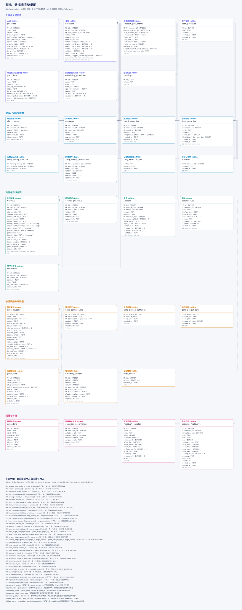
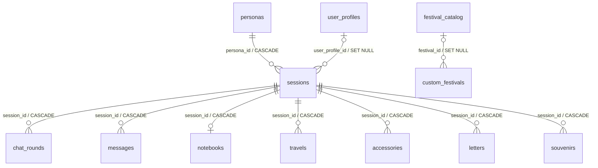
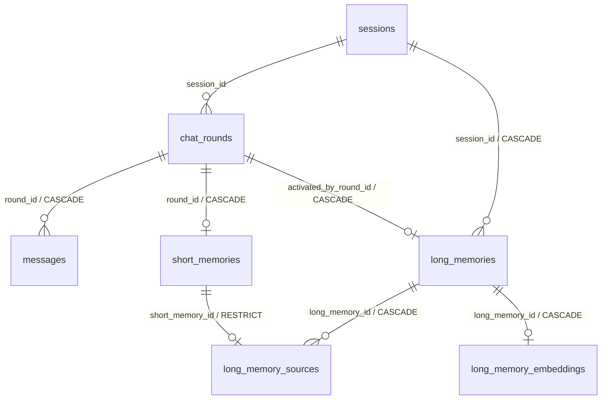
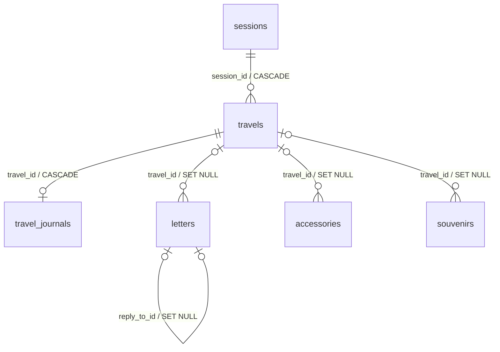
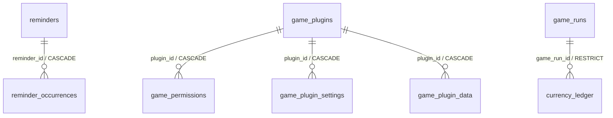

# 颜喵 YanMew 数据库与持久化设计

[打开完整数据库类图（离线交互页面）](./数据库完整类图.html)：包含全部 49 张业务表、1 张 FTS5 虚拟表、433 个字段及表间关系。支持模块切换、表名与字段搜索、缩放、关联跳转，以及完整约束和索引查看。用浏览器打开 HTML 文件即可，无须启动应用。

[完整类图 SVG](./数据库完整类图.svg) · [Mermaid 类图源文件](./数据库完整类图.mmd)。图从 `db/schema.sql` 生成；结构修改后运行 `python -B db/tools/generate_database_diagram.py` 更新。实线为物理外键，虚线为逻辑关联；以下图片是完整类图的静态预览。

- 日期：2026-10-19
- 范围：SQLite 结构、事务、后台任务恢复与备份协议。
- 结构唯一来源：`db/schema.sql`。本文描述该结构的写入与恢复规则；产品交互见前端设计文档。

## 1. 建库与升级

### 平台与存储边界

当前 schema 与阶段 0–18 仍以 Windows 首版为基线。未来 Android 复用业务表、外键和事务规则，不为手机复制一套记忆或钱包表。本次架构预留不新增列、不改变 SQL 类型与既有默认值。

数据库文件位置由 `AppPaths` 注入：Windows便携版为exe旁`data/`，安装版为当前用户`LocalAppData\YanMew\data`，Android为应用私有目录；资源存受管相对引用。系统文件选择得到的 URI 不直接当作数据库或模型路径。`crypto.rs` 经平台密钥保护接口读写：本文及 SQL 注释中的 DPAPI 表示当前 Windows 实现，未来 Android 使用 Keystore 管理的密钥保护凭据，其密文格式在移动端阶段版本化确定；不可跨设备复制密文作为有效凭据。

跨平台迁移使用版本化逻辑备份，索引重新建立，凭据重新填写；不共享运行中的 SQLite 文件。桌面位置偏好在 Android 不执行，系统授权、原生设备句柄和绝对路径不可从 Windows 备份转成手机有效状态。Android FTS5/trigram、资源读写及跨端备份往返须单独验证，当前不宣称兼容已完成。任务恢复契约见《项目架构与代码职责》第 9 节。

### 安装版与卸载

安装标记`yanmew-installed`（内容`YanMew-installed-v1`）决定安装模式；用户数据根与程序资源根由平台分别注入AppPaths。无标记继续便携模式，错误标记不另建数据库；安装盘符改变不改变当前用户的数据位置。两种版本通过现有逻辑备份迁移，不自动复制密文或共享运行库。

主动卸载清除该安装版数据库、图片、插件及存档、设置、密钥、模型缓存和业务暂存，没有保留数据选项；升级/同版本修复保留全部数据并复用既有备份迁移。安装器不执行SQL删除或新建数据库，不更改schema版本。详细目录、UPDATE识别及清理边界见《安装与发布设计》。

### 初始化与迁移规则

12→13 将会话日期逐条迁为全局 custom_festivals，移除会话外键并保留全部记录与序列。13→14扩充待机图片分类并统一无互动配置。14→15增加食品与Skill六表、扩充food_purchase原因及三种嘴馋/喜好图片分类。15→16仅扩充四种停靠图片分类CHECK，保留记录/图片/序列和索引。16→17通过017_pet_walking.sql扩充左右行走分类CHECK，保留旧记录和自增高水位。17→18通过018_real_money.sql新增独立现实账本七表，原喵币表不变。18→19通过019_pet_layers.sql增加拎后颈分类、多件佩戴及前后平面/层级。19→20通过020_pet_error.sql仅扩充报错图片分类CHECK，保留记录、图片引用、修订、索引及自增高水位。当前源码结构版本为`user_version=25`，支持空白新库及版本1–24依次迁移；21–25的增量规则见文末。11→12通过`012_pet_creation.sql`增加人设图片模式与创作条目、饰品相对位置和缩放；旧人设默认关闭，旧饰品沿用头顶位置。10→11通过`011_session_pinning.sql`增加会话置顶is_pinned，默认0，升级不改变会话内容与当前选择。9→10通过`010_chat_appearance.sql`增加人设级聊天气泡与双方正文颜色，旧人设保留原外观。8→9使用 `009_reminder_email.sql` 增加邮件队列和来源关联，不补登记旧提醒。7→8使用 `008_provider_models.sql`：保留所有旧连接的模型、最大输出及容量覆盖到 `provider_models`，把当前用途选择保存在 `provider_roles`，再移除连接表上的五个旧模型/选择字段和用途表上的重复模型名。6→7增加用途配置、聊天图片及提供商/人设排序时间；5→6增加饰品图片引用；1–5的既有迁移保持原顺序。旧生图配置与加密Key迁入通用连接后删除旧配置键，不覆盖已有聊天Key。磁盘升级前生成 `yanwenzi-before-v25-*.db` SQLite一致性备份；备份失败不升级，任一步失败整体回滚。已有002–010迁移文件不改写。无版本但已有业务对象、未知或更高版本均拒绝初始化，原库保留。

- 新库在一个事务内执行 `db/schema.sql`，写入 `is_builtin=1` 的默认人设、全局钱包、内置本地 Embedding 配置及版本号后提交。随包石头剪刀布只有在清单和程序资源校验通过后才登记为可用；开发阶段尚无插件资源时不制造可启动条目，完整 V1 发布必须包含并验收该资源。初始化阶段即创建完整结构，后续功能阶段只接入读写，不再重复增加同名字段。
- 使用 `PRAGMA user_version` 管理结构版本。已有旧库必须先迁移，再执行种子逻辑；`CREATE TABLE IF NOT EXISTS` 不能用来更新已有表。
- user_version=0 且没有业务对象时才按新库初始化；无版本但已含业务对象的库、未知版本及高于当前版本的库停止初始化并提示，不推测历史结构，不清空原数据。新库与迁移完成库应具有相同的字段、外键、CHECK 和索引。修改 CHECK 或外键需要重建表并复制数据，不能只 ADD COLUMN。
- 迁移前关闭后台写入并制作数据库备份。升级失败回滚并停止启动业务任务；不清空、不静默丢弃旧数据。新增 NOT NULL 列先回填，再验证约束；发现重复当前项、负余额或无法恢复的业务状态时报告具体冲突，不自动猜测保留哪条。
- 历史短期聊天摘要没有回合或消息关联时，不能推测精确来源；迁移需要明确处理这些不可追溯记录。迁移方案必须基于实际旧库版本编写并单独验证，不在应用启动时临时推断。
- 每个连接建立后、开启任何事务前执行 `PRAGMA foreign_keys=ON`，再读取 `PRAGMA foreign_keys`，必须返回 `1`，否则拒绝使用该连接。建表语句声明外键不能替代这一步；不得在运行中的事务内尝试切换外键开关。时间统一存 UTC RFC3339，采用一致精度；签到、游戏次数、节日与重复提醒的本地日期由 Rust 转换。

## 2. 数据层级与当前表清单

`db/schema.sql` 是当前结构的唯一来源。当前结构包含 42 张普通业务表和 1 张 FTS5 虚拟索引表。理解这些表时先区分“全局数据”“会话级数据”和“保留快照的历史记录”：

### 2.1 全局资源与全局状态

- `providers`：全局通用连接，只存ID、名称、接口地址、加密Key及创建/更新时间。
- `provider_models`：每个连接各用途的模型配置，复合主键 `(provider_id,purpose)`；保存模型名、最大输出及可选上下文容量。未选中的配置也永久保留到连接被删除。
- `provider_roles`：全局当前用途选择，`purpose` 为主键；只存连接ID和启用状态，通过复合外键引用 `provider_models`，不复制模型名或Key。记忆/识图无选择时跟随聊天。
- `embedding_providers`：长期记忆向量模型配置；内置本地模型与用户联网模型共用此表。
- `settings`：全局键值设置，包括当前会话、窗口位置、主题和各项数值配置。键值表中的逻辑引用由 Rust 校验，不使用数据库外键。
- `user_state`：固定 `id=1` 的全局状态行，当前只保存喵币余额。
- `currency_ledger`：全局喵币流水。历史流水不随人设、会话、饰品或插件删除。
- `game_plugins`：当前小游戏插件登记；随包石头剪刀布和用户本地安装插件共用。
- `game_permissions`：用户对插件权限申请的当前状态，按插件、权限名和权限作用域保存；联网权限按 HTTPS origin 分项记录。状态为 `pending/allowed/denied`，独立插件数据导入后统一为 `pending`。
- `game_plugin_settings`：插件自己的键值设置，不占用主程序 `settings`。
- `game_plugin_data`：插件全局私有 JSON 存档，只按插件 ID 隔离。
- `game_runs`：全局运行记录历史，保存插件身份和结算快照，不绑定人设或会话。
- `reminders`：全局提醒规则，不属于某个人设或会话。
- `reminder_occurrences`：每条提醒规则的具体触发记录。
- `user_profiles`：全局用户设定库；一份资料可被多个会话引用，也可以暂时不被引用。名称/正文 trim 后非空，手动正文无生成字数硬限；UTC RFC3339 创建时间保留，编辑更新最近修改时间。Task 10.6 已接通 CRUD，删除通过 SET NULL 解除引用，不删除会话、消息或记忆。
- 用户设定变更在唯一 Runtime store 锁内校验目标，再中断引用它的聊天请求，最后保存资料或绑定。普通中断复用回合事务保存片段，重说只取消预览。中断与资料变更顺序执行，不宣称它们是同一个 SQL 事务：若后一步失败，中断结果保留，原资料/绑定保留，界面仍补查实际回合状态。无效输入、无效引用、过期会话或无变化不取消请求。
- `sessions.user_profile_id` 在创建会话事务中验证并写入，修改绑定同样事务验证有效引用。绑定不切换当前项、不递增运行期 contextRevision、不重置桌宠或取消旅行；已有历史和记忆不重写，只有实际中断回合仍按既有规则递增 memory_revision。复用已有 schema 与外键，无新迁移。
- `festival_catalog`：系统内置节日母表；使用稳定 `code`，不随业务数据删除。

### 2.2 人设与会话根节点

`sessions.is_pinned`是会话列表置顶布尔值，0普通/1置顶，默认0，带CHECK约束。当前人设列表按is_pinned DESC、updated_at DESC、id DESC排序；置顶只更新此字段，不改更新时间、内容版本、当前选择或后台任务。v11新增011正式迁移；全量及包含会话的分类备份保存此值，v6–10旧包在暂存库补0，v11包字段缺失或非法值拒绝。

- `personas`：人设根节点。非内置人设删除后，它名下的全部会话级数据一起删除；唯一内置默认人设“电子小猫”由 Rust 禁止删除。初始化在同一事务按 `is_builtin=1` 幂等补齐；已有活动普通人设不切换，多个内置项报错回滚。旧种子的名称、正文、初始设定各自仅替换未修改原值，不覆盖用户编辑，不新建会话，不新增数据库迁移。
- `sessions`：会话级数据的真正边界。每个会话必须属于一个人设，可以选择绑定一个 `user_profiles` 记录。
- 会话级表包括：`session_pet_states`、`chat_rounds`、`messages`、`short_memories`、`long_memories`、`long_memory_embeddings`、`notebooks`、`travels`、`travel_journals`、`accessories`、`letters`、`souvenirs`。小游戏插件表全部属于全局层。
- `long_memory_sources` 没有单独的 `session_id`，通过它连接的长期记忆和短期记忆间接归属会话；Rust 必须验证两端属于同一会话。

### 2.2.1 会话桌宠状态与时间

Task 11.5 游走偏移、画布布局、系统鼠标/前台矩形、动画及检查点只在内存中，不写入本表或备份；本任务没有新增表、字段或迁移，结构版本仍为 5。用户拖动整个宠窗的位置继续使用已有全局位置设置，与画布内游走偏移分开。

`session_pet_states` 通过主键兼外键 `session_id` 与 `sessions` 一对一关联。创建会话时由数据库触发器建立初始状态，删除会话时级联删除。已有版本 1 会话迁移时补初始记录，未知的历史喂食、互动时间保持 NULL，不编造过去的行为。

- `hunger_elapsed_ms`：距上次喂食累计的有效运行毫秒数；普通点击、摸摸不能归零。
- `idle_elapsed_ms`：本段无互动累计的有效运行毫秒数；合法互动、醒来后归零。
- `idle_branch`：`none`=本周期尚未选择，`bored`=已经选择无聊，`sleeping`=已经选择睡眠。分支跨切换和重启保留，不因再次读取而重新随机。
- `sleep_until`：睡眠结束的 UTC RFC3339 时刻，仅 sleeping 时非空。进入睡眠只抽取一次持续时间，保存后不重抽；即使应用关闭或该会话不是当前会话，真实时间仍自然经过。
- `last_fed_at`、`last_interacted_at`：最近真实操作的 UTC 时刻，可空；只作记录，不能用当前时刻减去它们推导有效运行时长。
- `state_revision`：桌宠状态自己的并发版本，每次状态写入递增，拒绝迟到计时和重复提交；独立于会话的 memory_revision，不触发记忆重建。
- `updated_at`：最近一次状态提交时刻，UTC RFC3339。
- `proactive_next_check_idle_ms`：可空非负整数，下次主动抽签对应的 idle_elapsed_ms 阈值，不是第二份计时。进入 bored 时设置为当前 idle+300000；检查后设置为实际 idle+300000。bored 内 NULL 表示本周期已成功，none/sleeping 内 NULL 表示没有调度。失败或取消不清空，删除已发消息不重开周期。
- `last_proactive_sent_at`：可空 UTC RFC3339，最近一次成功保存主动消息的真实时刻；NULL 表示无成功记录。它独立限制同会话两次成功间隔至少 30 分钟，互动、醒来和删除消息不清空。

主动发送使用 `sessions::append_proactive_in_transaction`，在同一事务内保存无回合 AI 消息、递增 memory_revision、清空检查点、更新成功时刻及 state_revision。失败全部回滚；提交后才广播消息及气泡。调度只使用当前会话有效空闲，关闭/切换不补发。生成中租约仅存在内存，重启沿用已持久化的下一检查点；成功记录跨重启保留。全量及会话完整包携带这两个字段并保持其语义；不导出请求租约。

饥饿与无聊只累计当前会话的有效运行区间。关闭、系统暂停、非当前会话的时间不补累计；切换恢复目标会话自己的数值。后端调度根据平台运行许可和实际活动计算有效区间，使用单调时钟测量，事件切换前先提交旧区间；不能接收前端自报的计时增量。定时检查点与切换/退出提交共同保证恢复，异常终止最多损失尚未提交区间，不通过墙上时钟补算。

恢复时读取已保存的 sleep_until：未到期继续睡眠；已到期清除睡眠、idle_branch 改为 none、idle_elapsed_ms 归零，开始新无互动周期；不补算离线饥饿或无聊。提供商连接错误属于独立运行健康状态，不存入本表，也不因切换会话清除错误。

全量备份及包含会话的完整包携带该状态记录；人设资料包和插件使用数据包不带。导入重映射 session_id 后保留计时和睡眠结束时刻，按恢复规则检查到期，不因导入重抽。数据库版本 1 到 2 的升级为既有会话补零计时、none 分支和空睡眠时刻。

### 2.2.2 初始教程会话的保存方案（已接通，正式版验收待完成）

完整规则见《前端设计文档》5.7。复用 personas、sessions、messages、session_pet_states 与 settings.current_session_id，不增加表、列或全局教程标记；教程功能复用现有结构，不因模板更新增加迁移。执行规则为全新数据库仅初始化一次、已有库不补建：

1. initialize 开始时保留迁移前的版本及新库判定。只有原 user_version=0 且库内无业务对象，才满足新库条件；不能使用当前会话为空、会话数量为零或教程消息不存在作为判断。
2. 在现有初始化事务中完成建表、默认设置和默认人设种子，按 is_builtin 查询默认人设 ID，不硬编码 1。创建默认会话时复用事务内会话初始化逻辑，含现有桌宠状态触发器和出行倒计时初始化；不要遗漏后续接入的普通会话初始值。
3. 插入一条 assistant、round_id=NULL 的教程消息及 UTC 时间。初始化亲密度/余额仍为普通默认值，不经过正常回复完成或主动消息成功结算入口；尤其不更新 last_proactive_sent_at 或关闭无聊周期。
4. 写入 current_session_id，并保持默认人设的有效选择；会话、消息、选择、种子和 user_version 在同一事务提交。失败全部回滚，不能出现会话创建成功而教程缺失。
5. 再次启动、删除后重启、清空会话、升级已有库、普通新建会话和补回缺失默认人设都不重走该分支。新库模板有更新也不覆盖旧消息。新版本号不得用作每次生成教程的标记。
6. 含会话的数据包按普通消息导出及 ID 重映射。全量导入中的人设/会话也采用合并追加，保留目标原初始会话，不为教程静默删除会话；会话包导入只导入包内消息，不附加教程。用户明确导入的副本可能自带教程，这属于导入原文，不是再次初始化生成。API Key、模型和插件包仍遵守原排除规则。

首次自动打开聊天窗：db::initialize 返回本次是否创建初始会话，db::open 返回连接与该结果，Runtime.initial_session_created 仅在本次进程中传给窗口组装层；提交成功后才执行一次导航；不在 SQL/业务仓储里创建原生窗口，也不将“第一次打开窗”混入可备份的全局设置。开窗失败不回滚已提交数据；用户通过现有聊天入口阅读，下次启动不补开。

普通默认会话与上述教程初始化不同：新建人设时创建一条空白“新会话”；主动选择人设时复用同一事务内写入方法，仅在该人设没有任何会话时补齐，再更新当前人设和current_session_id。有会话则恢复最近更新的一条，不复制资料、消息或奖励。重复选择不增建；创建、旧旅行取消或选择任一步失败全部回滚。删除人设后的隐式回退保持原清理行为，不额外生成会话；重启不按空会话条件重走教程初始化。复用现有表及触发器，无schema变更。

### 2.2.3 人设背景文件与引用（Task 12.4 已接通）

图片继续复用`personas.chat_bg_file/chat_bg_opacity/chat_bg_blur`。file为`data/chat_background/`下由后端生成的basename，不存原始绝对路径；默认NULL、85、0，范围为0–100和0–40。`Runtime.paths`保存平台注入的AppPaths，背景与SQLite使用同一数据根，移动便携目录不依赖启动工作目录。正文保存继续保留文件引用并使用最新滑块参数，不提交或重置气泡与颜色字段。

v10通过`010_chat_appearance.sql`给人设表追加三个字段，不新增表或外键：

- `chat_bubble_style`：非空TEXT，枚举`solid`默认气泡、`transparent`透明、`outline`仅描边、`frosted`毛玻璃；默认solid。
- `chat_user_text_color`：可空TEXT，用户消息正文颜色，仅允许`#RRGGBB`；NULL跟随主题。
- `chat_assistant_text_color`：可空TEXT，AI消息正文颜色，规则同上；NULL跟随主题。
- 人设创建时将`color`一次性写入上述双方正文颜色字段，适用于手动新建、新安装电子小猫及首次安装四位预置。人设更新不写上述字段，聊天外观独立保存，NULL也是用户的有效选择；既有记录不回填，导入保持原外观恢复规则。不增加字段、迁移或同步标记，数据库版本仍为17。

样式按人设保存，所有会话共用；删除人设自然删除配置。Persona DTO以`chatAppearance={bubbleStyle,userTextColor,assistantTextColor}`返回。沿用背景读取/保存命令与配置通知，完整expected快照包含样式，提交前重核可防止多窗口相互覆盖。恢复默认背景只清图片和恢复85/0；未提交appearance时保留已有气泡及颜色。恢复默认样式只修改前端草稿，统一保存后写入默认值。外观不参与AI上下文，不触发记忆或人设自调。

保存先校验样式枚举和颜色；有上传时再校验jpg/jpeg/png/webp、10MiB和真实解码，以唯一文件名create_new写入并sync_all，不覆盖旧文件。随后在短事务中重核当前人设/版本和完整旧外观快照，更新背景三列及气泡/颜色三列。失败时旧引用与旧文件保留，新文件仅在确认无人引用后删除；成功后再清理无人引用的旧文件。图片读取也校验格式、字节上限和解码，文件故障只回退纯色，不清空数据库记录，气泡样式仍生效，用户仍能恢复默认。

进程在文件完成但提交前退出，只留下孤立新文件；已提交则目标文件已经写入完成。启动仅清理本程序生成且无人设引用的 `background-<时间>-<序号>.<格式>` 文件，不处理任意用户文件。删除人设后，其未被其他人设引用的背景会在下次启动清理；共享图片不误删。此规则解决本项单文件替换，不替代阶段 17 多文件导入恢复 journal，也不声称 SQLite 和文件系统具有跨介质原子事务。

逻辑备份已包含被引用的图片及相对名，以及三个人设外观字段；导入时校验、重命名和重映射。当前导出schema_version=11；导入继续支持6、7、8、9、10、11，会话置顶按2.2节恢复。旧包缺少外观列时仅在暂存库补solid/NULL/NULL，v10包缺少字段则拒绝；非法枚举或颜色由暂存库CHECK拒绝。创建新的人设时恢复包内外观，合并到已有同一人设时遵循既有追加导入规则保留目标人设设置，不因导入会话覆盖本机外观。背景/外观保存不递增context_revision或memory_revision，不更新自调时间，不触发记忆生成。

### 2.3 聊天与记忆

Markdown 仅为消息显示规则：`messages.content` 始终保存原文，流式终态、用户编辑、上下文组装及备份导入导出沿用同一字符串。不保存 HTML，不增加格式字段或迁移，不回写旧消息；界面按角色决定是否渲染，复制原始文本。

- `chat_rounds`：一轮“用户消息 + AI 回复”的生命周期，区分 pending、completed、interrupted。
- `messages`：消息原文。完整回合的两条消息绑定同一个 `round_id`；主动消息使用 `round_id=NULL`。
- `short_memories`：每个 completed 回合至多一条短期记忆，整合后仍永久保留。
- `long_memories`：由前 `k` 条待整合短期记忆生成；记录标题、正文、实际来源数量及触发它的第 `k+1` 回合。覆盖边界从 `long_memory_sources` 的最后一条来源所对应的回合推导，不重复保存消息 ID。
- `long_memory_sources`：长期记忆与短期记忆的来源关联表，同时保存来源顺序。每条短期记忆最多只能成为一条长期记忆的来源。
- `long_memory_embeddings`：当前 Embedding 模型为每条长期记忆生成的一份向量缓存，可删除重建。
- `long_memories_fts`：长期记忆标题和正文的 FTS5 全文索引，是可重建数据，不进入逻辑备份。
- `notebooks`：一个会话至多一行，整行保存该会话的记事本正文。

### 2.4 旅行、内容与节日

- `travels`：出行记录表，保存一次旅行的状态和生成任务游标；一个会话同时最多一条 away 旅行。
- `travel_journals`：正常返回后的一篇旅行游记；一个旅行至多一篇。
- `letters`：用户信、途中信、回来信和回复；使用 `reply_to_id` 自关联，每封信最多被回复一次。
- `accessories`：制作或旅行带回的饰品；一个会话同时最多佩戴一件。
- `souvenirs`：旅行带回的普通文字伴手礼；可保留来源旅行引用。
- `custom_festivals`：全局自定义生日、纪念日和年度固定月日，由用户或 AI 维护；所有人设和会话共用，不含 session_id。新增不关联母表；festival_id 仅保留旧关联兼容。

出行记录是关联根节点，游记、信件、伴手礼与旅行饰品是并列子项。删除子项不会反向级联到 travels，也不删除同次出行的其他子项；只有删除根记录时才按外键规则处理子项。不能把“生成时读取其他结果”解释为这些记录之间存在删除级联。

### 2.5 小游戏插件与历史审计

- `game_plugins`、`game_permissions`、`game_plugin_settings`、`game_plugin_data` 保存当前登记、授权、设置和私有存档；删除登记时级联删除后三类当前数据。
- `game_plugin_data` 保存插件全局私有 JSON 数据。同一插件和数据键不能重复；它不绑定人设或会话。
- `game_runs` 保存每局游戏的插件 ID、名称、版本、钱包授权快照、结果和累计喵币变化。它不外键关联 `game_plugins`，卸载插件后仍保留历史，也不保存人设或会话引用。
- `currency_ledger` 的 `plugin_game` 流水保存运行记录、插件 ID、版本、显示原因和钱包请求 ID。已记账运行记录受 `RESTRICT` 保护，不能先于账单删除。
- 石头剪刀布是随包插件，首次初始化由种子逻辑登记到 `game_plugins`，并和第三方插件共用全部表与钱包流程。

### 2.6 尚未进入当前 schema 的规划表

- 语音扩展的 `voice_models`、`voice_providers`、`voice_profiles`、`voice_profile_references`、`persona_voice_settings`、`persona_wake_words` 仍属于后续方案，首版阶段 0–18 不创建空表。
- 文档提到规划表时必须明确标为“预定结构”；只有写入 `db/schema.sql` 并提供旧库迁移后，才算当前数据库结构。

### 2.7 `settings` 完整键清单

`settings` 不是自由写入的插件式配置表。`key` 是非空文本主键，保存下面登记的稳定英文设置名；`value` 是非空文本，保存该键的规范字符串值。类图中的 `PK key: TEXT` 和 `value: TEXT` 是所有全局设置共用的两列，不是两项具体设置。Rust、前端、初始化和迁移必须共用这份清单，不得自行增加同义键或维护另一套默认值。

Rust 只通过强类型设置仓储读写本表，不向前端或插件提供任意字符串写库接口。整数使用无空格、无单位、无小数点、无前导正号的十进制字符串；枚举使用清单列出的固定小写值；URL 必须是完整 HTTPS URL；密钥只保存 Windows DPAPI 密文的 Base64。可选设置未配置时删除整行，不用空字符串表示。保存时先完成单项和成对校验，再在一个事务内写入；读取或导入时不认识的键必须按备份版本兼容规则处理，不能静默当成有效配置。

#### 通用连接、模型配置与生图用途

三张表均为全局数据，不绑定人设或会话；都在同一个SQLite数据库内。`providers.id` → `provider_models.provider_id` 为一对多；每个用途最多选一条已存在的模型配置，`provider_roles(provider_id,purpose)` → `provider_models(provider_id,purpose)` 为复合外键。

- `purpose` 枚举：`chat`聊天、`memory`记忆、`image`生图、`vision`识图。一个连接可同时用于多种用途，各用途模型名可以不同。
- 连接编辑只更新名称、地址及Key，不改模型或预算。保存用途在一个Immediate事务内校验 `expectedRevision`、连接和模型，先更新该连接的模型配置，再更新当前选择，最后增加 `provider_roles_revision`。
- 切换时保留原连接的全部模型配置；重新选回时界面读取其保存的模型名、最大输出和容量覆盖，不使用另一连接的预算。不自动选择未配置模型的连接。
- `provider_models.max_output_tokens` 默认32768，正整数；`context_window_override` 为NULL时自动解析，非空须为正整数。两者为聊天、记忆、识图用途的高级设置，运行期缩减的实际预算不回写配置。内部表情、标题、记忆及其他文本生成复用实际用途的预算，默认32768 tokens，不另设更小固定上限；生图接口不使用文本token预算。记忆/识图未独立选择时跟随聊天，不误用历史保存但未选中的用途模型。
- `provider_roles.enabled` 为0关闭/1开启；只有生图可关闭，聊天/记忆/识图保持1。启用生图前必须已有该连接的Key；清除当前生图Key会关闭生图并增加对应版本。生图调用OpenAI-compatible `/images/generations`，失败或未启用继续使用图标、Emoji、颜文字或符号组合。
- 当前用途引用连接或模型配置时，外键阻止删除；未选中连接可删除，其模型配置级联删除。连接、用途变化按现有协调入口取消相关旧请求，迟到结果不落库。
- `provider_effective` 是只读SQL视图：从上述表计算原业务查询需要的聊天模型、当前选择和预算字段，不保存第二份数据，不导出视图。
- `image_generation_config` 及 `image_generation_provider_<id>_api_key_encrypted` 仅作为旧库/旧备份迁移来源。正常初始化/全量恢复在事务中完成迁入并删除这些旧键；新设置界面只通过通用连接和用途配置保存。
- 全量备份导出三张表的非密钥字段；导入后清空连接密钥，生图强制关闭。普通会话、人设、用户设定及独立插件包不改变全局连接和用途。

#### 联网搜索配置

- `web_search_config`：版本化 JSON，由专用强类型仓储维护。字段 `version=1`、`revision`（每次配置修改递增）、`nextId`（递增分配配置 ID，不复用）、`enabled=false`、`activeId=null`、`providers=[]`。每项包含 `id`（十进制字符串）、`name`、`kind`（`tavily` / `bocha` / `custom`，custom 为 Tavily 兼容）、`baseUrl`（HTTP/HTTPS API 根地址）。未登记整行等于关闭且没有配置，不要求初始化插入。
- `web_search_provider_<id>_api_key_encrypted`：对应配置 ID 的 DPAPI 密文；缺少行表示未保存 Key。禁止通过通用设置接口任意写入；搜索配置保存/删除与密钥更新在同一事务中完成。
- 全局搜索配置不绑定人设或会话，也不复用聊天提供商表。更换服务类型或地址须重新填写或清除密钥；删除当前项被拒绝；选择无 Key 的当前项或清除当前 Key 后自动关闭搜索。
- 全量备份可保存配置元数据，必须排除全部搜索密钥（包括密文）；导入后强制关闭搜索，重新填 Key 后由用户开启。其他范围的导入不修改它们。搜索来源随 AI 回复文本保存，不新增聊天来源表。见[联网搜索设计](联网搜索设计.md)。

#### 桌宠与空闲计时

- `hungry_minutes`：正整数，默认 `120`；达到后进入饥饿状态。
- `standby_minutes`：正整数，默认10；同一无互动累计达到此值时显示待机姿态。
- `idle_event_minutes`：正整数，默认45；唯一无聊／睡觉共同触发阈值，到点各50%随机一次。
- `sleep_min_minutes`：正整数，默认 `60`；每次睡眠持续时间下限。
- `sleep_max_minutes`：正整数，默认 `120`；睡眠持续时间上限，必须不小于 `sleep_min_minutes`。

`idle_event_minutes`到点各50%随机选择一次，设置和运行态都不再维护两个独立阈值。互动重置无互动周期，但不重抽旅行倒计时。

#### 记忆、上下文与记事本

- `short_memory_min_chars`：正整数，短期记忆最小汉字数；默认 `12`。
- `short_memory_max_chars`：正整数，短期记忆最大汉字数，必须不小于最小值；默认 `100`。
- `long_memory_min_chars`：正整数，长期记忆最小汉字数；默认 `150`。
- `long_memory_max_chars`：正整数，长期记忆最大汉字数，必须不小于最小值；默认 `250`。
- `memory_merge_count`：正整数，默认 `20`；生成一条长期记忆使用的短期记忆数量 `k`。
- `recent_message_count`：正整数，默认 `30`；正常容量下进入上下文的最近消息原文数量。
- `recent_long_memory_count`：正整数，默认 `30`；直接进入上下文的最近长期记忆数量 `m`。
- `travel_journal_min_chars`：正整数，旅行游记最小汉字数；默认 `250`。
- `travel_journal_max_chars`：正整数，旅行游记最大汉字数，必须不小于最小值；默认 `350`。
- `tool_call_rounds`：正整数，默认 `3`；AI 单次回复最多执行的工具调用轮数。
- `notebook_max_chars`：正整数，默认 `4000`；一个会话记事本的 AI 维护建议上限。它不形成数据库长度约束，超限内容不截断、不丢弃，AI 在后续修改时优先压缩回范围内。

字数范围用于约束提示词和校验生成结果，不对正文做无提示硬截断。上下文超限时只减少本次携带的较旧内容，不修改全局设置。恢复默认值时，短期记忆恢复为 `12–100` 字、长期记忆恢复为 `150–250` 字、旅行游记恢复为 `250–350` 字。

#### 亲密度、饰品与签到

- `intimacy_threshold_1`、`intimacy_threshold_2`、`intimacy_threshold_3`、`intimacy_threshold_4`：1–999 内的整数，默认依次为 `10`、`50`、`150`、`300`，必须严格递增。亲密度上限固定为 999，不另设 settings 键。
- `sessions.intimacy`：整数 0–999，点击/摸摸/喂食和后续聊天成功奖励共用后端封顶规则，与触发行为同事务保存；满值不阻止行为本身。导入的亲密度必须在此范围内，非法包拒绝导入，不能绕过触发器。
- `accessory_cost_1`、`accessory_cost_2`、`accessory_cost_3`、`accessory_cost_4`：非负整数，默认依次为 `20`、`50`、`120`、`300` 喵币；第四档及以后重复制作使用第四档价格。
- `sign_in_min_coins`：非负整数，默认 `1`；普通每日签到随机奖励下限。
- `sign_in_max_coins`：非负整数，默认 `10`；普通每日签到随机奖励上限，必须不小于下限。

修改阈值或价格不恢复前三档已经使用的制作机会，也不重算历史喵币流水。命中节日时签到奖励固定为 `10`，不读取普通签到随机范围。

#### 出行与回信

- `travel_min_online_hours`：正整数，默认 `2`；下一轮旅行有效在线等待时间抽取下限。
- `travel_max_online_hours`：正整数，默认 `4`；等待时间抽取上限，必须不小于下限。
- `travel_min_duration_minutes`：正整数，默认 `60`；实际旅行时长抽取下限。
- `travel_max_duration_minutes`：正整数，默认 `180`；实际旅行时长抽取上限，必须不小于下限。
- `travel_accessory_chance_percent`：`0`～`100` 的整数，默认 `10`；正常返回时带回可佩戴饰品的概率百分比。
- `letter_reply_min_minutes`：正整数，默认 `10`；用户信件自动回信延迟下限。
- `letter_reply_max_minutes`：正整数，默认 `30`；回信延迟上限，必须不小于下限。

修改出行等待范围只影响以后新抽取的 `sessions.travel_trigger_remaining_seconds`，不能重抽或改写会话中已保存的倒计时。

#### 天气、当前上下文与窗口

- `weather_qweather_api_host`：可选 HTTPS URL，无默认值；保存用户在和风天气控制台获得的专属 API Host。
- `weather_qweather_api_key_encrypted`：可选 DPAPI Base64 密文，无默认值；Host 与 Key 都有效时才启用和风天气兜底。
- `current_session_id`：正整数文本，无默认值；当前会话的逻辑引用。无可用会话时删除该键；启动、导入、删除和切换时由 Rust 验证会话存在且属于当前人设。
- `window_pos_x`：规范有符号 i32 整数文本，无固定默认行；主宠窗左上角物理像素 X，允许副屏负坐标。
- `window_pos_y`：规范有符号 i32 整数文本，无固定默认行；主宠窗左上角物理像素 Y。与 X 在同一事务 UPSERT，不允许一项写入成功、另一项失败。
- `theme_mode`：枚举 `system`、`light`、`dark`，默认 `system`；只影响颜喵主程序界面，不传递给小游戏插件。

位置内部读取要求 X/Y 同时存在且能解析为规范 i32 文本；残缺、空白、溢出、前导零等无效值保留原数据但回退默认位置，不阻止应用配置读取。位置键不加入通用 `get_settings/save_settings` 白名单或默认值，不由前端上传坐标。Task 10.5 接入已有 settings 表，不新增表、列或数据库迁移。

窗口恢复使用 Tauri 物理位置、实际物理窗口尺寸和显示器工作区，不额外乘除 DPI；有交集时将窗口适配到对应工作区，无交集则回到当前显示器（不可取时使用主屏）的工作区右下角。系统临时回位不覆盖用户首选位置。只有主宠窗原生拖动写入，250ms 节流，结束与退出补存；失败保留最新待存坐标，后续移动/结束/退出可重试。天气 Host 与 Key 不进入任何导出包；设置 DTO 只返回密钥是否已配置，不能返回密文或历史明文。

#### 内部一次性初始化键

- `preset_personas_seeded_v1`：缺失表示未安装四位预置图片人设；文本 `1` 表示已整体安装。和人设、创作条目同事务写入，不属于通用设置或导出白名单；全量恢复保留目标本机值，用户删除人设不重置。无其他合法值或界面默认输入，非法值报初始化状态错误。具体初始化流程见本文“预置图片人设的持久化”。

#### 不属于 `settings` 的内容

- 当前聊天、记忆和 Embedding 提供商保存在对应提供商表的当前项字段；当前人设、颜色、背景和自调开关保存在 `personas`。
- Task 12.2 自调复用已有 prompt、initial_prompt、self_evolve_enabled、last_evolved_at；不增加表/迁移。工具候选只在本轮内存，完整回复事务成功后才独立更新 prompt/last_evolved_at。更新 WHERE 同时匹配目标 ID、开关和原 prompt/initial_prompt/last_evolved_at，防止旧结果覆盖手动编辑、新基准或另一调整。initial_prompt 不由 AI 改写；人设提交失败保留已完成回合和奖励，重启/续写不恢复候选。
- 会话亲密度和旅行倒计时保存在 `sessions`；插件权限、设置和存档保存在 `game_permissions`、`game_plugin_settings`、`game_plugin_data`。
- 开机自启以 Windows/Tauri autostart 的实际注册状态为准；不新增 `settings` 键，不随备份迁移。登记名固定为 `YanMew`，路径变化须用户明确修复，不通过数据库布尔值声称已开启。普通二级窗口临时大小由窗口系统管理；后续语音配置使用人设级语音设置及语音模型表。

全量备份导出并替换 `settings`；人设资料包、人设完整包、会话包、用户设定包和插件使用数据包都不携带全局设置。API Key 即使已加密也不导出。导入后必须验证所有已知键并重新映射 `current_session_id`。

## 3. 表间关系图

### 3.1 人设、会话与会话内容

主链是 `personas → sessions → 会话级数据`。删除非内置人设会先级联删除其会话，再由会话继续级联删除聊天、记忆、旅行和养成内容。`user_profiles`、`festival_catalog` 与 `custom_festivals` 是全局资料，删除后只解除引用，不删除会话或全局自定义日期。

### 3.2 回合与记忆来源

这里有三种不同含义：`round_id` 表示原始回合，`long_memory_sources` 按 `source_order` 保存长期记忆实际使用的短期记忆，`activated_by_round_id` 表示哪一轮触发了这条长期记忆。删除最后一轮时先按触发关系回退长期记忆，再删除该轮消息和短期记忆；来源短期记忆上的 `RESTRICT` 防止长期记忆仍存在时单独删除来源。

例如 `k=20` 时，来源表的第 1～20 项就是完整覆盖范围；取 `source_order` 最大的一项，经 `short_memories.round_id` 打开对应回合及 AI 消息，就能得到实际覆盖边界。第 21 轮保存在 `activated_by_round_id`，表示它的出现触发了前 20 条的整合。来源清单是覆盖关系的唯一事实。

`long_memories_fts` 和 `long_memory_embeddings` 都属于检索派生数据。FTS5 由触发器同步标题和正文；向量由后台任务生成。它们不能成为业务事实来源，丢失后应从 `long_memories` 重建。

### 3.3 旅行、信件、礼物与游记

删除旅行会删除只属于该旅行的游记，但不会删除用户仍应看到的信件、饰品和伴手礼；这些记录只把 `travel_id` 置空。删除会话则会删除整组旅行及其所有会话级内容。`letters.reply_to_id` 置空只解除现存引用，`has_been_replied` 仍保存历史回复资格，不能因为回复被删而重置。

### 3.4 全局提醒、插件与喵币

`user_state` 与 `currency_ledger` 没有外键连接，这是有意设计：余额是当前汇总，流水是永久审计记录。每次变动必须在一个事务中同时检查余额、更新 `user_state.coins` 并插入 `currency_ledger`。`currency_ledger.ref_id` 是饰品等业务的历史引用，不设外键；插件流水使用明确的 `game_run_id` 外键。`game_runs.plugin_id` 和账单中的插件信息是历史快照，不外键指向当前 `game_plugins`，因此卸载插件不会破坏审计记录。

### 3.4.1 钱包数据服务（Task 13.1 已接通）

currency.rs 复用既有 user_state 与 currency_ledger，初始化钱包仍由 db::initialize 负责；没有新表或迁移。get_balance 为后端 i64；对外 get_wallet 的 coins 为规范十进制字符串，防止前端大整数舍入。亲密度读取复用 sessions 归属查询和 pet::MAX_INTIMACY=999，当前选择由命令层同锁校验，不与喵币相互转换。

apply_delta 独立开启 IMMEDIATE 事务，联合业务用 apply_delta_in_tx 的保存点，不提交调用方事务。余额以 checked_add 计算并要求非负；写余额和完整账单共同成功。账单失败时保存点回滚余额，即使父事务捕获错误后继续也不会保留单边变动。调用方仍必须在关联业务失败时回滚外层事务，不提前发送成功通知。

原因枚举与 schema 一致：daily_sign_in 非负且无引用、sign_in_festival 固定 +10 且无引用、accessory_craft 非正且正整数 ref_id、accessory_sell 非负且正整数 ref_id、plugin_game 带完整运行记录和插件快照/请求 ID 且无 ref_id。制作价格和普通签到奖励允许配置为 0，因此零价制作/零奖励也保留账单；插件平局同样保留。插件外键及唯一请求索引已经保护来源和重复插入，授权与幂等回查必须由 13.4 可信宿主实现。

新写入时间统一为 UTC RFC3339 毫秒 Z 格式，count_today_reason 使用 created_at 索引先取本地日期周围的 UTC 候选，再将每条记录转换到当前电脑时区判断日期。23/25 小时日期不按固定 24 小时切分；时区改变后下次统计重新投影。签到必须在同一事务同时判断普通/节日两个原因，不新增签到状态表。普通签到与状态页面已由 Task 13.3 接入；插件结算及节日命中仍待后续。

### 3.4.2 全局普通签到事务（Task 13.3 已接通）

`currency/sign_in.rs` 复用现有表和全局设置，后端取得 Runtime 锁后采样 UTC 时刻，并使用电脑当前时区。开启 SQLite IMMEDIATE 写事务后查询今日两类签到流水；已领取直接返回最新余额和已签状态，不写入、不抽随机数。未领取按 sign_in_min_coins/max_coins（默认 1/10，非负 i32，两端均包含）抽取；固定范围无需随机。通过 apply_delta_in_tx 保存余额与无引用的 daily_sign_in 账单；0 奖励同样记账。写入失败、溢出或无效随机结果回滚，允许重试；另一连接须先取得写锁才能判断，不能重复到账。

签到状态从账单推导，不保存 last_sign_in_date 或人设/会话签到副本。没有当前会话、删除/切换人设或会话不影响签到与钱包；关闭后重开按历史流水恢复。日期切换或修改时区只重新投影，不自动补签。阶段 18 的节日命中必须加入同一事务，在发放前决定普通或节日原因，不能先发普通再额外发节日。提交后通知 wallet_changed；页面未收到通知时聚焦或重新打开补读，不回滚已提交数据。该任务首次完成时数据库为 v5（当前版本为 v16），无新增表、列或迁移。

## 4. 外键、删除与逻辑完整性

### 4.1 `CASCADE`：父对象消失，子对象也没有独立意义

- `personas → sessions`：删除非内置人设会删除它的完整会话树。
- `sessions →` 回合、消息、短期/长期记忆、向量、记事本、旅行、游记、饰品、信件、伴手礼、自定义日期。
- `chat_rounds → messages/short_memories`：删除回合时删除该轮原文和对应短期记忆。
- `chat_rounds → long_memories`：只通过 `activated_by_round_id` 删除由该回合触发的长期记忆。
- `long_memories → long_memory_sources/long_memory_embeddings`：长期记忆删除后，来源连接与向量缓存一起删除。
- `reminders → reminder_occurrences`：永久删除提醒规则时删除它的触发记录。
- `travels → travel_journals`：旅行记录删除后，该旅行游记不再独立存在。
- `game_plugins → game_permissions/game_plugin_settings/game_plugin_data`：清除插件登记时清除当前授权、设置和私有存档。

### 4.2 `SET NULL`：被引用对象可删除，业务记录仍应保留

- 删除 `user_profiles`：会话保留并变成未绑定用户设定。
- 删除 `festival_catalog` 引用：自定义日期保留为独立记录。正常产品流程不删除内置母表，但迁移仍需可恢复。
- 删除 `travels`：信件、旅行来源饰品和普通伴手礼保留，只失去来源旅行链接。
- 删除被回复的 `letters`：回复信保留，`reply_to_id` 置空；历史上的 `has_been_replied` 不重置。

### 4.3 `RESTRICT`：必须先执行业务回退

- `long_memory_sources.short_memory_id → short_memories.id` 使用 `RESTRICT`，防止来源短期记忆在长期记忆仍存在时被删掉。
- `currency_ledger.game_run_id → game_runs.id` 使用 `RESTRICT`，防止已经产生喵币账单的历史运行记录被删除。
- 尾部删除必须在同一事务内先读取并保存触发长期记忆的来源 ID，将这些短期记忆恢复为 `pending`，再删除触发长期记忆（来源关联与向量自动级联删除），最后删除回合及其消息、短期记忆。不能先删来源关联再查来源，也不能绕过回退规则直接删消息。
- 整会话删除和整人设删除共用删除服务；追加导入不调用该服务：先删除目标会话范围内的长期记忆，解除短期来源上的 `RESTRICT` 引用，再删除会话或人设，由外键清理剩余子记录。全部步骤必须在同一事务内完成，不能依赖多条级联路径的内部执行顺序，也不能关闭外键绕过检查。

#### Task 10.2 已接通的原文与尾部操作

`sessions/messages.rs` 编辑保存先比较旧原文，成功只 UPDATE messages.content 与 sessions.memory_revision/updated_at，不改已有记忆或游记。length_limit 回合编辑后 stop_reason 改为 user_cancelled，不能继续旧前缀。底部删除验证实际最大消息 ID，完整回合复用 rollback_trigger 先恢复来源 pending，再删长期，最后删回合/消息/短期；中断回合只删回合和消息，主动只删单条。成功一次换代 memory_revision，失败全部回滚，索引同事务同步；已发放亲密度保留。

重说仅有运行期 RequestSnapshot（regenerating=true），不新增 pending 回合或预览表。新回复、短期及所有关联长期锁外准备；提交事务重验原回合、原文、记忆来源/配置/version，先 memory::regeneration::apply，再 UPDATE 原 AI 消息/表情和会话版本。现有记忆原位更新，缺失短期才 INSERT pending；FTS 由原触发器，旧向量删除后由原工作器补建。不调用 complete_round，亲密度和 completed_at 不变。关闭进程只丢弃未提交预览，该功能未增加数据库结构。

#### Task 10.1 已接通的整会话删除

`sessions::delete` 使用单一事务校验目标归属，先删除该会话长期记忆，再删除会话；FTS5 删除触发器、长期来源与向量、其余会话子记录同步清理。当前选择也在此事务内更新：仅删除当前项时从同人设剩余会话按 `updated_at DESC,id DESC` 回退，最后一项删除后移除 `current_session_id` 设置键，不自动建会话。删除非当前项保留该键。钱包、账单、提醒、插件及人设/全局资料不参与清理。事务失败全部回滚，不关闭外键或新增迁移；该功能没有新增数据库结构。

标题成功仅更新 `sessions.title/updated_at`，不修改消息、记忆或 `memory_revision`。标题提交按独立快照校验，不因正常后台记忆写入失效；目标被删、首条用户消息变化、触发回合变化、手动改名、提供商变化、切换上下文或取消均拒绝迟到标题。整会话取消由运行期服务协调，不能在数据库事务中等待 AI 或网络。

### 4.4 逻辑引用与外键之外的业务校验

- `settings.current_session_id` 是键值设置中的逻辑引用；启动、切换、导入和删除人设后都由 Rust 验证并修正。
- 多张表同时保存 `session_id` 和更具体的 `round_id`、`long_memory_id` 或 `travel_id`，目的是快速按会话查询。出行子项已使用 (travel_id, session_id) 复合外键证明同会话归属，父表提供 UNIQUE(id, session_id)。原有单列外键负责 CASCADE/SET NULL，附加复合外键用 NO ACTION 在语句结束时检查，避免 SET NULL 意外清空非空 session_id。聊天/记忆关联尚使用单列外键，Rust 仍必须检查其同会话关系。
- `currency_ledger.ref_id` 会指向不同业务类型，结合 `reason` 解释；这是多态历史引用，不设单一外键。
- `game_runs.plugin_id` 以及插件账单里的 `plugin_id`、`plugin_version` 是历史快照，不设到当前插件登记的外键；Rust 只能从它们追溯来源，不能据此判断插件当前已安装。
- `long_memories_fts` 与 `long_memory_embeddings` 是可重建索引，不能作为业务事实来源；前者由触发器同步，后者通过外键随长期记忆删除。
- FTS5 的日常触发器更新必须与长期记忆写入处于同一事务。全量 rebuild 单独安排，并在完成前避免使用未就绪索引；Embedding 推理、AI 请求、文件复制和网络调用在业务事务外执行，按“读取快照 → 外部处理 → 短事务校验版本后提交”处理。

### 4.5 关键唯一约束

- 内置 Embedding 配置最多一条且必须为 local；向量 BLOB 字节数必须等于 dimensions × 4，有限数值及归一化由 Rust 检查。
- 插件账单同时以 (game_run_id, plugin_id, plugin_version) 引用运行记录快照，防止账单冒用另一插件身份。
- 全局最多一个聊天当前提供商、一个记忆专用提供商、一个当前 Embedding 提供商、一个当前人设和一个内置默认人设。
- 每个回合每种角色最多一条消息；每个回合最多一条短期记忆。
- 每条短期记忆最多成为一条长期记忆的来源；同一长期记忆的来源顺序不能重复。
- 每个触发回合最多激活一条长期记忆；每条长期记忆只有一份当前模型向量缓存。
- 每个旅行最多一篇游记；每个会话同时最多一条 away 旅行、最多一件佩戴饰品。
- 每封信最多有一条现存回复；同一旅行的途中信和回来信各最多一封。
- 同一提醒规则的同一原定时间最多一条 occurrence，防止启动恢复或重试重复入队。
- 同一插件、权限名和权限作用域最多一条授权决定；同一插件的设置键和私有数据键各最多一条。`network.fetch` 以单个 HTTPS origin 作为权限作用域。
- 同一插件的同一个 `wallet_request_id` 最多产生一条账单，防止插件重试造成重复到账或扣款。

所有数据库连接都必须执行 `PRAGMA foreign_keys=ON`。前端校验只改善交互，不能替代 SQLite 约束和 Rust 事务检查。

## 5. 通用事务与约束

- 写入事务只包含数据库操作，不包含 AI、网络请求或等待用户确认。运行时按会话/业务对象串行执行冲突任务。
- 需要 AI 的任务：读取输入快照 → 释放数据库锁 → 请求 AI → 开启短事务 → 校验记录仍存在且状态/版本未变化 → 写入结果与完成状态 → 提交。过期结果丢弃；可重试任务保持 pending。
- 当前聊天提供商、显式记忆提供商、当前人设分别最多一条；无显式记忆提供商时跟随聊天提供商。切换时先验证目标，再在同一事务中清除旧项、启用新项。
- 正被聊天或记忆整合使用的提供商禁止删除，必须先切换；当前联网 Embedding 项同样必须先切换，内置本地 Embedding 项永远不可删除。
- `personas.is_builtin=1` 的默认人设永远不可删除且最多一条。删除当前非内置人设时，在同一事务内级联删除其会话级数据、切换到默认人设并修正 `settings.current_session_id`；事务提交后再广播上下文变化。
- Embedding 提供商与聊天/记忆整合提供商独立，最多一条当前项。首次启动写入并启用随应用打包的 `BAAI/bge-small-zh-v1.5` 本地项；联网项的 API Key 使用 DPAPI 加密。
- 一个会话最多一件佩戴饰品、一条 away 旅行，由部分唯一索引保证；换装先卸载旧项再佩戴新项，并在同一事务提交。
- 余额非负、布尔值、枚举及数值范围由 CHECK 约束；Rust 还需检查设置最小值不大于最大值、亲密度档位递增、日期有效、重复规则合法和饰品字符限制。
- `settings.theme_mode` 是全局主程序主题偏好，只允许 `system`、`light`、`dark`，缺失时默认 `system`，非法值按配置错误处理并回退到 `system`。`system` 保存的是跟随系统偏好，不持久化当时解析出的亮色或暗色结果。
- 主题设置只由主程序窗口读取；小游戏插件宿主不把 `theme_mode`、解析后的主题或主题颜色变量加入插件上下文。
- 涉及回合、消息、短期记忆、长期记忆来源、`travel_id`、旅行游记和 `reply_to_id` 时，Rust 必须验证关联对象属于同一会话；出行归属由复合外键进一步保护；其余单列外键仅验证存在性，仍须服务层检查。
- 宿主余额检查、运行记录更新、余额更新和账单插入共用一个事务。每日签到的领取记录与账单也在同一事务中保存，普通签到与节日签到按同一本地日期去重，不能分别领取。插件玩法次数属于插件私有存档，不按窗口运行记录计数；石头剪刀布获授权的结算局平局以 `delta=0` 记录流水，纯玩局不写钱包流水。
- 插件只能通过宿主服务修改钱包。新的请求必须同时校验当前登记、启用状态、包状态、版本、运行记录打开时的钱包授权快照与当前 `wallet.modify` 授权、运行记录归属、整数变化、非负余额和钱包请求 ID；已提交请求按原运行 ID、变化和原因核对，只返回原账单，不重复结算。数据库唯一索引负责最后一道幂等保护。中途授权不改变本次纯玩运行，撤销立即阻止尚未提交的请求，已记账变化不回滚。
- 饰品制作同时检查余额和对应 `craft_tier_1_used/2_used/3_used`，扣款、写流水、插入饰品、标记档位均在同一事务内完成。卖出/删除饰品不重置档位；调整阈值/价格不重置已使用标记。第四档不设一次限制。
- 制作内容与简介在扣款前准备并校验；确认请求绑定会话和报价，提交时重新检查当前资格与余额。卖出事务同时删除未佩戴饰品、增加余额并写流水，重复提交不得再次到账。

全局设置使用统一`idle_event_minutes`，默认45，正整数，用户只能一起修改无聊／睡觉触发时间；它与 sleep_min_minutes/sleep_max_minutes 的睡眠持续时间区间分开。上下文自动缩减只影响当次请求，不产生数据库删除或配置写回。

## 6. 当前会话与旅行

- Rust 维护唯一当前会话，并以 `settings.current_session_id` 保存；启动时验证归属当前人设，失效则按当前人设最近会话恢复，无会话时保持空。后台任务不得用执行时的新当前会话替代创建任务时绑定的会话。
- `sessions.travel_trigger_remaining_seconds` 是下一次出行还需等待的有效在线秒数。创建会话、正常返回或取消旅行后，从全局设置的 `travel_min_online_hours`～`travel_max_online_hours` 抽取一次并持久化；默认范围为 2–4 小时。它取代“累计秒数 + 随机阈值”两个字段，V1 不保存已经累计了多久的统计。
- 仅当前会话、应用运行、在家且桌宠空闲时递减该倒计时；聊天、互动、睡觉、休眠、隐藏宠窗或出门中不递减，其他会话和应用关闭期间暂停。应分批持久化剩余秒数，正常退出前再保存一次；本次扣减将达到零时，不保存零值，而是在同一事务创建 `away` 出行并把倒计时设为 `NULL`。
- 出行倒计时与无聊/睡眠的无互动计时完全独立。互动会重置无聊/睡眠周期，但只暂停旅行倒计时，不重新抽取旅行等待时间。
- 出发事务写入 `away`、出发/计划返回时间和行程中点 `midway_letter_at`；下一次回信时间在用户信保存时单独抽取。重启不能重新抽取已保存的期限。
- 切换会话或人设时，尚未出发的会话只暂停并保留 `travel_trigger_remaining_seconds`，再次成为当前会话后继续递减，不重新抽取。若离开会话已有 `away` 旅行，则先在事务内取消旅行，记录 `cancelled_at`，将未完成旅行生成状态和用户待回信置为 cancelled，再为该会话抽取并保存下一轮 2–4 小时倒计时。取消不生成回来信、礼物或总结，已经存在的信件和数据保留。
- `travels.status` 只允许三种枚举值：`away`=出门中，`returned`=正常返回，`cancelled`=切换会话或人设后取消。`cancelled` 是旅行历史状态；桌宠仍只有在家/出门中两种外观状态，取消不能伪装为正常返回。
- 正常返回事务将旅行标为 returned，记录实际返回时间，取消尚未完成的途中信和用户待回信，抽取并保存一次 `gift_kind`，并抽取、保存下一轮 2–4 小时的 `travel_trigger_remaining_seconds`。离线到期的正常返回时间使用 planned_return_at。
- 返回后的回来信、礼物、旅行游记分别用 `return_letter_state`、`gift_state`、`journal_state` 保存 pending/done/cancelled。先保存固定出行事实，再生成礼物并同事务保存实际礼物快照；回来信和游记依据事实及已完成快照生成，不能编造尚未发放的礼物。游记不要求信件或礼物展示行仍存在，详见第 6.1 节。
- 每个生成任务写入结果与 done 状态必须同一事务提交；失败保持 pending，后续调度或启动重试。同一任务不并发调用 AI，提交时再次检查仍 pending；删除已生成结果不重置 done。
- 正常关闭应用不等同于切换会话。启动时先恢复当前会话，再检查所有 away 和 returned 的未完成任务：未到期继续，已到期先正常返回；已取消的旅行不恢复。迟到的 AI 响应只有在事务检查允许时才能保存。

当前实现（Task14.1/14.2基础）：不改schema，整秒在既有桌宠检查点事务中分批保存；不足一秒的余量只存在控制器内。新建/取消使用SQLite内置随机源，运行期使用注入的系统随机源，共用秒级区间规则；不依赖Windows业务代码。出发事务同时清空倒计时，返回事务固定类型及下一倒计时。旧在家会话的NULL仅初始化一次，不补历史在线时长。固定事实由 `travel/facts.rs` 后台扫描 pending 并完整写入，取消后不能落盘；各返回内容仍为pending，后续模块接入，不能视为已发放。

Task14.4只接入既有数据，不改schema/v5：`travel/queries.rs`按当前会话读away和历史；所有IPC ID为字符串，分页默认30、上限200。历史giftKind只在returned且gift_state=done时显示；抽取类型不代表已发放，删除展示子项后done及历史事实仍保留。写信草稿和窗口导航请求只在内存，不新增草稿/队列表或备份内容。事实Worker的active/失败退避由Runtime共享，持久pending保证重启恢复；页面只请求查询与提前重试，不能写入任务状态、期限或奖励。

### 6.1 出行事实与实际礼物快照

出行事实直接属于 `travels`，不是临时缓存，不依赖信件、游记、伴手礼或饰品行继续存在。它们随会话级备份导出，删除子项不清除，删除出行/会话才按根节点生命周期清理。

字段契约：

- `facts_state`：pending / ready / cancelled。出发时 pending；事实完整写入才 ready；取消尚未生成事实的出行改为 cancelled。已经 ready 的事实在取消后保留作历史，但不得继续生成返回结果。
- `destination`：非空目的地文字，ready 时必填。
- `activities_json`：非空数组，每项 `{elapsed_minutes: 非负整数, description: 非空字符串}`。表示本次虚拟旅行固定的活动时间线；按 elapsed_minutes 严格递增且不超过计划行程分钟数；每次1–32项，description为1–500字符单行文字，destination为1–120字符单行文字。旅行中只把已到时间的活动作为已发生事实，未来项不能在途中信或回信中写成已经完成。
- `facts_version`：未生成为 0，成功固定为 1；首版不提供重新生成或编辑基础事实的入口。生成任务读取此版本和旅行状态，提交前复验；不把不同请求的目的地和活动分批拼接。
- `facts_ready_at`：事实完成落盘的 UTC 时间，不等于每项活动发生时间。
- `gift_snapshot_json`：实际发放礼物的不可变快照；礼物未完成时 NULL。普通礼物为 `{schema_version:1, kind:"text", content, note}`；旅行饰品为 `{schema_version:1, kind:"accessory", name, display_text, description}`，文本字段均非空。类型必须与 gift_kind 一致，饰品还须通过既有字符/长度限制。

生成与恢复顺序：

1. 出发事务保存时间与 pending 状态；在事务外请求地点与活动时间线。途中信和回信生成等候事实 ready，失败可重试，不另造一套经历。
2. 事实结果仅当目标仍存在、facts_state=pending 且 status 为 away/returned 时一次提交；已取消则丢弃。若离线回来时仍无事实，先补事实，再补返回结果，不能补发过期途中信。
3. 正常返回仍由事务固定 gift_kind，不能等 AI 成功才改变返回状态。事实 ready 后生成一种礼物，短事务同时写礼物/饰品行、完整快照及 gift_state=done；失败全部回滚。
4. 回来信读取固定事实和已发放礼物快照；游记读取相同事实、实际时间、快照及仍存在的往返信件。已删除信件不恢复，不将信件全文另存到事实字段。信件只提供可选交流细节，游记不等待某条展示信件存在。
5. 删除或卖出礼物、删除信件/游记不改事实及 done 标记；之后生成游记仍可描述历史上实际带回过的礼物，但不恢复它到当前列表，也不能据快照宣称用户仍持有该物品。
6. 用户手动编辑游记不反写基础事实；后续生成任务使用出行事实，不通过重新读取用户编辑后的游记改造历史。

SQLite 检查事实状态、必填字段、JSON 外形、快照版本/类型与生成状态组合；Rust 逐项校验活动内容、时间范围、礼物完整字段与不可变状态转移。状态的跨表转换仍必须由统一服务在事务中执行，不能只靠 CHECK 代替业务服务。

### 6.2 结构升级与验证

- 当前运行库版本为 5，已有 1→2 的会话桌宠状态、2→3 的亲密度约束、3→4 的聊天预算/停止原因及 4→5 的主动消息状态正式迁移。后续新约束按实际旧结构设计顺序迁移；不得声称尚无迁移，也不得为已存在的旅行表重复建表。真实旧库与当前 schema 的差异必须用对应历史结构核对，不能仅用当前 schema 构造的降版本样本推断全部历史兼容。
- 对已有旅行，缺少地点或经历时不能凭空补写成已知事实，也不能为了满足 CHECK 将旧 done 改回 pending 而重复发放。实际旧库迁移需有对应版本样本与缺失数据处理方案，无法无损升级时明确拒绝并保留备份。
- 图中的父子数量与删除方向不变；出行关联额外增加同会话复合外键。每次旅行普通礼物/饰品各有 travel_id 唯一索引；二者择一由 gift_kind 与返回服务保证。
- `python -B -m unittest discover -s db/tests -v` 在临时 SQLite 内测试结构、非法事实/快照、跨会话引用、重复发放、删除隔离和事务回滚，不访问实际数据。

#### Task 16.1 伴手礼实际持久化与恢复

数据库仍为v6，复用souvenirs/accessories/travels，无新增字段、表、迁移或设置键。返回时固定gift_kind的概率仍由既有事务决定，Worker仅处理returned + facts_state=ready + gift_state=pending。物品行与gift_state=done、完整gift_snapshot_json同事务，任何失败回滚，跨两表存在礼物时拒绝重复发放。旅行饰品cost=0/source=travel/is_worn=0，不修改钱包、账单或制作档位。

快照只包含不可变实际礼物语义，不依赖展示项仍存在、当前image_file可读或回来信已完成。普通礼物删除/旅行饰品删除或卖出后，不改done与快照；信件和后续游记仍可叙述历史事实，不能宣称用户仍持有物品。

生图尝试集合、退避及Prepared结果不持久化：同进程保存失败保留已准备文字/PNG，不再次请求；重启首次恢复前将既有returned及已过期away归类为补偿，只使用字符外观。这一规则无需添加attempt字段即可保证重启不再付费。尚未到期的旧away以后在线返回可首次尝试，分类失败默认不生图。只有最终实际发放图片进入受管assets/accessories及备份文件清单；缓存不进入备份。阶段17恢复/导入pending的返回任务必须执行恢复分类，不能把它们当作本次运行刚返回的付费任务。

#### Task 16.2 游记实际持久化

复用现有travel_journals和travels.journal_state，数据库仍v6，无新增表/字段/迁移。正常返回事实ready、礼物done后锁外生成，提交前复验快照；INSERT及journal_state=done同事务，无无条件UPSERT。删除只DELETE游记，仍保留done/出行事实/礼物快照/其他子项；done但无游记行是合法删除状态，重启和恢复不能改回pending。

手动编辑标题与正文只要求非空，AI范围不约束手动；expected包含title/content/updatedAt，短事务比较原记录，删后NOT_FOUND、改后JOURNAL_CONFLICT，不新建丢失目标。仍复用created_at/updated_at，不增加行版本字段。状态队列与退避仅运行态，恢复只按persistent pending扫描。列表只给元数据，详情读全文；完整界面已由16.3接通。

## 7. 写信、回信与删除

Task 14.3 已直接接入本节既有表和约束，无新增结构或迁移。`letters.rs` 负责发送、分页、标记与删除，`letters/generation.rs` 负责生成资格、锁外 AI 和短事务提交；只有主程序可信窗口可调用，插件不能操作信件。以下 `reply_state` 是数据库持久状态，生成中的 active、失败重试等待和本次上下文裁减 notice 是运行态；重启从持久 pending 恢复，不新建任务表。

- 只有当前会话仍在旅行中才允许用户写信或回复 AI 信；返回后邮箱只允许查看、收藏、删除。
- `letter_kind` 区分 user/midway/return/reply；用户信保存时按 `letter_reply_min_minutes/max_minutes` 抽取一次 `reply_due_at`（默认 10–30 分钟、含端点）并设 pending 和已读；AI 信的自动回信状态为 none、reply_due_at=NULL、初始未读。收藏与已读独立修改，不改变资格、期限或生成状态。
- AI 自动回信前、保存时均验证旅行仍 away、原信仍存在、reply_state=pending 且 has_been_replied=0。成功时同时插入回复、把原信设为 completed 和 has_been_replied=1。
- 用户回复 AI 信时，也在一个事务内检查原信未回复、插入用户信并把原信 has_been_replied 设为 1；这封用户信再按期限等待 AI 自动回信。
- `has_been_replied` 表示历史上已成功回复，删除回复不能清零。reply_to_id 唯一索引作为补充，不能单靠现存回复判断资格。
- 删除待回信的原信即取消该任务；后台提交发现原信不存在就丢弃结果。删除回复保留原信已回复标记；删除原信时回复保留但 reply_to_id 置空。
- 返回或切换会话后取消 pending 回信；重启时旅行仍 away 且回信已到期才补回。若旅行也已到期，先返回并取消待回信，不能先生成过期回信。
- midway/return 生成分别更新 `travels.midway_letter_state/return_letter_state` 为 done，与信件插入同事务；删除这些信件不重置 done，不补回。return 必须 facts ready、gift done 且完整 gift_snapshot_json，只有 gift_kind 不够。正文生成前及提交时复核归属、状态和快照，AI 失败不保存半封信。

## 8. 聊天回合、记忆来源与事务

### 8.1 完整回合与短期记忆

- `chat_rounds` 是聊天回合主记录；`messages.round_id` 把一条用户消息和对应 AI 回复绑定到同一轮。`status` 完整枚举为：`pending`=只有用户消息、正在等待 AI；`completed`=AI 正常回复完成，可生成短期记忆；`interrupted`=回复被中断或只保存了部分回复，不生成短期记忆。`DEFAULT 'pending'` 只表示新建回合的初始值，不表示该字段只有一种状态。主动消息不属于回合，`round_id=NULL`。
- 一个 `completed` 回合只能有一条短期记忆，`short_memories.round_id` 唯一绑定来源回合。中断回合和主动消息不生成短期记忆。
- **短期记忆和长期记忆是中性事实记录，不使用人设口吻，不需要任何氛围总结或主观评价，必须只是如同剧本一样的叙事描述。**
- 短期记忆的 `integration_state` 完整枚举只有两种：`pending`=短期记忆已经生成，但尚未成为长期记忆来源；`integrated`=已经被 `long_memory_sources` 关联到一条长期记忆。`DEFAULT 'pending'` 只是新短期记忆的初始值，与“短期记忆生成任务是否等待执行”无关。整合成功只更新为 `integrated`，不删除原短期记忆。
- 自动生成读取固定回合、两条消息正文和 `memory_revision` 快照；AI 返回后在短事务内检查这些值及提供商/字数设置未变化，再插入缺失短期记忆并递增版本。已有短期记忆直接保留；更新由明确的编辑/重新生成入口处理。任何一步失败全部回滚。
- 如果 AI 返回时发现 `memory_revision` 或消息正文已变化，本次结果必须作为过期快照丢弃，不得写入。工作器随后使用最新回合内容重新排队；不能把“发现过期”当成任务已经完成，也不能只记录错误后永久跳过。
- 启动与失败恢复通过查询“`chat_rounds.status='completed'` 且不存在对应 `short_memories.round_id`”的回合补做，按来源回合顺序执行。缺失记录本身就是持久化待办标记，不另建易失的内存任务状态；即使版本冲突后立即关闭应用，下次启动仍能补做。`short_memories.round_id` 唯一约束保证重试最多落盘一条。
- `integration_state=pending` 只表示已有短期记忆尚未整合。长期整合因版本冲突或失败时不得把来源改为 `integrated`，因此下次调度仍能按来源顺序重试；长期整合不得跨过尚缺短期记忆的较早完整回合，不能按后台请求完成顺序分组。

Task 9.3 已使用现有表实现上述自动生成与缺失恢复，该任务实施时数据库版本为 3，9.6 升级为 4，Task 11.3 当时升级为 5；当前版本见第1节，没有新任务表或临时 ALTER TABLE。每次扫描只返回每个会话最早的缺失回合；生成失败的重试次数在内存中有界维护，缺失关系作为重启恢复依据。状态统计分别查询当前会话短期记忆数与 completed 缺失数，不把 `integration_state` 当作生成进度。重试延迟、恢复条件及字数规则见《记忆与旅行游记设计》3.3。

### 8.2 长期记忆来源与 `k+1` 触发

- 全局设置 `memory_merge_count` 是每条长期记忆使用的短期记忆数量 `k`，默认 `20`。当同一会话出现第 `k+1` 条 `pending` 短期记忆时，固定读取此前连续 `k` 条生成长期记忆；触发整合的第 `k+1` 条仍为 `pending`。
- 长期记忆的非空标题和正文由同一次 AI 请求生成。长期记忆插入、`long_memory_sources` 来源关联写入和这 `k` 条短期记忆改为 `integrated` 必须在同一事务提交。`source_count` 保存当时的实际 `k`；修改全局 `k` 只影响以后尚未整合的数据。
- `long_memory_sources` 的最大 `source_order` 推导来源末轮和覆盖边界，`activated_by_round_id` 记录触发整合的第 `k+1` 轮。长期记忆正常生成后不删除旧长期记忆。
- 积压记录按来源回合顺序逐组整合，每组使用它自己的第 `k+1` 个回合作为触发回合。提交前同时校验本次读取的 `k`、来源及版本，设置已变化时重新计算未提交分组，不重算已有长期记忆。
- 长期记忆永久保存，不自动删除、覆盖、二次合并或压缩。最近 `recent_long_memory_count` 条直接进入上下文，更早记录由混合检索按需选取。

Task 9.4 已使用现有 long_memories、long_memory_sources 和 FTS 触发器实现自动整合，本任务未新增迁移，当前运行库已由 9.6 升为 4。来源选择按 roundId 排序，并限制在较早 completed 缺失短期回合之前；窗口前 k 条作为来源，第 k+1 条作为触发。提交时复核 k、来源正文/更新时间、提供商、字数配置和 memory_revision，来源状态更新与长期/FTS 写入原子完成。失败保留 pending，重启和明确恢复会继续扫描；没有新增持久任务表。底部完整回合回退由 memory::delete_completed_tail_round 统一服务完成，界面按阶段 10 接入。向量生成已由 9.5 接入，正文编辑与预览确认已由 9.7 接入；消息删除界面仍在阶段 10。

### 8.3 编辑、重新生成与回退

Task 9.7 管理服务复用既有表，该功能没有新增数据库结构，没有新增迁移。手动编辑和确认预览在同一原位更新入口中比较目标/来源及 memory_revision，更新后递增版本；长期标题正文的 FTS 触发更新、旧向量删除与正文保存同事务提交。原始 ID、来源、整合状态、触发回合及创建时间不变。预览仅暂存在 Runtime，不进入持久化或备份；未确认、取消、过期和生成失败都保留旧记忆。

生成字数范围不限制用户手动编辑或修改预览，人工正文只要求非空，完整保存。长期标题要求非空单行，不新增长度硬上限。原文、来源或会话内容版本变化使预览失效；即使原文变化误漏递增版本，后端仍比较实际消息快照，防止覆盖。

- 编辑历史消息只改原文并递增 `memory_revision`，不自动修改或删除任何短期记忆、长期记忆或旅行游记。若该轮尚未生成短期记忆，后续任务读取编辑后的正文。
- 用户不能新建或删除短期、长期记忆，可以手动编辑。短期记忆“重新生成”使用其原回合；长期记忆“重新整合”严格使用原 `long_memory_sources` 并同时生成标题与正文。两者都先返回预览，确认时校验记录 ID、来源 ID 和版本，覆盖原记录且保持 ID 不变。
- 编辑或重新生成已整合短期记忆不自动改写长期记忆，界面提示用户按需重新整合相关长期记忆。
- 删除聊天只允许从底部删除。完整回合在一个事务内删除两条消息、回合和对应短期记忆；若该回合是 `activated_by_round_id`，还要删除对应长期记忆，并将其来源短期记忆恢复为 `pending`。底部只有待回复用户消息时，删除该消息和未完整回合。
- 底部为中断回合且存在部分 AI 回复时，同一事务删除该回合、用户消息与部分回复；中断回合没有短期记忆，不修改已有记忆。底部为主动消息（`round_id=NULL`）时只删除该消息，不修改任何既有记忆或前面的回合。
- 删除前取消目标回合尚未结束的请求，事务内重新验证实际底部及会话归属；主动消息未删除前不得越过它删除更早回合。以上删除均递增 `memory_revision`，使旧快照失效；迟到结果不得恢复已删除消息。
- 重说只处理最后一个完整回合。先在事务外生成新回复、新短期记忆以及通过 `long_memory_sources` 找到的受影响长期记忆；提交前校验最后回合和版本，随后在一个短事务内原位更新 AI 消息、短期记忆及受影响长期记忆。失败或快照过期不得留下部分更新。
- 每个会话的消息写入、回合状态、记忆生成或编辑、重说和回退都递增 `memory_revision`。不在 AI 或网络请求期间持有数据库事务。

### 8.4 长期记忆检索索引

- `long_memories` 是真实业务数据；`long_memories_fts` 和 `long_memory_embeddings` 都是可丢弃、可重建的派生索引。
- FTS5 外部内容表索引 `title` 与 `content`，使用 `trigram` tokenizer。插入、删除、编辑及重新整合长期记忆时由触发器同步全文索引；不足三个字符的检索词由 Rust 层补充普通匹配。
- `long_memory_embeddings` 每条长期记忆只保留当前 Embedding 配置的一份向量，保存 `model_key`、维度、归一化 float32 BLOB、标题与正文的内容哈希及更新时间。
- Task 9.5 已接入以上表，本任务无数据库迁移，当前运行库已由 9.6 正式升为 4。`model_key` 为 `local:<manifest SHA-256>:<维度>` 或 `online:<规范端点与模型名 SHA-256>:<维度>`，不含密钥；本地 manifest 固定权重、分词、预处理与运行库身份。`content_hash` 对带标题字节长度前缀的标题/正文计算 SHA-256，避免拼接歧义；同一正文的旧标题向量也视为过期。向量采用 float32 小端序 BLOB。
- 唯一 jobs 中的索引工作器检查缺失、内容过期与模型不匹配记录，按当前会话优先逐条补建；提交前重新验证提供商密文快照、恢复代次、所属会话及内容哈希。提供商切换事务清除旧向量；编辑配置后旧身份缓存不参与查询，补建时覆盖。测试当前项发现维度变化时清除不匹配身份缓存。数值无效、空向量、零范数或尺寸不符均拒绝。
- 新增长期记忆后后台生成向量；编辑或重新整合时在业务事务中使旧向量失效，提交后异步补建。删除长期记忆时向量随外键级联删除。
- 切换 Embedding 提供商时清除或标记全部不匹配 `model_key` 的向量，并按当前会话优先后台重建。重建过程可中断并在下次启动续建，FTS5 始终可独立工作。
- 每次检索限定当前 `session_id`。最近 `recent_long_memory_count` 条长期记忆不参与较旧记忆召回；FTS5 与向量通道并行取候选，经排名融合、去重、相关阈值、数量上限与上下文预算筛选后返回。
- 联网 Embedding 请求失败只让该次语义通道降级，不中断 FTS5 或聊天；错误保留给设置页和诊断记录，不进入桌宠休眠。

### 8.5 旅行游记

- 旅行游记存入独立的 `travel_journals`，每次正常返回的旅行最多一篇，通过 `travel_id` 唯一关联；它不是记忆，不参与长期记忆整合。
- 游记使用对应人设口吻和独立字数范围，标题用一句话概括时间、地点、活动、伴手礼和时长。用户可编辑标题与正文，也可确认后单独删除；不提供 AI 重新生成。删除保留 travels.journal_state=done，不影响出行记录及其他子项，不触发补生成。
- 删除游记只删除目标行并保留 journal_state=done；编辑目标不存在时返回 NOT_FOUND，生成服务只在 returned 且 pending 时插入，禁止 UPSERT 复活已删行。done 且无游记行是合法状态，导入和启动均不得改回 pending。
- 生成失败保持 `travels.journal_state=pending`，应用重启、配置有效提供商或测试连接成功后重试；写入游记与改为 done 同事务提交。取消旅行改为 cancelled，不生成游记。

## 9. 提醒规则与每次触发记录

- 循环提醒跟随电脑当前时区，以当地 `HH:MM` 和日/周/月日历计算；月度不存在日期与夏令时不存在时刻跳过，同一当地时刻重复时只采用第一次。一次性提醒保存带时区输入对应的绝对时间，不因切换时区改变触发瞬间。
- `schedule` JSON 版本为 1：每天 `{"version":1,"repeat":"daily","time":"09:00"}`；每周另有 `weekdays:[1,3,5]`（周一为 1）；每月另有 `days:[1,15]`。数组非空、无重复、范围分别为 1–7 与 1–31，不混用两种数组。每天不能带日期数组。
- 后端在 JSON 内维护 `next_local_at`，格式 `YYYY-MM-DDTHH:MM:SS`，表示下一次尚未入队的当地日历时刻。调度按当前时区将其换算为 UTC `fire_at`；界面不能修改此字段。旧 JSON 缺版本按 1 读取，缺当地游标暂沿用 `fire_at` 并在首次推进时补齐。UTC 写入统一使用毫秒精度 RFC3339。
- `reminders` 保存非空提醒名 `name`、提醒详情 `content`、规则和下一次尚未入队的 fire_at；`reminder_occurrences` 保存每次原定时间、完成状态、展示状态。以 `(reminder_id, scheduled_at)` 唯一防止重复入队。
- 在线到期：同一事务插入 queued occurrence，再推进重复规则 fire_at；一次性设为 NULL。即使前端未加载，本次提醒仍保存在数据库中。
- 启动同时恢复已经入队但未展示的 queued occurrence，不能只查询 missed；展示确认只改变 delivery_state，不表示用户已完成。事件丢失时由前端重新查询待展示记录。
- 在线 queued 文案由 AI 润色；失败固定使用“`{提醒名}事件提醒：{提醒详情}{提醒时间}`”。提醒气泡展示后把 delivery_state 改为 shown，不能因 AI 失败丢失触发记录。
- 离线错过一次性：为每次错过分别写 status=expired、delivery_state=missed 的 occurrence 并保留 scheduled_at，不再逐条询问“补提醒/标过期”。
- 离线错过重复提醒：每个提醒规则只为最近一次错过时间建立一条 status=expired、delivery_state=missed 的 occurrence，下一次 fire_at 指向未来，其余错过次数跳过；已入队记录不重复创建。
- 启动时查询全部 missed occurrence，汇总提醒名为“`你离开这段时间，{提醒名称1-n}过期了！`”。前端确认展示后批量改为 shown，避免每次启动重复弹出；用户未修改的 expired 记录继续留在提醒页面。
- 点击“完成”必须携带 occurrence ID，只完成这一次。重复规则保持 pending 并继续调度；永久停止只能删除 reminders，级联删除 occurrences。一次性只有最新触发记录且不存在重新安排的未来计划时，才同步规则状态；操作旧记录不能完成新计划。
- 用户编辑规则不能修改已经入队记录的 scheduled_at；提醒页面允许把本次 occurrence 手动改为 pending、done 或 expired，对未来时间/循环规则的编辑更新 reminders。月度日期按所选日期匹配，不存在的日期跳过，不自动改为月末。
- 只改名称和详情保留原游标、来源和状态；改时间或循环规则从修改时刻起重新计算未来计划。过期一次性提醒只改文字不重新触发，若重新安排时间则必须选未来时间。

### 提醒润色的持久化边界（首版已补齐）

reminders与reminder_occurrences继续保存权威规则、详情、原定时间、状态和展示确认。AI润色只是当前气泡的可重建显示文字，运行期仅缓存最近快照，不增加表/列，不改原详情/触发记录，不写聊天或记忆，也不进入逻辑备份。到点立即显示默认格式，成功后替换辅助文字且保留原详情与时间；失败保持默认。模型等待不持有数据库锁，结果前后复验原记录及当前人设/配置；不重放提醒调度或发放奖励。

### 邮件提醒持久化（v9）

`reminders 1 → N reminder_occurrences`；`reminder_email_deliveries 1 → N reminder_email_items`；每条item通过唯一的occurrence_id外键关联一次触发记录。两个外键均ON DELETE CASCADE；删除提醒规则会删除其触发关联，发送前重建正文，无事项则取消。删除提醒不会更改其他任务、界面状态或聊天。来源快照为item.name/content/scheduled_time；scheduled_time是触发时当地时区的展示字符串，其余控制时间仍为UTC RFC3339。

任务列：id本机自增；kind=due/offline_summary；recipient、subject、body为邮件快照；config_revision绑定连接修订；state=pending/sending/retry_wait/sent/failed/uncertain/cancelled；attempts是本次尝试次数；next_retry_at仅等待重试时有值；error是无凭据的中文错误；created_at、sent_at分别登记和SMTP确认时间。items列为delivery_id、occurrence_id及三项来源快照。唯一约束使同一次触发只登记一次；离线批次一个任务，循环同一规则正文去重一次。

全局settings键：`reminder_email_config`为version=1的JSON；connection={email,host,port,encryption,username,from,to}；email为基础发信邮箱，username为SMTP登录账号、from为实际发件地址，默认随email预填；to为独立收信邮箱，新表单为空须用户单独填写，不自动代填，更改发信邮箱或恢复推荐配置保留to，已有保存地址正常读取。port默认465，encryption枚举tls/starttls，默认tls；未知host留空需用户填写。控制字段revision默认0、enabled/verified默认false、enabledSince默认null（启用后的UTC起点）。`reminder_email_secret`单独保存DPAPI密文，默认无此键，禁止返回前端或导出。修改连接或授权码推进revision并关闭绑定，开关变化也推进revision，旧任务不复活。运行内存中的验证码只存SHA-256摘要及配置指纹、10分钟期限、错误次数和60秒重发时间，不落库。

v8及更早受支持库经009正式迁移到v9，迁移前生成yanwenzi-before-v9一致性备份；新库直接执行最新schema。队列和关联表不进入逻辑备份白名单。全量包仅导出公开连接信息，enabled=false、verified=false、revision=0、enabledSince=null；导入阶段再次清理，删除本机旧队列并移除授权码，不重放历史邮件。v6/v7/v8备份继续兼容；人设、会话及插件独立包不含全局邮件配置。

SMTP无法与SQLite组成原子事务。重启把sending转uncertain，不自动重发；明确临时失败初次加两次重试（60秒、300秒），认证/永久拒绝直接failed；提交阶段未知结果转uncertain。发送前复核配置、队列状态和仍存在的来源；没有来源取消。网络期间不持有数据库锁。完整工程规则见《邮件提醒设计》。

## 10. 节日与共用上下文

- year 表示本年公历年份，不记录出生年或事件起始年。启动、跨年和系统日期变化后，根据内置 1950–2100 小型农历/节气日历更新当年映射；不能只在启动时更新。
- 公历月日保持不变，只更新 year；农历/节气按目标公历年查表，年初腊月对应上一农历年，不能直接把公历年当作农历年传入转换函数。
- 内置表没有本年对应日期时，本年不命中，不沿用旧年换算结果、不挪到其他日期。农历映射失效时清空 solar_month/solar_day 并更新 year；公历无效月日由当年日期有效性判断。超出覆盖范围按规格跳过农历与节气。
- 母表祝福词内置；AI 新增/编辑子表时必须提供非空 blessing，用户手动新增/编辑同样校验必填。新增子表不关联母表，也不按名称猜测纪念性质；仅既有带关联记录保留原母表标记兼容。
- 日常聊天与无聊主动消息共用人设、用户设定、记忆、环境和当天母子表节日上下文；区别是后者由主动触发指令发起，不伪造用户消息。

### 10.1 已实现的系统母表（18.2）

`festivals::ensure_in_transaction(tx,today)`在现有初始化事务补齐内置定义，按code插入缺失行；`festivals::synchronize(connection,today)`供后台短事务使用。系统母表只读，不删除/重建旧行，不改既有code、主键、祝福词、备注或子表外键。未知已有母表行仍保留，更新其year及能由已有定义推出的日期，不伪造日期。

内置13个稳定标识与规则：

- `solar_new_year`：元旦，公历1月1日。
- `solar_labor_day`：劳动节，公历5月1日。
- `solar_national_day`：国庆节，公历10月1日。
- `lunar_laba`：腊八，当年春节之前所属农历年十二月初八。
- `lunar_new_year_eve`：除夕，当年春节前一天；农历十二月日数按查表结果保存29或30。
- `lunar_spring_festival`：春节，农历正月初一。
- `lunar_lantern_festival`：元宵，农历正月十五。
- `lunar_dragon_boat`：端午，农历五月初五。
- `lunar_qixi`：七夕，农历七月初七。
- `lunar_mid_autumn`：中秋，农历八月十五。
- `lunar_double_ninth`：重阳，农历九月初九。
- `solar_term_qingming`：清明，按公历年查节气表；is_memorial=1，祝福不使用“快乐”。
- `solar_term_winter_solstice`：冬至，按公历年查节气表。

其余12行is_memorial=0，所有行有内置非空祝福词，不调用AI。小年因日期存在地区差异，不放默认母表；用户之后可自定义。

初始化使用电脑本地日期。现有后台jobs循环通过注入时钟转换为本机当地日期，观察日期变化（跨年、日期回拨、时区变化）后复核母表year；成功后缓存这次日期，仅缓存调度条件，真实日期和定义仍在SQLite。失败不更新缓存，后续可重试，错误独立记录，不触发模型故障或休眠。一次更新与缺失行补齐同事务，失败不会留下半数节日已换年的状态。

公历母表只更新year；农历/节气更新year与solar_month/solar_day。没有支持的日期则公历映射置NULL，不能沿用旧年值。除夕动态lunar_day同时置NULL；其他固定农历月日仍保留定义。18.3已接通会话子表年度更新与CRUD，不以母表变化覆盖子表独立祝福和备注。

### 10.2 全局自定义日期

`festival_catalog` 保存系统只读内置节日；`custom_festivals` 保存用户与 AI 可维护的全局生日、纪念日和自定义固定月日。所有人设和会话共用同一份记录；没有会话也能查询、新增和编辑。删除会话或人设不删除日期。新建不复制母表、不接受 festival_id；该可空外键仅兼容已有数据和旧备份。

公历定义使用闰年 2000 校验，允许 2 月 29 日，非闰年无命中；拒绝 4 月 31 日等无效定义。农历月 1–12、日 1–30，普通月/闰月分别记录，不存在则跳过。通过上一农历年及本农历年查找目标公历年的所有命中，可能为 0、1、2 次，不丢弃第二次。

year 仅表示缓存已按哪个公历年计算，不是出生年份。公历行只更新 year；农历缓存 solar_month/solar_day 保存本年首次命中，无命中为 NULL。完整 occurrences 查询派生。年度更新和时间回拨不改原月日、闰月、文本、来源或创建/更新时间。

source 为 ai/user，创建时由服务决定，编辑保持原来源和 created_at。用户编辑/删除携带完整行派生的 revisionToken，事务内复验旧快照；跨窗口或其他人设的 AI 修改同一条记录后，旧草稿保存失败并提示重新读取。名称与祝福必填，备注可空，保留现有字数规则。

六个日期工具沿用已有聊天循环。正常聊天和无聊主动消息可查询和维护全局日期；AI 只在日期、历法和闰月信息明确且确有需要时记录，修改/删除先读，不复制系统节日。数据没有会话归属，但发起工具的聊天仍须校验请求租约、取消、上下文和出门状态；重说只读，续写无工具。成功写入独立保存，不因后续聊天中断回滚。同调用 ID 重放幂等，改参拒绝。

### 10.3 全局节日签到

沿用签到 IMMEDIATE 事务、全局钱包及账单同日去重。当天系统节日与全局自定义日期通过 `festivals::custom::today` 统一查询，与当前会话是否存在无关。任意命中固定奖励 10 喵币，多个命中合并祝福但不叠加奖励；无命中仍用普通签到设置。删除/修改日期、切换会话或人设不会再次发奖。

SignInStatus.festivals 为派生数据，不新增祝福快照表。状态查询不发币、不维护年度缓存；不能把农历行首次公历缓存作为唯一匹配依据。

### 10.4 v13 升级与备份兼容

数据库 v13 使用正式迁移 `013_global_custom_festivals.sql`：将旧 session_festivals 逐条复制为 custom_festivals，移除 session_id 及其级联外键，保留 ID、定义、祝福、备注、来源、时间、旧母表引用和自增水位。同名记录全部保留，不自动去重。沿用升级前 SQLite 一致性备份和 IMMEDIATE 事务；失败回滚，重启不重复搬迁。

当前备份schemaVersion=16，全局日期只进入全量包，不进入人设、会话、用户设定或插件包。全量恢复按已有全局恢复确认流程替换本机全局日期；日期 ID 重新映射，旧母表引用按稳定 code 映射。新增行在同一导入事务中调用 `refresh_imported_in_transaction`，即使来源 year 与当前年相同也重新计算派生日期；保留原定义和文本时间，不发币。重算失败回滚整个导入。

继续接受旧 6–12 格式：旧全量包的 session_festivals 转为全局日期，不自动合并同名记录；旧部分资料包日期在预览提示跳过，不写入本机全局日期。旧字段与计数先按旧协议校验，临时库统一为新结构，正式库只在确认导入后修改。新格式部分包夹带全局日期直接拒绝。

## 11. 聊天写入、中断与恢复

- 正常发送由 Rust 在请求开始时保存用户消息，然后按消息 ID 顺序组装最近原文。条数读取全局设置 `recent_message_count`，默认 `30`；当前消息已经包含其中，不能再追加，前端不另行保存同一条。
- 以 request_id 区分流式请求，事件同时携带 session_id 和 request_id。前端仅渲染匹配当前请求的事件，切换/删除会话前取消请求；Rust 防止同会话同时发送。
- 中断覆盖表情生成、正文流式及工具调用边界。保留已经收到的正文，只保存一次 AI 消息；没有正文不插空消息。中断不计完整聊天轮次、不提交本轮人设自调候选；候选不持久化，其他已经成功提交的工具修改不回滚。
- Task 9.8 已在 `sessions::finish_round` 接通正常完成：同一事务保存 AI 正文与表情、首次把回合由 pending 改为 completed、递增 memory_revision，并复用 `pet::rewarded_intimacy` 给所属会话亲密度 +1，封顶 999；满值仍正常完成，重复完成和中断不发放。长度多次续写最终只奖励一次。亲密度更新失败时 AI 消息、回合状态与版本一并回滚；提交后才唤醒短期记忆任务，窗口关闭或事件丢失不影响已提交结果。
- 流式守卫复用现有 stop_reason 与唯一终态入口：重复保存 repetition，非法编码保存 invalid_encoding，首响应/无进展/整轮超时保存 timeout，工具无进展保存 tool_limit。中断保留已收到正文，不生成短期记忆或奖励，已提交工具副作用保留；前端重新查询即可恢复停止提示，仅 length_limit 满足继续条件。阈值为局部常量，细则见记忆设计 6.5；9.8 没有新表或迁移，该功能没有新增数据库结构。
- 应用重启后，没有运行请求与之对应的 pending 回合改为 interrupted，保留已落盘消息，不自动续发或生成短期记忆。强制终止前未落盘的流式片段不承诺恢复。
- 重说使用独立 regenerate 命令，组装历史时排除被替换 AI 回复，保留原用户消息一次；成功后按本文第 8.3 节及《记忆与旅行游记设计》第 5.3 节原位更新回合相关消息与记忆。失败/中断保留旧回复，不重复增加亲密度，不重放已提交的有副作用工具调用。
- 尚未整合的短期记忆可进入当前会话上下文；若其原消息仍在最近原文范围内则本次跳过，避免重复。已整合短期记忆不直接进入。最近 `recent_long_memory_count` 条长期记忆直接注入，更早记录通过当前会话的 FTS5 与 Embedding 混合检索选取；最近 5 篇旅行游记只注入标题，正文由只读游记查询工具按需读取。
- 休眠时保留设置、刷新、测试连接入口。用户点刷新触发恢复尝试；配置有效提供商或当前聊天提供商测试成功也触发恢复。失败继续显示中文错误，状态循环不得自行清除 Dormant；不自动重发旧消息。
- Task 11.6 不增加数据库结构：主连接错误、健康版本及当前提供商配置快照仅在运行期 Controller 中维护，重启重新检查现有配置；名称和输出预算不属于连接身份。后台生成待办沿用缺失短期关系/未整合状态，错误和重试等待沿用 worker 运行期状态，由现有查询/事件展示；不新增 errors 表、持久化健康键或第二份记忆队列。

### 11.1 输出预算与继续生成（版本 4 已实现）

新库 `schema.sql` 与 `004_chat_budget.sql` 已一致接入以下字段。Rust/TypeScript DTO、同轮续写、启动恢复及数据库类图同步更新；阶段 17 逻辑备份按本节白名单保留用户预算与停止原因，不导出派生能力缓存。状态与停止原因通过插入/更新触发器保持一致：只有 interrupted 允许且必须持有非空原因。

- `provider_models.max_output_tokens`：INTEGER NOT NULL DEFAULT 32768，CHECK > 0；用户配置的该连接、该文本生成用途的单次最大输出 token 数（可包含模型思考），实际生效值由模型能力和本次预算推导，不回写缩小用户设置。
- `provider_models.context_window_override`：INTEGER NULL，NULL 为自动识别/未知，非空 CHECK > 0；高级设置的手动上下文容量覆盖。不设统一 16384 默认容量，不要求输入预算与输出设置简单满足大小关系，由运行期解析实际生效值。
- 自动能力缓存属于可重建资料，不把服务商返回值当用户设置导出。来源、模型键、获取时间及是否估算由能力解析结果返回 UI；更换端点或模型后失效。
- `chat_rounds.stop_reason`：TEXT NULL；NULL 表示正常完成或进行中未停止；非空枚举为 `length_limit`、`user_cancelled`、`timeout`、`repetition`、`invalid_encoding`、`tool_limit`、`provider_error`、`context_changed`、`app_shutdown`、`recovered_after_restart`、`unknown`。仅 interrupted 持有停止原因；旧 interrupted 回填 unknown，不能推断为 length_limit。
- 继续资格不另存布尔值：由 interrupted + length_limit + 当前会话尾部 + 无运行请求共同判定。开始继续时原子校验资格，把同一回合转 pending、清空终态时间/原因，保留原 AI 消息；新 requestId 关联原 roundId。不得新增第二条用户消息或第二条该轮 AI 消息。
- 完成/中断更新同一 AI 消息的完整正文；唯一终态门禁防止重复完成。启动恢复续写中的 pending 为 interrupted/recovered_after_restart，保留此前落盘正文；尚未落盘增量不保证恢复。不自动重发。
- 原回合只有最终 completed 才进入短期记忆缺失扫描和完整轮次奖励；多次续写不是多个完整回合。删除沿用尾部中断回合删除规则。
- 部分备份/全量备份保留上述用户配置和停止原因；兼容旧逻辑备份时缺失最大输出使用 32768、容量覆盖用 NULL、旧中断原因用 unknown。包格式兼容与运行库迁移分别处理，不直接执行备份内 SQL。

### 11.2 图片饰品结构与文件契约（15.1–15.3数据、制作与佩戴界面已接通）

**现状与迁移：** 饰品图片在v6引入，当前新库和运行库结构为v10；`006_accessory_images.sql`只给既有accessories增加可空image_file，旧饰品保持NULL。管理仓储、六个IPC接口与透明图资源服务已接通，类图已同步；15.2已实现生图设置页、制作工具、运行态候选与确认事务；15.3已接通预览卡片、管理页及宠窗单槽佩戴层，复用现有饰品结构。不重复建accessories/providers表，不改已有迁移。后续若新增已确认字段，必须使用下一顺序迁移与新库schema同步。

`accessories.display_text`是视觉兜底字段：保存可直接绘制的图标字符、Emoji、颜文字或符号组合，例如`✿`、`★`、`🎀`、`👑`或`✧･ﾟ`。它不是普通名称或说明文字；“蝴蝶结”“皇冠”等名称放在name，简介放在description，不能直接把name/description复制到display_text代替饰品外观。这里的图标按可渲染字符/符号保存，不增加另一套图片图标资源。生成提示词和字段校验必须遵守此区别，始终保留非空、可佩戴的视觉兜底。

已实施字段：`accessories.image_file TEXT NULL`，中文注释为“可选透明饰品PNG的受管相对路径；NULL显示display_text内的图标字符/Emoji/颜文字/符号组合，不能保存远程URL或绝对路径”。旧饰品统一NULL；display_text、description、来源及原外键/索引保持，仍一个会话最多佩戴一件。图片属于饰品内容，不是可重建索引。

1. 正式文件位于数据根下`assets/accessories/<随机唯一名>.png`，数据库存`assets/accessories/...png`；预览暂存于`assets/accessories/staging/`，只通过AppPaths定位，不依赖cwd。禁止任意路径、目录链接与路径越界；删除/清理仅受管目录、确认无数据库或活动预览引用的文件。
2. 复用已有image 0.25.10、HTTP客户端、base64及取消机制，不增加抠图模型或图片服务。响应字节上限16MiB，解码边长上限4096、总像素上限16,777,216，先限制再解码；仅接受静态PNG/WebP，拒绝JPEG、SVG、动画及伪装内容。
3. 验证真实alpha：必须有可见像素及透明区域，四边应有透明空间；完全透明/完全不透明判为失败。PNG扩展名、提示词或棋盘格外观不证明透明；无法保证自动识别所有画错的内容，最终预览供用户判断。无自动背景移除，失败图标、Emoji、颜文字或符号组合兜底。
4. 裁掉完全透明留白，保持比例居中缩放进256×256透明画布，保存静态PNG；不拉伸、不把整只宠物当饰品、不写图片文字或水印。服务支持的生成分辨率与最后佩戴尺寸分开，前端按头顶槽缩放。
5. 图片准备在网络请求/解码期间不持SQLite锁；确认前将可用候选以唯一不可变文件名发布并刷新落盘，最终预览引用可用文件。确认事务只引用已经发布的文件，同事务保存饰品、扣币、流水和档位。图片在确认前已丢失则提示并换成待重新确认的图标/Emoji/颜文字预览，不静默改变用户刚确认的外观。
6. 确认失败/取消/会话切换不扣币、不消费档位；释放预览，清理确认未引用的候选。崩溃最多留下孤立文件，不能留下已提交但尚未发布的图片引用。启动清理须数据库可读且排除活动预览；15.2清理服务在同一Store锁内检查accessory_crafts.references，发布与挂入候选引用也在该短临界区内，防止清理/发布竞态。不新增文件事务日志或任务表。删除/卖出饰品、删除会话/人设后，先提交数据库，再清理不再引用的图片；文件清理失败可下次清理，不回滚已提交钱包。
7. 每件始终保存非空display_text，图像加载失败只在界面回退并提示，不删除饰品、不改余额、不自动调用生图。生图过程和预览为运行态，不新增image_state、error或长期任务表。
8. 旅行饰品与制作饰品共用资源/校验服务，普通文字伴手礼不生成图片。图片失败仅导致image_file=NULL，仍可保存已准备图标/Emoji/颜文字结果及gift_state=done；不重抽gift_kind、不再奖励。gift_snapshot_json仍是原语义事实，不新增文件路径或二进制，删除图片不抹除历史礼物事实。
9. 生图传输失败不自动重试。旅行新发放当次可尝试一次，重复调度同一活动任务不得再调用；重启补偿/保存失败恢复使用已准备内容或图标/Emoji/颜文字显示路径，不为补偿自动再发付费生图请求。只有gift结果保存失败才保持pending，不能因可选图片失败长期卡住返回链路。

## 12. 备份协议与导入事务

- ZIP 结构统一为 `manifest.json`、`data.json`、`files/`。manifest 包含 format_version、schema_version、包类型、导出时间、记录计数和文件清单；data.json 按表名分组。
- 全量包包括聊天/记忆/Embedding 提供商非密钥配置、人设、用户设定、会话、聊天回合、消息、短期记忆、带标题的长期记忆及来源关联、记事本、提醒及 occurrences、全局钱包/流水、小游戏插件登记与权限、逐 origin 联网授权、插件设置与私有存档、运行记录、settings、旅行、旅行游记、信件、饰品、伴手礼、全局自定义日期表、被引用背景图和饰品PNG。插件登记快照包含 manifest 声明的联网来源。内置节日母表由目标端生成，不导出；四个第一方小游戏程序包由目标应用随包提供。用户自行安装的 `.yanmew-game` 程序包不进入备份。
- 饰品图片随包含该饰品的全量/人设完整/会话/带会话用户设定包进入files清单；人设资料包和插件使用数据包不带会话饰品。非空image_file只引用包内校验过的文件，导入重新发布唯一文件名并重写路径，不沿用源机绝对路径或旧文件名。受支持的旧包缺字段时用NULL；导出时本地饰品图片已丢失则在导出副本中置NULL并提示图标、Emoji、颜文字或符号组合兜底；背景图缺失同样只清空副本引用并提示默认背景，继续导出，不改原库；manifest声明的文件缺失/损坏则拒绝导入。图片先发布后数据库引用遵守下文文件事务规则，未购买候选不备份。
- 独立插件使用数据包保存所选插件的登记快照、来源链接、manifest 权限与联网 origin 声明、设置和私有存档。它不含 `.yanmew-game` 程序包、`game_runs`、`currency_ledger` 或 `user_state`，因此不能恢复战绩、插件账单或历史喵币变化。
- 人设资料包仅含人设定义、外观、背景图和表情库；不含会话与私人数据。人设完整包包含其全部会话级数据，以及会话引用的用户设定。会话包包含所属人设定义、所绑用户设定及其背景图，确保可独立导入。用户设定包若携带会话，也携带这些会话的所属人设定义和所有会话级数据。
- 人设资料包、人设完整包、会话包和用户设定包不导入钱包、账单、全局设置、提醒、提供商配置或任何小游戏插件登记、授权、设置、存档、运行记录与插件账单。插件使用数据包是唯一可携带插件设置与存档的非全量包，但仍不携带钱包、账单或运行记录。档位使用字段属于会话，跟随会话包迁移，不从全局流水反推。
- 全量导入用备份替换全局钱包、账单、非密钥 settings、提醒及 occurrences、提供商非密钥配置，以及小游戏插件登记、权限、设置、私有存档和运行记录；它们保持全局唯一，不相加、不随人设复制。人设/会话仍按第 12.2 节合并追加，保留目标原有会话和复用人设的设定，不因全局替换而删除它们。钱包、插件运行记录和账单必须作为闭合的一组导入；导入摘要明确展示将替换的全局数据。
- 独立插件数据导入先按插件 ID 列出将覆盖的设置与存档，用户确认后在一个事务中替换所选插件的 `game_plugin_settings` 和 `game_plugin_data`。目标端没有程序包时写入登记快照并标为 `missing_package`；有程序包时仍须通过插件 ID、API 版本和存储版本兼容检查。
- 独立插件数据包中的 `wallet.modify` 与 `network.fetch` 只恢复为待确认申请：写入 `game_permissions.decision='pending'`、`decided_at=NULL`。导入前的允许或拒绝状态不得成为有效授权；用户重新决定前，宿主拒绝钱包与联网调用。
- `theme_mode` 随全量备份中的 settings 导出和替换；人设资料包、人设完整包、会话包与用户设定包均不携带或修改主题。
- 人设和会话采用合并追加：已有对应人设则复用，没有对应项才新建；包内会话全部作为独立会话追加，不替换目标旧会话或将两个会话的消息、记忆混在一起。复用的人设定义、外观与原会话保留；详细匹配、映射和预览规则见第 12.2 节。
- 所有导入业务 ID 建立来源到目标的映射；复用人设映射到其既有 ID，新增会话及其子记录分配新 ID，包括 persona_id、user_profile_id、session_id、round_id、message_id、short_memory_id、long_memory_id、activated_by_round_id、travel_id、travel_journal_id、reply_to_id 和 reminder_id。全局 settings 中 current_session_id 必须映射并验证所属当前人设；选中当前项统一在导入提交时确定，不能复制多个 is_active=1。
- 全局自定义日期表导出关联母表的 code，导入按 code 查目标母表 ID；不沿用源库 festival_id。回信已回复标记、取消状态、档位使用记录和旅行生成完成标记必须保留，不能因导入而重新发放。
- 全量 `currency_ledger` 的饰品引用是历史业务引用，来源饰品可能已被卖出或删除；存在目标记录时映射对应饰品 ID，缺失时不得猜测映射到其他饰品。用户已确认：失效饰品引用只在导出副本中置NULL，金额、原因和时间仍保留，manifest提供警告，原库不改；导入保留NULL，不能猜测映射或伪造已删除饰品。签到引用保持空。每条 `plugin_game` 流水必须与对应 `game_runs` 一起导入并重新映射 `game_run_id`；缺少历史运行记录时拒绝导入该不完整备份，不能把必需引用改空。插件 ID、插件版本、显示原因和钱包请求 ID 原样保留。来源没有明确类型的引用不能猜测映射。
- 主程序管理的聊天、Embedding、生图与和风天气 API Key 不导出明文或密文；插件私有 JSON 属于插件自行维护的数据，若插件把自己的服务凭据存入其中，它会随存档备份，不能声称已自动剔除未知字段。新导入 provider 和联网 Embedding provider 的 api_key_encrypted=NULL，全量替换的密钥项也清空；部分包不改动目标全局密钥。导入后提示需要填写的项目。
- 游记删除后的备份可以包含 journal_state=done 而不含对应游记行；导入保留这一状态，不补生成。用户选择删除前的旧备份则按旧快照恢复，不能承诺任何旧备份都不会恢复已删内容。
- 内置本地 Embedding 项及其模型文件由目标应用提供，不随备份复制。`long_memories_fts` 与 `long_memory_embeddings` 不进入任何导出包；导入提交后先 rebuild FTS5，再按当前 Embedding 提供商异步重建向量。索引重建失败不回滚已提交业务数据，可在下次启动或测试连接成功后继续。
- 导出通过SQLite的VACUUM INTO在主库存储锁内生成受管临时一致性副本，图片同时取得有效文件句柄；随后释放主库锁，从临时副本逐条读取并压缩，避免非WAL主库被长时间读事务阻塞。临时副本不进入ZIP，连接关闭后清理；文件句柄在附件写入前保持可用。导入先校验版本、字段、关联闭合、数值、日期、文件清单、路径和实际解压字节数与清单的一致性，拒绝越界路径或缺失图片。不设聊天条数、data.json 大小或备份解压总量的人为上限；文件落盘、逐条处理以减少内存占用，不截断数据。既有单张图片格式、尺寸和体积校验仍有效；磁盘空间不足或读写失败时完整报错并回滚。
- 图片先写入受管暂存目录并校验，再以全新、不冲突的文件名发布到最终目标路径，完成文件刷新后才开启数据库导入事务。数据库只能引用已发布文件；禁止 COMMIT 后才移动文件，禁止覆盖旧文件名。提交前不删除旧图片。失败或提交结果不明确时，重新读取数据库引用后才清理确定未引用的新文件，不能猜测事务失败后直接删除。
- 启动恢复仅清理受管目录中确认未引用、且不属于活动导入的遗留文件；数据库不可读时不清理。提交后才清理不被引用的旧文件。此顺序用“先发布不可变文件、再提交引用”避免跨 SQLite/文件系统伪原子事务，不新增复杂 import journal；若未来必须原地覆盖文件，须另行设计日志恢复，不得套用此协议。文件刷新与数据库事务不能保证损坏磁盘或不遵守刷新语义的硬件绝不丢数据。
- 导入期间暂停后台写入；在同一数据库事务中完成人设关联、会话追加、该包允许的全局或插件数据替换、ID 映射和外键检查。失败回滚，不留下半成品。提交后按正常启动恢复调度；cancelled 任务不得恢复。

### 12.1 V1导出协议（Task 17.1）

后端统一export_backup，设置窗口提供明确范围，系统保存窗口选择目标；后端直接保存ZIP，只返回文件名、大小、SHA-256和manifest摘要，不传输ZIP/base64。插件数据快捷接口export_game_plugin_data委托同一实现。Task 17.2文件导出、追加导入及设置入口已接通。当前导出schema_version固定8，运行库版本不同则拒绝，不能通过导出自动迁移、补表或修改原数据。

**文件导出契约（Task 17.2文件处理增量）：** 系统窗口选定目标后，先在目标同一目录独占创建临时文件；SQLite临时快照位于主库目录，生命周期内只读，不进入ZIP。主库锁只用于快照/图片句柄准备，压缩阶段不阻碍主库写入。游标每次投影一行，图片每次校验一张，JSON大小/哈希和记录数随写入累计；ZIP64允许大文件。manifest在数据完成后写入，ZIP内条目顺序不构成协议限制。

写入完成并flush、sync_all后流式计算整包SHA-256，再由平台端口提交到正式文件名；不先删旧备份、不将base64传给前端。用户取消选择不创建文件；读写/校验/发布失败清理本次已独占创建的临时文件，正式旧备份保留。正常结束清理临时数据库副本；进程被强制终止可能留下临时文件，但不把它标为成功的正式备份。新增或变化的原库数据不混入已取得的快照。

**包类型与选择：**

- full：ids=[]、includeSessions=false，导出全部业务数据及非密钥全局配置。
- session：ids为正整数会话ID字符串，导出这些会话完整子树、所属人设和引用的用户设定。
- user_profile：ids为用户设定ID字符串；includeSessions=false时只含所选资料，为true时带所有绑定这些资料的会话、所属人设及完整会话子树。
- persona_profile：ids为人设ID字符串，只带定义、当前/初始设定、自调开关/时间、颜色、表情库和背景，不带会话或全局数据。
- persona_full：ids为人设ID字符串，带其所有会话、引用用户设定、完整会话子树和图片。
- plugin_data：ids为插件ID字符串，仅game_plugins/game_permissions/game_plugin_settings/game_plugin_data；登记保留来源链接与声明origin，权限只输出pending申请，decided_at=NULL，不输出有效授权。

除full外必须选择至少一个实际存在的对象，禁止重复ID；只有user_profile可开启includeSessions。业务数字ID均按正整数字符串传输，避免大ID精度损失，计数/金额/时间计数等字段保留JSON整数。plugin_id保持原字符串。SQL/JSON只使用protocol.rs固定字段白名单；新增业务字段需要明确扩展协议，不用SELECT *。data.json是按表名分组的对象，每表为记录数组；不按表分别生成JSON文件。

**manifest.json固定字段：** format_version=1、schema_version=11、app_version、package_type、exported_at（UTC RFC3339）、selection={kind,ids,includeSessions}、record_counts（每表记录数）、data_size（data.json字节数）、data_sha256、files数组及warnings数组。files每项={path,size,sha256}，warnings每项={code,table,record_id,message}；不写绝对来源路径。应用版本用于说明来源，结构兼容判断以格式/结构版本为准。

files/只含被所选人设/会话记录引用且成功校验的背景图和饰品PNG；文件名使用内容SHA-256及真实格式后缀，同内容同格式去重。data里的chat_bg_file/image_file转换为files/包内路径，原库引用保持不变。缺失图仅修改导出副本并提示，非法路径或损坏图片拒绝导出，不能把损坏文件当合法PNG。未购买候选、模型目录、数据库文件和插件程序包均不扫描或打包。

**字段传输规则：**

- providers/embedding_providers不输出api_key_encrypted。内置Embedding配置行不输出，由目标应用提供；所有导出的联网项is_active=0时，目标端可恢复内置本地当前项。
- settings只输出config::DEFAULTS数值键、theme_mode/current_session_id/last_sign_in_date/window_pos_x/window_pos_y，以及image_generation_config/web_search_config非密钥结构。和风Host/Key、专用提供商密钥键、未知设置与派生能力缓存不输出。两种结构化配置再次投影白名单，不输出未知凭据字段。全量导入时仍须清空密钥、生图默认关闭，不能将本协议的配置快照当成已可联网。
- game_plugins.package_path在导出副本置NULL；来源、包校验和、API/存储版本等用于重新安装匹配，不证明目标端已经拥有程序包。is_active/is_builtin/is_bundled/package_status/is_enabled是来源快照，不直接决定目标端当前项、内置身份或包可用状态。
- custom_festivals以festival_code替代festival_id；无关联时为NULL。母表不导出，目标端按code映射。其他外键继续使用包内来源ID，由17.2统一重映射。
- 插件私有JSON原样输出，manifest提示其中可能包含插件自行保存的凭据；只能保证颜喵明确管理的密钥字段已排除，不能自动识别用户正文或第三方自由JSON中的秘密。

**一致性与关系：** 在Runtime唯一存储锁内生成SQLite磁盘一致性临时副本并固定受管图片句柄，完成后释放锁，后台逐条序列化JSON/计算清单/压缩ZIP；每次只读取一张图片，不在锁内联网或压缩。所有普通父子引用必须在包内闭合，messages/short_memories/long_memories到回合和旅行子项到travels复验同会话，长期source_count/连续source_order/来源短期integrated及同会话必须一致。插件账单必须带对应game_runs。全量current_session_id必须能找到所属当前人设；不完整引用拒绝，不猜测修补。done旅行没有游记行是合法删除状态，原样保留，不补生成。

返回值={filename,size,sha256,manifest}或null；建议文件名为yanmew-类型-UTC时间.zip，返回filename为用户实际选定的文件名，size/sha256对应完整ZIP。正式文件由后端逐条读取、边压缩边写临时文件并完成发布，前端不接收ZIP/base64；取消系统保存窗口返回null。FileTransferPort提供已由用户选择的路径，不接受前端传入任意本机写入路径。导出不写入原用户数据库、不修改钱包，也不触发后台AI补生成；不设置人为容量上限，极大实际数据量压力验收另行记录。

错误包括VALIDATION_ERROR（类型/选择无效）、NOT_FOUND（选择已不存在）、BACKUP_VERSION_UNSUPPORTED、BACKUP_RELATION_INVALID、BACKUP_ASSET_INVALID及现有受管图片错误、BACKUP_WRITE_FAILED、FILE_DIALOG_FAILED及BACKUP_PUBLISH_FAILED。错误不返回半成品包；实际保留缺图/历史失效引用的警告随清单输出。

### 12.2 人设关联与会话追加导入（Task 17.2 实现契约）

导入目标是将来源的人设和会话加入目标应用。示例：A 机有人设 A／会话 A，B 机已有对应人设 A／会话 B；导入后 B 机仍只有一份人设 A，下面是会话 A、会话 B。会话 A 的消息、记忆、记事本、桌宠计时、亲密度、档位、出行及子项独立导入；会话 B 的完整数据保留，两个会话不拼接。

**人设关联：**

1. 对包内每个人设建立一条来源到目标的映射。普通人设按名称提供目标候选；唯一同名项可以预选为“加入现有人设”，由用户确认整份导入预览。多个同名项必须明确选择一个；无候选时默认新建。同名但实际不是同一人设时，用户可改选新建，以名称后缀区分。不得把同名当作已证明身份，也不得一次关联多个目标。
2. 复用目标人设时，映射 `source_persona_id -> existing_persona_id`，不更新目标的名称、prompt、initial_prompt、自调开关/时间、颜色、背景或表情库。包内设定与目标不同只在预览提示“保留本机设定”，不以导入会话为由替换它。新建时才按包内定义及已校验资源创建普通人设。
3. 来源内置默认人设关联目标唯一内置默认项，保留本机设定与所有原会话；目标缺失时复用正常初始化的补齐规则。普通来源人设不能因名称为“电子小猫”或数字 ID 相同而获得内置身份，不盲写来源 `is_builtin`。
4. 名称用于预览候选，包内数字 ID 只在本次包内有意义。V1 不增加跨机器 UUID、同步表或相似度判断。预览绑定明确目标 ID 及其定义快照；确认时在事务内复验，删除或修改则要求重新预览，不静默换到另一同名项。

**会话和关联资料：**

- 包内每个会话分配新的目标 ID，`persona_id` 指向已确认的人设映射；全部子记录及相互引用建立各自映射，不能绑定到目标原会话的同号消息、记忆或出行。相同标题不表示同一会话，不需要选择“要覆盖的会话”。
- 不按聊天内容、标题或源 ID 自动去重。重复导入同一包会再次追加独立会话，预览明确显示将新增的数量；不为避免重复而删除或改写目标旧会话。
- 人设资料包没有会话：无人设时新建，有对应项且确认复用时保留本机定义，摘要说明复用了人设、未修改设定。不会因资料分享包覆盖已有私人会话。
- 用户设定及其会话绑定必须保持闭合；新增资料分配新 ID。若导入用户设定的独立恢复操作明确选择更新已有资料，只处理资料定义、保留原绑定会话并追加包内会话，不把资料恢复扩大为覆盖这些会话。会话导入本身不改目标现有用户设定正文。
- 部分包导入保留当前人设与当前会话选择；新增会话通过列表访问，不因追加自动取消当前旅行。全量包按已确认的全局恢复规则映射 `current_session_id` 并验证归属，真正改变当前选择时才执行现有切换协议。来源多个 `is_active=1` 或无效当前引用必须拒绝，不能猜测。

**事务和恢复边界：**

- 人设关联、会话追加与全部外键改写在同一导入事务完成，不调用整人设／整会话删除服务。复用目标人设时不提交包内背景引用，也不为它发布会被忽略的背景；新建人设背景与新增会话饰品图仍先发布不可变文件再提交引用。
- 所有包含人设／会话的包都遵守此追加规则。全量包另外替换全局钱包、账单、配置、提醒、提供商及插件使用数据；独立插件包另外按插件 ID 恢复指定设置／存档并把权限改为待确认。这些全局或插件恢复不等于删除旧会话。
- 保留已回复、取消、礼物／游记 done、亲密度及档位标记，不因追加导入重发奖励或补生成已删除游记。索引重建和未完成任务恢复继续复用现有服务。
- Task 17.2 必须验证示例的“一份人设、两份独立会话”、目标定义及原会话不变、无对应项新建、同名歧义、跨机同号 ID、重复导入、来源闭合与失败回滚；不能只检查 JSON 解析和编译。

### 12.3 已实现的导入文件与事务契约

- `import_export/restore/stage.rs`逐条读取ZIP中的data.json，暂存到`data/backup-import-<进程>-<时间>-<序号>/source.db`；图片每次读取一张并经原图片服务校验。临时库不包含主程序密钥；仅临时解码库先关闭外键、移除触发器以接收声明顺序，装载后执行完整外键/业务校验。正式库外键始终开启。
- 支持format_version=1/schema_version=6、7、8；旧包仅在临时库转换到v8后校验和恢复。严格字段白名单、记录计数、SHA-256/CRC、附件清单及作用域闭合；拒绝未知表、重复字段、路径越界、缺失资源、跨会话引用、非完整回合短期记忆、错误来源顺序及旅行事实/礼物快照。用户手动编辑仅遵守非空等既有规则，不套AI生成字数范围。
- 预览和临时映射是进程内/临时库数据，不进入`db/schema.sql`。每次提交重新生成`import_id_map`，以本机MAX(id)和sqlite_sequence的较大值分配新ID；复用人设/资料ID仅来自明确关联候选和定义快照复验。所有会话和子项独立分配，不覆盖旧会话。
- 先持有store锁并发布不可变背景/饰品文件，复用人设不发布来源背景；再以Immediate事务写入。正式事务只使用`defer_foreign_keys=ON`处理前向引用，提交前foreign_key_check；含新长期记忆时同事务重建FTS5。失败回滚，随后按正式引用清理新文件；提交前不删除旧引用文件。全量恢复不删除本机原会话、人设或其资源。
- 导入结束的图片回收仅遍历本次`import_published`记录，并通过原图片服务复核正式引用与活动候选；不得调用启动清理、扫描其他操作刚发布的图片或清空生图暂存区。失败重试重新生成本次发布记录。
- 本机受影响聊天的部分回复及`context_changed`中断状态与导入数据处于同一事务，复用会话终态保存逻辑；来源消息插入后再保存部分回复，避免自动分配消息ID与来源映射冲突。仅提交成功后取消对应网络请求并移除活动快照。导入失败时保留原聊天状态、内存片段和请求，仍可继续生成。
- 全量settings采用原公开白名单；主程序API Key及天气服务用户专属地址等按原协议不导出。全量清空本机旧密钥，联网搜索/生图配置保留非密钥元数据但enabled=false；提供商Key为NULL。本地Embedding用既有种子补齐。币余额与账单一次恢复，不执行历史改币操作。
- 插件程序路径/随包身份来自本机实际登记和校验，不接受来源自报。可兼容本机程序时恢复使用数据，旧存储版本由开发者隔离迁移后校验；无法使用本机版本时保留为停用的缺包卡片。独立包重置所有授权；全量仅完全匹配版本/包校验值的原作用域可恢复原决定，其余pending。
- pending聊天回合改为interrupted/recovered_after_restart；保存计时与睡眠结束时间，醒来由既有调度判定。保留已回复、取消、礼物/游记done及已用档位。本次导入的返回/离线到期礼物只走恢复兜底，不能使本机其他在线旅行失去生图资格。全量提醒复用离线补偿，不逐次补发重复提醒。
- 提交成功后消耗预览并发布现有刷新事件，向量由既有后台补建。部分包保留当前聊天/记忆任务；显式修改现有用户设定时，只中断受影响聊天并更新绑定会话版本。全量真正切换当前上下文时取消原旅行及旧请求并刷新窗口；不关闭后台总循环。

## 13. 小游戏插件持久化边界

Task 13.4–13.5 已接入。经真实历史提交 `52d68e5`（v1）与当前 schema 的 SQLite PRAGMA 比较，五张插件表及 currency_ledger 的字段、外键、索引一致，本次不新增表或迁移，数据库保持 v5；SQL 仅更新运行口径注释。

`game_runs` 表名保留，语义是一回打开到关闭的宿主运行，不是游戏的一局或长期进度。打开固定钱包授权快照，新授权从下次打开生效，撤权立即拒绝新操作。插件用 game_plugin_data 保存局次和长期进度；关闭/崩溃只结束运行记录，不删除存档。金额和 ID 对外为十进制字符串。

迁移由开发者提供 manifest.migration ES module。关闭该插件实例后，将完整旧快照交给隐藏隔离实例；15 秒内返回目标数据，无钱包、联网、存储写入。校验结果后先发布文件，再在 Immediate 事务中复核旧数据快照、版本及包校验值，更新登记、授权、设置和存档。失败或并发变化保留旧数据，不自动清空。改变不兼容设置结构也必须提高 storage_version，完整协议见插件设计 7.1.1。

安装使用 data/plugins/staging-<sha> 和不可变 versions/<sha>；每文件同步落盘，重命名前关闭句柄，再切换数据库引用。启动清理 staging 和未引用版本，拒绝目录链接/重解析点。WebView 缓存不作为正式存档、不进入备份。备份功能仍由阶段 17–18 接入。

历史兼容门槛：先核对实际版本 1/2/3 的建库结构和迁移记录；当前 002/003 仅负责会话状态与亲密度，不能据此证明所有真实旧库都含插件表。若发现结构缺失，另行增加顺序迁移及历史样本验证；已有完整表则不重复创建。升级授权的版本更新、未增加权限的沿用规则以插件设计 7.1 为准，运行期不直接接受旧版本授权。

本节解释已经进入完整 V1 schema 的插件持久化规则。阶段 13 负责实现仓储、宿主和界面；已验证的历史v1数据库已经包含这些表和账单字段，当前不重复增加迁移；只有实际历史库样本确有结构缺失时，才设计明确的顺序迁移。完整产品设计见 `docs/小游戏插件生态设计.md`。

- 钱包、账单、插件登记、授权、设置、私有存档和运行记录全部保持全局，不绑定人设或会话。插件不能跨插件 ID 命名空间读写。
- 所有插件都能申请 `wallet.modify` 和 `network.fetch`。本地插件安装时询问，随包插件首次打开时询问；实际授权按插件、版本和权限作用域持久化，新增权限或 HTTPS origin 不能自动继承旧授权。
- 插件不得直接访问 SQLite。`wallet.changeCoins()` 在主程序内验证插件、授权、运行记录、唯一请求 ID、整数变化和非负余额，再用一个事务更新余额、插入账单并累计运行记录的喵币变化。
- 每条插件游戏账单需要保存或关联插件 ID、插件版本、运行记录 ID、变化数量、显示原因和唯一钱包请求 ID。重试同一请求不能重复到账或扣款。
- 每日签到仍是应用唯一的全局签到，由主程序按原规则写签到流水。插件钱包接口只能写通用插件游戏来源，不能写入或冒充普通签到、节日签到、饰品制作或饰品卖出来源。
- `game_plugins` 保存当前插件的身份、版本、API/存储版本、来源、包路径与校验值、GitHub 仓库、主页、Release 页、manifest 声明的 HTTPS origin、随包状态、程序包状态和启用状态。`missing_package` 必须停用。
- `game_permissions` 保存权限名、权限作用域、待确认/允许/拒绝状态、决定对应的插件版本和时间；`pending` 的决定时间为 NULL，且不得调用对应能力。manifest 只能申请权限，不能直接写入有效授权。`wallet.modify` 作用域为空，`network.fetch` 按 origin 分行。
- “清除数据并重载”按单个小游戏执行恢复初始状态：先关闭该小游戏窗口，再在同一 SQLite 事务中删除该 `plugin_id` 的 `game_plugin_data` 和 `game_plugin_settings`，把 `game_permissions.decision` 改为 `pending`、`decided_at` 改为 NULL。保留 `game_plugins` 登记和程序包、全局余额、既有 `game_runs` 与 `currency_ledger`；不反向改写或重放旧账单。清除成功后由用户重新决定申请的权限，启用且有包的游戏才能以空进度重开。
- `game_plugin_settings` 保存 manifest `settings_schema` 声明的用户覆盖值。常见键包括 `audio.enabled`、`audio.volume`、`game.difficulty`、`game.confirm_action` 和 `accessibility.reduce_motion`；值可以是 JSON 布尔、数字、字符串、数组或对象，但必须符合声明的类型、枚举及范围。数据库没有覆盖行时读取 manifest 默认值，插件通过 `game.getContext().settings` 只读取得合并结果。
- `game_plugin_data` 保存插件私有存档。常见键包括 `progress.main`、`stats.overall`、`records.high_scores`、`unlocks.items`、`tutorial.state` 和 `state.current`；插件负责业务结构和 `storage_version` 迁移，Rust 负责命名空间隔离、合法 JSON 与容量。存档不能作为钱包、账单、授权或宿主强制规则的权威来源。
- Task 13.6 四个游戏各在自己的命名空间使用 `state.main`，JSON为 `{version:1,progress,pending}`。前三个 progress 是 `day`（当前时区完整年月日）、`usedToday`、`walletMode`、`lastRound`；接星星另有 `activeRound={roundId,walletMode,startedAt}`。我的家 progress 是 `affinity`（私有熟练度）、`inventory`、`farm`（enabled/level/current/count/readyAt/lastDailyReward）、`fishing`（rodDurability/dailyCount/lastDay/fishGrams）、`barn`（enabled/level/lastChickenCollect/lastCowCollect）。不保存或初始化权威钱包余额，不用game_runs行数统计每日局数。
- `state.main.pending` 是第一方插件的中断衔接数据，可空；非空时为 `{request:{request_id,game_run_id,delta,reason,details},after:progress}`。同一个键先保存旧progress与pending，宿主结算成功再发布after并清除pending。重开使用原请求核对已有账单补存进度；旧运行未提交的请求不重放，未知结果阻止新动作。使用既有私有JSON字段，不增加表/列/数据库版本。导入插件数据时仍遵守阶段17不重放历史钱包请求的契约，不能把待核对请求当成可重新执行的新业务。
- `game_runs.outcome` 保存稳定结果标识，`details_json` 可保存 `schema_version`、模式、玩家/对手选择、得分、结果和耗时等玩法明细。它用于战绩与诊断，实际钱包变化仍以宿主提交的运行记录、账单和余额事务为准。
- `game_runs` 保存不可因卸载而消失的运行记录快照；`currency_ledger` 使用 `plugin_game`、`game_run_id` 和插件快照字段记录每一次钱包请求。
- 插件 WebView 不能直接联网；`network.fetch()` 由 Rust 宿主校验 HTTPS、manifest 声明、逐 origin 授权、重定向、超时和数据大小后代发。插件不能访问颜喵保存的任何 API Key、Cookie、聊天、记忆或其他插件数据。
- 四个第一方小游戏作为随包插件登记在 `game_plugins`，与本地安装插件共用权限、运行记录、存档和账单结构；纯玩运行记录保存结果但不写喵币变化。
- 第一版不保存“官方收录”状态。主仓库第一方来源和“随应用提供”状态由构建清单与主程序登记，不接受插件 manifest 自报。
- 全量备份覆盖插件清单、授权、设置、私有存档、运行记录和相关账单，并保存 manifest 提供的 GitHub 仓库、项目主页和 Release 页面；不保存用户自行安装的插件程序包及其本机绝对路径。
- 全量恢复时先导入插件使用数据。目标端没有对应程序包时，将该插件登记为 `missing_package`，保留权限、设置、存档、运行记录和账单供小游戏插件显示；缺包插件不得启动或调用任何宿主权限。
- 独立插件使用数据包只恢复登记快照、来源、权限申请、设置和私有存档；不恢复运行记录、账单或钱包。导入后所有钱包与联网权限均为 `pending`，即使原备份中曾经允许也必须重新确认。
- 用户重新安装相同插件 ID 后，Rust 校验包、插件 ID、API 版本、存储版本和数据迁移兼容性；通过后关联原设置与存档。新版本新增的权限仍需单独确认，不能因为备份中有旧授权而静默授予。
- 删除“缺少插件包”数据卡片时，用户可清除登记、权限、设置和私有存档；历史运行记录与喵币账单继续保留。来源链接缺失不阻止恢复，只在界面标记“未提供来源链接”。

## 14. 后续语音扩展持久化边界

语音功能不属于当前首版，当前 `db/schema.sql` 不提前增加语音空表。扩展开始前必须确定新的 schema 版本和旧库迁移；完整方案见 `docs/语音扩展设计.md`。

- 本地 ASR、KWS、VAD、TTS 模型和联网语音提供商属于全局资源；每个人设通过独立设置绑定自己的唤醒词、声线、语速、音量、自动发送、句末静音时间、无输入自动结束时间和朗读范围。
- 预定逻辑结构包括 `voice_models`、`voice_providers`、`voice_profiles`、`voice_profile_references`、`persona_voice_settings`、`persona_wake_words`，以及可选的 `messages.input_mode`。`voice_profile_references` 保存一条声线的多组参考音频相对路径、准确参考文字、语言、顺序和哈希；具体字段、外键、唯一约束和迁移以扩展实施时更新的 schema 为准。
- 用户输入的唤醒词原文是业务数据；模型 token、拼音和阈值配置是随 KWS 模型变化的可重建数据。只监听当前人设的启用词。
- 两个内置声线、用户导入模型和克隆模型登记为全局资源；人设只保存稳定 voice profile 引用。后续支持通过标准包或导入向导安装别人已经制作完成的 GPT-SoVITS 声线，登记为 `imported/gpt_sovits`，但不在颜喵内训练 GPT-SoVITS 模型。删除或缺失资源时保留人设配置并标为不可用，不能静默改绑。
- 模型文件、运行库、导入模型内容、克隆参考音频和派生缓存位于 `data/models/voice/`，不写入 SQLite BLOB。
- 普通全量备份保存非密钥语音设置、唤醒词、模型稳定 ID 和声线绑定元数据，不包含模型文件、运行库、克隆参考音频、派生缓存或联网提供商密钥。恢复后资源缺失时提示重新安装或导入。
- 第二阶段可单独导出 `.yanmew-voice-profile` 声线包；它不属于普通全量备份，导出前明确提示可能包含参考声音。
- 只有最终发送成功的 ASR final 才写入消息、回合和记忆。partial、丢弃的 final、本地结束语音指令和日常原始录音都不持久化。
- 语音模型安装使用临时目录完整校验后原子登记；失败清理本次文件并保留旧版本。联网语音 API Key 继续使用 DPAPI 加密。

## 15. 实施与验收入口

跨模块接口、启动恢复顺序、事务失败用例和阶段交付门槛见[实施接口与验收约定](实施接口与验收约定.md)。其中尚未通过实测定稿的工程项不代表已经增加数据库字段；导入历史引用协议等必须在对应阶段实现并完成兼容验证。

**第一方小游戏待处理请求恢复：** 全量导入时，四个第一方插件`state.main`版本1中`pending.request.game_run_id`同步走本次game_runs映射，只改宿主引用，不改玩法进度/数值。已结算请求由现有唯一请求核对返回duplicate，不改币；独立包不带运行/账单，未结算的旧运行请求在读取旧记录前统一PLUGIN_PERMISSION_DENIED，原SDK取消该待处理操作并保留旧进度。第三方私有JSON不猜测改写，仍由插件协议/开发者迁移处理。
## 设置重整与聊天图片数据契约

统一提供商使用providers连接表、provider_models模型配置表和provider_roles当前用途表；模型与预算仅存模型配置表，当前选择以外键引用它。Embedding与搜索维持独立存储。旧聊天/记忆选择及模型、独立生图配置和加密Key要迁入新契约，不能清空或要求重新填Key。正在被用途引用的提供商不能删除；变更连接必须取消受影响请求。用途配置、密钥白名单和备份恢复同时更新；密钥不导出。
新增日期字段用于提供商、人设排序。旧记录实际时间未知时用NULL，不以升级时间冒充创建时间；新建/编辑写真实UTC时间。卡片查询按名称/正文全文匹配后，用时间和主键稳定排序再分页。
聊天图片为消息附件，外键绑定 `messages` 并随消息级联删除；文件位于 `AppPaths.data_root/assets/chat_images/` 受管目录，记录原名、媒体格式和文件引用。写文件成功后在原回合创建事务关联，失败清理暂存；不能以任意用户路径替代受管引用。识图结果为派生文本，供后续上下文和记忆使用，原图片长期保留到其消息删除；重说成功时在同一事务更新图片说明与记忆，失败保留旧说明。导入/导出及 ID 映射同步扩展，旧包缺附件视为空；失图提示但不伪造内容。升级遵守现有升级前 SQLite 一致性备份、短事务和版本检查，不修改已发布迁移文件。
月历为只读派生查询，不新增日历表，不改写所浏览年份至节日母表。

## 快捷聊天的持久化边界

宠窗快捷输入和聊天详情共用既有chat_rounds/messages及记忆关联；只更换输入/展示入口，不新增聊天表、不复制回合，也不新增迁移，快捷聊天本身不新增结构；当前整体结构v14（全局日期和待机分类迁移已纳入）。由唯一聊天协调器负责流式终态与SQLite保存；前端不直接写消息。快捷展开chatOpen、120像素临时高度、未发送草稿及正在展示的气泡都是窗口内运行态，不进入settings、业务备份或窗口位置偏好。隐藏/恢复只复原本次运行态，应用重启不自动恢复未发送的快捷草稿。

## 图片桌宠与统一饰品定位（当前版本新增）

已确认按人设保存可选图片模式、静态透明图片库、文字自定义批量要求、逐张预览与重新生成；所有饰品统一支持相对桌宠的位置及缩放，旧数据保留原默认效果。完整产品、持久化、API、备份与实施顺序以 `docs/桌宠自定义创作设计.md` 为准；功能已接入；定向检查通过，真实生图质量和原生窗口视觉仍待实机确认。复用现有聊天/状态/生图配置/受管图片/备份，不重新实现养成及钱包。

### 创作表及定位字段契约（012迁移）

`personas.pet_image_enabled`：0颜文字/1图片，默认0；`pet_image_revision`为非负库版本，新增/修改/接受/删除条目及开关时递增，不用于聊天记忆版本。`pet_artworks.persona_id`外键指向personas.id并级联删除；每个人设kind=base只有一行，expression可以有多行。kind、category、enabled及revision的枚举/约束见schema逐字段注释。image_file为正式图片，preview_file为尚未确认的图片，两者都允许NULL；时间均为RFC3339。预览不覆盖正式图，接受时同事务替换引用、清空preview并递增版本。

`accessories.position_x/position_y`为可空整数，含义是饰品中心相对桌宠中心的宽/高千分比，范围-1500～1500；二者同空时沿用既有头顶布局，业务入口要求同空或同非空。scale为200～3000整数，1000代表默认大小。记录仍属于会话，不改关联表或钱包。保存位置只更新这些字段；备份同步保存。正式图、预览及饰品共用受管透明PNG文件服务，清理必须同时检查两张表的引用。

## 待机与统一无互动触发规则

全局设置唯一键为`standby_minutes`（正整数，默认10）与`idle_event_minutes`（正整数，默认45）。后者到点各50%选择无聊/睡眠一次，持久化到既有`idle_branch`；不分别配置无聊和入睡。`sleep_min_minutes`/`sleep_max_minutes`继续仅保存睡眠持续范围，默认60–120。

待机由既有`session_pet_states.idle_elapsed_ms`派生为运行期`Activity::Standby`，不新增表、列、分支值或重复计时。重启和切换恢复原累计，不计离线时间；合法互动及消息发送沿用已有重置事务。待机不改钱包、亲密度、消息或记忆。

v14通过`014_pet_standby.sql`重建`pet_artworks`，仅向category CHECK增加`standby`。复制全部列，保留ID、自增高水位、图片和预览路径、版本、时间与索引；正式启动沿用SQLite一致性备份，失败整体回滚。初始化事务调用`config::normalize_legacy_idle_settings`：优先保留已有`idle_event_minutes`，否则使用旧`bored_minutes`、再否则`sleep_idle_minutes`；缺省45，转换后删除两个旧键，再补齐待机默认10。新设置接口拒绝两个旧键。

新备份schemaVersion=14，接受6–13旧包。待机图片和表情库按已有各类人设包范围导出/导入；全局两个计时键只进全量包。旧全量包先在隔离暂存库验证完整性及记录数，再转换旧键，缺待机值取10。部分导入不更改本机全局阈值。库升级和导入都不修改会话累计或睡眠结束时刻，不重放任何喵币变化。

新开启图片模式要求已接受初始图及至少一张启用的正式待机图；开启后删除/停用/改类最后一张待机图必须事务回滚。旧版已开启但缺待机图保留开关与素材、提示补图，补图前按原缺分类回退初始图，不伪造数据。颜文字JSON增加standby数组；旧JSON缺字段按空数组读取，新AI结果不得缺待机分类。完整状态优先级和交互规则见产品规格“待机与统一无互动触发规则”。

## 预置图片人设的持久化

复用 personas 与 pet_artworks，不新增表、列或迁移，最初安装不改数据库版本，当前食品分类扩充使用v15。电子小猫继续是唯一 is_builtin=1 的保护人设；四个预置图片人设均 is_builtin=0、is_active=0、pet_image_enabled=1、pet_image_revision=1，初始/current prompt 初次相同。每位写入一个 kind=base/category=normal 条目和十五个 kind=expression 条目，正式 image_file 非空、preview_file 为空、enabled=1、revision=1；同名用户人设不去重、不覆盖。

内部键 settings.preset_personas_seeded_v1：缺失表示本机尚未安装；值只能为文本 1，表示四个预置人设已整体安装。标记与资料同事务提交，不属于通用设置白名单，也不属于备份导出白名单。全量恢复清理 settings 时保留目标本机的这个键，其余键继续原规则；人设删除不删除标记。普通全量设置替换规则对此内部标记例外。源图片是程序资源；发布到 data/assets/accessories 后成为普通人设正式图片，按既有备份与引用清理规则处理。

## 食品与 Skill 持久化（v15）

正式迁移 `015_foods_and_skills.sql` 与schema同步新增六表：`food_catalog` 稳定食品目录；`food_inventory` 全局有限库存；`persona_food_settings` 人设默认/喜好；`food_actions` 唯一成功回执；`skills` 正文及修订；`persona_skills` 多对多绑定。字段、CHECK、外键及中文说明以schema为准，专题第6节逐项解释。

目录token免费无限且禁止库存行，其余五种固定5币。persona_food_settings.persona_id级联，食品引用RESTRICT；favorite只能有限食品，允许空。回执保留名称快照，删除人设/会话SET NULL，ledger_id唯一且RESTRICT。Skill删除仅级联关联，人设删除同理，不连带删共享Skill。

购买Immediate事务：核对报价修订和数量/乘法溢出，调用唯一钱包的同事务扣币/流水，再加库存与回执，任一步失败全回滚。投喂Immediate事务：复验上下文、互动资格与库存，复用互动写入，统一完成喜好随机/封顶/扣粮/回执。kind为purchase/feed，purchase必须有流水、feed固定数量1且无流水；同actionId同载荷返回原结果，不同载荷拒绝。

currency_ledger增加food_purchase原因，ref_id为空，不能伪装插件。pet_artworks.category增加craving/craving_favorite/eating_favorite。迁移重建两表保留记录/索引/序列；默认小猫喜好小鱼干，普通自建人设token默认、无喜好，缺失偏好时读默认值，不生成无限库存。

备份schemaVersion=16，接受v6–15旧包，在暂存库补空新表；food_catalog为程序目录，不从包恢复价格。全量保存库存、偏好、回执、Skill和关系并与钱包/流水一致恢复；部分含人设包只含偏好及相关Skill/绑定，不带全局库存/账单。Skill完整标题/简介/正文一致才复用，否则新建和重映射；关联现有人设时保留其偏好与绑定。全量回执动作ID增加导入命名空间，防止恢复历史请求冒充当前操作，恢复本身不重放扣币或奖励。

## 本机桌面游走与停靠（v16）

复用settings.pet_desktop_preferences保存JSON开关与Dock枚举，不新增位置或宠物状态表；原生位置仍为window_pos_x/y。Dock为none/peek_left/peek_right/rest_sit/rest_lie，重启不重抽。015原迁移保持，016只重建pet_artworks扩充四类CHECK，保留原字段、ID、图片、修订、时间、自增序列与索引。新schema同步。

全量及人设范围备份继续携带创作条目，v16接受v6–15旧包。窗口偏好不跨机导出，全量恢复保留目标pet_desktop_preferences及preset_personas_seeded_v1/preset_personas_docking_seeded_v1两个本机标记，避免误重置停靠或重复补图。旧角色仅按初始设定及base匹配一次补缺失动作，不覆盖已有类别、不复活删除角色。具体字段、窗口权限和排布见[桌面游走与停靠设计](桌面游走与停靠设计.md)。

### 新人设默认会话与派生表情（2026-10-19）

本轮不改变v17结构。新建人设、首次安装四个图片预置时，使用已有sessions表在同一事务插入普通默认会话，并复用travel等待初始化；不选中该会话、不添加新手教程。编辑与重启不补建主动删空的旧会话。失败时人设与默认会话整体回滚。

`effectiveExpressions`是读取DTO按已存expressions与程序基础姿态合成的展示字段，不落库、不参与备份，不改变原expressions为NULL时允许后台首次生成的语义。图片库仍读取pet_artworks，窗口图片模式尺寸仅保存在运行期PetState，不新增表或列。

## 增量J的持久化边界

数据库仍为v17，无新增表、列或迁移。personas.expressions继续为唯一颜文字JSON：原字段保留，增加带默认空数组的normal、peek_left/right、rest_sit/lie、walk_left/right可选分类；旧资料缺项由运行时基础姿态兜底，不在读取时写回。用户逐栏保存完整库，按编辑时原JSON做事务内比较，失败不覆盖；updated_at按实际保存更新时间。数据备份仍复制/恢复该JSON字段，无额外资源文件、模型调用或版本伪造；新保存的JSON应使用包含该协议的新程序读取，不回退旧构建。

instance.lock是data根目录的运行期文件，不是数据库表或业务记录，仅含本机PID及宠窗HWND。Windows文件句柄控制是否允许另一个写入者，不能只看文件是否存在。关闭/崩溃释放句柄；再次启动取得锁后重写，旧PID/HWND必须验证。逻辑备份白名单不包含此文件，整份data接续在程序退出后进行，遗留文件不需要手动删除；锁在数据库打开和升级之前取得。停靠仍使用已有pet_desktop_preferences和window_pos_x/y，最终吸附后保存，不新增位置或动作表。

## 增量M的Skill和记忆编号持久化边界

数据库仍为v17；复用skills、persona_skills、chat_rounds、short_memories、long_memories与long_memory_sources，不增加表、列、标记或迁移。Skill工具创建/复制及自身绑定切换在同一事务，复制记录沿用既有备份白名单；不得借支持工具增加权限表。共享原文预览存于Runtime.Store.skill_previews，只含候选、当前上下文及原Skill/绑定快照，重启失效，不导出、不执行脚本；可信界面确认时事务内比较完整原文和绑定范围，变化拒绝，取消不写DB。模型只能操作当前人设自己的关联，手动仓库仍可管理所有关联。

roundNumber为当前会话现存回合按id顺序的1-based计数，包含中断/待完成，不含无回合消息。长期来源起止从source_order首尾真实来源计算，再各自换算会话序号；触发序号独立。它们仅管理DTO派生，原round_id和activated_by_round_id保留，不批量修改主键、来源、生成正文或FTS。删除或导入后按现存目标数据重新计算。k+1整合逻辑无结构调整，仍只取当前会话的前k条pending完整来源，触发条保留。

## 全局账单查询与统计（2026-10-20）

本功能仍为v17，无表、字段、索引或迁移变动。复用currency_ledger、game_runs的历史快照和user_state；利用created_at索引读取日期候选，逐条汇总并只返回一页12条。统计结果不落库、不进入备份，不修改任何记账数据。详细金额精度和本地时区边界见[账单与界面交互设计](账单与界面交互设计.md)。

## 现实人民币账本（v18）

七张独立表分别为real_assets、real_categories、real_schedules、real_entries、real_occurrences、real_budgets、real_operations，金额以整数分保存，IPC用字符串传输。资金池余额由账单和校准求和；不引用人设、会话、喵币或银行账户。默认资产有唯一索引；收入/支出须正金额且有分类，余额校准允许有符号金额且无分类。

周期唯一键为(schedule_id,generation,sequence)，修改未来锚点或规则增加generation。漏期保存原模板快照，确认前不写实际账单；删除已生成账单保留期次状态，防止再生。操作回执与业务写入同一事务，修改使用revision避免旧表单覆盖。

全量逻辑备份携带七表及原内部关联；部分资料包七表为空，不携带财务数据。全量恢复替换现实账本但不重放金额，活动计划进入漏期复核；旧v6–17全量包初始化为空现实账本。协议接受v6–18。完整规则见[现实记账设计](现实记账设计.md)。

## 聊天绘图与预置情绪（增量P）

不新增表列、schema仍为v18。AI绘图复用message_images关联assistant消息，同活动调用ID缓存结果；先发布受管文件再事务关联，失败清理，迟到结果拒绝。重说按原消息ID更新文本，保留图片；会话和全量包沿用附件映射。六种预置情绪复用pet_artworks的chat类别；preset_personas_emotions_seeded_v1为本机一次性标记，不导出、全量恢复保留目标值。见[聊天表情与生图设计](聊天表情与生图设计.md)。

## 宠窗互动与挂件图层（增量Q，v19）

正式019升级扩充pet_artworks的lifted分类，移除单件佩戴唯一索引，新增accessories.render_layer(back/front，默认front)与layer_order(默认0)。旧资料和自增序列保留；升级前一致性备份，事务失败回滚。备份schema19兼容6–18，旧包补默认图层，全量恢复保留本机拎起补图标记。完整行为、接口边界、测试与实机待验项见[宠窗互动与挂件图层设计](宠窗互动与挂件图层设计.md)。

报错分类增量：020_pet_error.sql仅重建pet_artworks扩充error类别，沿用完整字段搬迁、两项索引和自增高水位保护。逻辑备份版本20接受6–19，全量恢复额外保留本机preset_personas_error_seeded_v1标记；无新业务表或列，不导出该标记。详见《聊天表情与生图设计》。

## v21 普通伴手礼图片（2026-10-22）

经用户确认，正式迁移`021_souvenir_images.sql`为`souvenirs`追加可空TEXT列`image_file`，不改变旧记录、ID、序列、收藏和出行外键。新库schema与迁移后结构一致；数据库版本及导出schema_version为21。旧库仍在既有升级事务和升级前备份机制中更新。

字段引用既有受管透明PNG目录；备份字段白名单、文件固定、暂存验证、引用重映射和资源回收均包含此列。旧版v6–20备份缺少该列时只在暂存库补NULL。`souvenir_images_enabled`为设置表中的全局0/1开关，缺省为1，独立接口保存；完整备份携带并校验，普通参数设置接口不修改它。没有本次个人数据库迁移或实际发布操作。

## v22 抛接动作分类

`022_pet_toss.sql`仅重建`pet_artworks`扩充类别CHECK为`toss_up/toss_down/landing`，保留旧条目ID、正式/预览文件引用、启停、修订、时间、自增高水位及索引；不改旧迁移或增加业务表列。当前备份schemaVersion=22，继续接受v6–21旧包。`preset_personas_toss_seeded_v1`是本机补图标记，不导出，全量恢复保留目标标记；抛接阶段和轨迹不写业务数据库，上缘top属于既有本机窗口偏好。

## v23：等摸摸分类

`023_pet_wait_pet.sql`仅扩充`pet_artworks.category`的CHECK，增加`wait_pet`。保留旧条目ID、正式/预览图片引用、启停、修订、时间、索引和自增高水位；不新增业务表、列或养成事实。建库与恢复版本同步为23，旧v6–22包仍可导入。预置新增分类的一次性安装标记留在本机，全量恢复时保留，不导出到资料包。此为源码升级，个人运行数据库尚未迁移。

## v24 伴手礼独立标题

经用户确认，024_souvenir_titles.sql仅为souvenirs新增可空title，非空值去除首尾空白后的长度为1–60；旧资料不回写、不补生成。新礼物要求模型同时返回title/content/note，写入展示行及现有礼物事实JSON；JSON仍沿用schema_version=1，增加可选标题字段，不改变旅行表约束。旧快照和旧礼物继续读取。逻辑备份版本24包含title，恢复v6–23备份时补NULL；新标题、原内容、备注、收藏及图片引用同原事务恢复。当前发行包20261023-102236已迁移至v24，源码后续改动未在该包内。

## v25 提醒话语与处理进度

正式025_reminder_presentations.sql在reminder_occurrences新增6列及pending索引，无新增业务表。presentation_state取legacy/pending/generating/ready；旧记录默认legacy。presentation_persona_id、presentation_session_id、presentation_message_id分别引用personas、sessions、messages，删除置空。presentation_input为合法JSON，保存原提醒名称/详情及触发时人设名/正文，不含服务密钥；presentation_text为最终AI或默认提醒。

在线dispatch将本次状态写done并设置completed_at，同时排队文案；离线逻辑仍expired/missed。文案任务固定触发会话，生成前持久化generating，最终文本与无round_id的assistant消息原子保存；重复完成无操作。重启恢复generating为默认文案，不重试收费模型；pending正常处理。只读polish IPC及页面刷新不会调用模型。已删除会话不重建或转投。

逻辑备份schema_version=25，正式接受v6–24旧包并为旧触发记录补legacy与NULL。完整包保留文本及外键映射；导入pending/generating改legacy，不补发任务，邮件队列仍排除。v24→25升级保留旧状态、资料、主键与自增高水位；升级前一致性备份和失败回滚继续沿用。当前个人发行库仍v24，尚未执行本轮迁移。

### 追逐鼠标冷却设置

`pet_chase_cooldown_minutes`为全局正整数分钟设置，默认10。使用既有settings键值表和config默认值/校验/备份白名单，无表结构变更；旧资料缺失时读取默认值。

### 首次教程内部状态

settings.onboarding_pending仅新库初始化事务写入true；完成或跳过写入false，缺省false以兼容旧资料。此键不进入公共配置默认项与备份协议，不新增表列或schema版本。全量导入后缺省视为已有资料，不触发新手教程。
