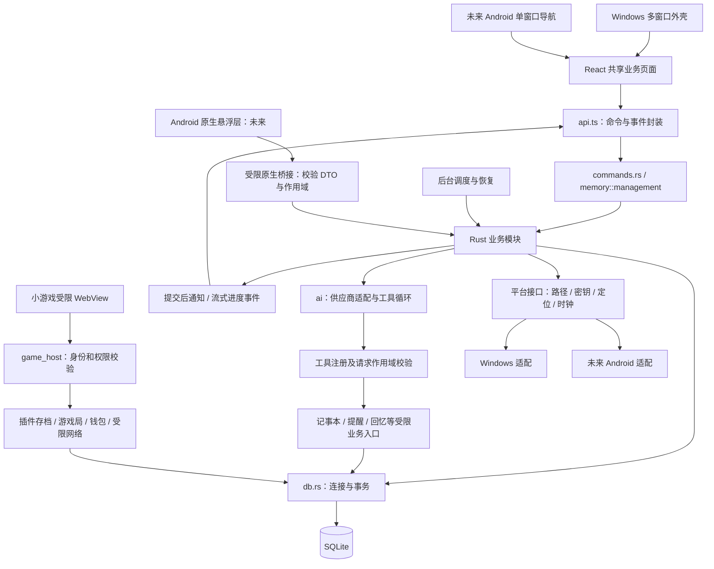

# 颜喵项目架构与代码职责

- 日期：2026-09-20
- 范围：Windows 首版阶段 0–18 的目标代码结构、模块通信和实现边界；预留未来 Android 复用边界，Android 与语音分别作为后续扩展。
- 状态：设计约定与实施边界。第 2 节列出已经落地的桌面壳、主题样式、配置存储、平台密钥适配和 AI 引擎服务；其他文件随对应阶段创建，不代表功能已经实现。
- 配套：[实现计划](superpowers/plans/2026-09-04-yanwenzi-desktop-pet.md)、[实施接口与验收约定](实施接口与验收约定.md)、[数据库设计](数据库与持久化设计.md)、[前端设计](前端设计文档.md)。

## 1. 总体结构

### 已确认增量的职责分配

当前阶段 9.1–9.8 和 Task 10.1 已接通，Task 10.2 消息编辑、尾部删除与重说已接通，Task 10.3 开机自启与默认人设已接通，Task 10.4 正式应用名已完成，Task 10.5 宠窗默认位置与位置记忆已接通，Task 10.6 用户设定 CRUD 与会话绑定已接通，Task 11.3 无聊主动消息已接通，Task 11.5 桌面游走已接通，Task 11.6 休眠恢复与错误分流已接通，下一项为 Task 12.2 聊天后人设自调。`chat/context.rs` 负责固定会话资料、预检索注入和本次整项裁剪；`chat/memory_tools.rs` 提供四个只读回忆工具；`chat_capacity.rs` 负责能力来源、端点/模型缓存、估算和输出预算。`chat/tools.rs` 负责有限工具循环、逐轮预算并调用 `chat/guards.rs` 的文本及工具守卫；`ai/streaming.rs` 判定有效增量和非法 UTF-8，`ai/client.rs` 实施首响应/无进展计时，`chat.rs` 覆盖表情、检索与工具的整轮总时长。`chat/coordinator.rs` 保留唯一终态及活动恢复入口，支持同轮长度续写和异常部分正文保存；`sessions::finish_round` 在首次完成事务中复用 `pet::rewarded_intimacy` 发放一次封顶奖励。默认时长和保守阈值见记忆设计 6.5，相关定向测试已通过，真实供应商、原生窗口人工验收仍待完成。记忆管理复用 `memory/management.rs` 和现有小窗，生成中取消失败会恢复界面生成入口（后端请求若尚未结束仍可返回忙碌）；已有可编辑预览在取消失败时保留以便重试，写入预览前在锁内复核取消信号。Embedding 复用原推理/索引服务和平台资源边界，不另建运行时。

提供商层解析模型容量与输出上限并标明来源；`chat/context.rs` 选择内容、计数、保护固定输入并裁减可移除项；`ai` 适配层映射供应商参数与结束原因，并保证增量解码正确。`chat/coordinator.rs` 继续唯一持有请求、回合与终态提交；流式守卫仅报告停止原因并调用现有取消，不自行写消息。前端只渲染实际预算、停止原因和继续入口，不自行计费、裁剪或保存回合。

`continue_chat` 使用新 requestId、原 roundId 和原消息追加；状态与迁移见数据库设计 11.1，行为见记忆设计 6.4/6.5。不要新建并行聊天服务、独立记忆调度器或通用 Agent 框架。保留当前先表情后正文策略，分别记录表情耗时、正文首 token/总耗时、工具往返、Embedding 与后台记忆耗时；计数不记录密钥或完整私人正文。先观察真实数据，不在本次交接擅自改变产品调用顺序。

颜喵采用 Tauri 2 + React + Rust + SQLite。Windows 首版提供桌面壳；未来 Android 版复用 React 业务页面与 Rust 业务模块，通过平台适配接入原生能力。每个设备独立运行、独立保存数据。当前阶段不开发 Android 安装包、悬浮服务或跨设备同步。

架构分为共享页面、应用入口、共享业务与存储、平台适配四个职责层。它们先在既有项目内按模块隔离，不另建一套业务目录，也不提前拆成多个 crate。小游戏使用受限宿主，原生窗口与 WebView 创建归平台层。首版不引入 LangChain、LangGraph、Node/Python 常驻服务、消息中间件或独立向量数据库。

借鉴的 AI 组织方式是供应商适配、工具注册、有限轮工具调用、显式请求状态、结构化输出校验和可追踪请求 ID。使用 Rust 普通模块、结构体和必要的 trait 实现，不引入通用 Agent 平台，也不为每个业务类配置依赖注入容器。



调用方向以“窗口入口 → 业务服务 → 数据库或外部适配器”为主。Rust 业务之间使用明确函数调用；事务成功后发布事件供界面刷新。不得靠多窗口接力或一串事件消费者完成扣款、记忆回退等原子业务。

文档分工：本文件规定代码归属和通信；专题文档规定业务；`db/schema.sql` 规定字段和约束；实现计划规定先后次序。冲突先修正文档，不以其中一份静默覆盖另一份。

### 1.1 依赖边界

- `chat/memory/context/travel/letters/currency/reminders` 等业务模块不接收 `AppHandle`、`Window`、WebView 或 Android Activity，不直接调用 `emit`、DPAPI、Windows API 或 JNI。
- `commands.rs` 校验调用者后，向业务传入明确 DTO、请求作用域和所需服务引用；业务输出结构化结果或事件。`events.rs` 定义不依赖 Tauri 的事件数据，平台事件适配器负责发送。
- `lib.rs` 是唯一组装点；规划 `runtime.rs` 持有数据库、业务状态、任务调度及平台接口引用。只在边界使用必要 trait 和手动组装，不引入依赖注入框架。测试可注入假时钟、假密钥服务、假通知出口与假网络。
- Windows API、托盘、桌面窗口、DPAPI 和相应依赖按目标平台隔离。Android 原生代码将来只实现权限、生命周期与设备能力，不复制 Rust 的记忆、钱包或旅行规则。
- 原生悬浮层与主界面使用同一应用进程中的同一个 Rust runtime。Android 服务不配置独立业务进程，不另开第二套调度器或数据库写入入口。

## 2. 当前代码与目标代码

已经存在的前端文件：`src/main.tsx`、`App.tsx`、`vite-env.d.ts`、`windows/PetWindow.tsx`、`usePetWindow.ts`、`PetWindow.css`、`PetWindow.test.tsx`。

已经存在的 Rust 文件：`src-tauri/src/main.rs`、`lib.rs`、`commands.rs`、`pet_region.rs`；另有 `Cargo.toml`、`build.rs`、`tauri.conf.json`、`capabilities/default.json` 与图标资源。

配置存储已增加 `config.rs`、`db.rs`、`crypto.rs`、`error.rs`、`providers.rs`、`persona.rs`、`runtime.rs`，以及 `platform/contracts.rs`、`platform/windows/paths.rs`、`platform/windows/secrets.rs` 和模块入口。会话持久化已增加 `models.rs` 与 `sessions.rs`，稳定 DTO 与事务服务分离。前端增加 `src/api.ts`、`src/types.ts`、`src/styles/` 和 `usePetAppearance.ts`，现有宠窗已按风格文档接入亮暗主题及人设颜色。

AI 引擎已增加 `state.rs`、`expressions.rs`、`chat.rs` 和 `ai/{mod,provider,openai_compatible,client,streaming,tests}.rs`。`state.rs` 当前承担请求登记、去重、取消和退出门禁；`chat.rs` 提供后端上下文验证、先表情后正文及内部事件回调；内部辅助模块 `chat/coordinator.rs` 接入回合保存和请求快照，由 commands.rs 注册统一聊天 IPC。9.2 已在 chat/tools.rs 接通有限工具循环、记事本读写、提醒创建和只读游记查询；后续只新增已实现工具处理器，不重建循环。

会话仓储已实现按当前人设创建、列表、切换、改名及有界消息分页；回合仓储原子建立 pending、完成或中断终态，并支持无 round 的主动消息。`models.rs` 中所有跨 IPC 的数据库 ID 均序列化为字符串。会话管理命令校验当前人设和 context revision；消息历史还要求目标就是当前会话。创建/切换复用桌宠结算和旅行取消规则，提交后取消旧会话请求、递增上下文版本并广播。启动恢复遗留 pending 为 interrupted，不自动重发。`chat/coordinator.rs` 已串联基础 AI 流式服务与回合仓储：提交保存用户消息，活动快照跟踪未落盘片段，终态保存后发送事件；前端不能直接提交回合终态。9.6 已接入完整上下文、预算和长度继续，9.8 已接入异常守卫及首次完成奖励；中断不生成短期记忆或奖励，已提交工具副作用保留。

桌宠状态已增加 `pet_store.rs`、`pet.rs`、`pet/controller.rs` 及对应测试。仓储负责会话计时、互动和睡眠分支；业务负责全局参数判定、原子保存及亲密度 0–999 封顶；控制器负责当前上下文、计时锚点、短时表情、活动资格和提供商故障。`jobs.rs` 每秒调用唯一 runtime，`events.rs` 定义事件出口，`platform/windows/events.rs` 广播提交后的快照，`usePetActivity.ts` 按版本接收。数据库版本 5 包含会话桌宠状态升级、亲密度范围保护、提供商预算与停止原因及主动消息检查点/成功时刻；旧库升级先备份。自动调度、启动恢复、人设切换、点击/喂食/摸摸已接通，原生窗口与系统挂起仍需人工验收；无聊主动消息已由 Task 11.3 接通，桌面游走已由 Task 11.5 接通。

`platform/windows/time.rs` 使用 `QueryUnbiasedInterruptTime` 测量排除系统睡眠的运行时间，UTC 单独用于睡眠期限；生产随机源使用 Windows `BCryptGenRandom`，测试可替换时钟和随机源。窗口隐藏、拖动和聊天阻止无互动累计与新空闲分支；出门不累计。启动不补算离线有效时长，但恢复已到期睡眠。已有库或用户删完会话后，没有当前会话时只显示状态提示；全新库的 Task 10.7 一次性初始化见 2.2。将来的会话切换服务必须复用 runtime 的旧区间结算、上下文换代和目标恢复步骤。

`Runtime` 持有受锁保护的 SQLite 连接、运行期上下文版本、`SecretProtector`、共享 AI HTTP 客户端及请求管理器。命令校验调用窗口后通过后台执行器运行短事务，连接测试和表情生成先获取并解密配置快照，释放数据库锁后联网。人设切换的旅行取消、当前项和当前会话更新同事务完成，提交后在同一数据库锁作用域内取消旧人设请求；聊天协调收到取消后将原会话回合收束为 interrupted；关闭聊天窗或正常退出同步保存已有片段。当前配置与聊天命令仅允许 `main/chat/settings`，插件窗口不在白名单。

初始化失败保存在 runtime 的失败状态中：配置命令返回中文错误，宠窗显示错误，但窗口隐藏、恢复与退出仍可用。修复目录权限或更换兼容版本后重新启动，不提供删除数据式的自动恢复。

当前 `App.tsx` 直接显示宠窗；`lib.rs` 注册托盘和宠窗命令；`commands.rs` 包含宠窗运行状态及主线程调度。后续在此基础上增量接入，不覆盖已实现的命中区域、隐藏恢复与拖动行为。现有 `PetState` 仍负责原生窗口状态，后续 `state.rs` 的业务状态不得与之混成同一套状态枚举。

本文件沿用实现计划中的 `chat.rs`、`memory.rs`、`chat/context.rs` 等路径，不另建一套同名服务目录。增加的内部辅助文件在对应阶段建立。将来单文件需要拆分时，可以变为同名模块目录，但必须同步计划和引用，不同时维护两套实现。

提醒持久化已接入：`reminders.rs` 管理 occurrence 查询、展示确认和状态事务；`reminders/rules.rs` 管理规则 CRUD、离线补偿和在线入队；`reminders/schedule.rs` 负责版本 1 日/周/月日历、时区与夏令时计算。业务接受时间和时区参数，不依赖 Tauri。现有 `jobs.rs` 唯一循环先完成启动补偿，再在线调度；任务提交成功后通过 `ReminderEventSink` 通知，提醒故障独立于桌宠和提供商故障。`commands.rs` 校验调用窗口并注册管理接口，`api.ts/types.ts` 提供对应调用和 DTO。调度复用现有 schema，无新增迁移；`components/settings/ReminderPanel.tsx` 已接入规则与触发记录管理，`ReminderForm.tsx` 负责时间输入与校验，`hooks/useReminders.ts` 负责分页读取、事件/焦点补查和旧响应丢弃。页面内离线汇总读完所有分页，确认展示按最多 200 个 ID 分批提交；不把确认展示当作完成。宠窗气泡与启动汇总由 `PetReminderNotifications` 组合 `ReminderBubble` 和 `MissedReminderSummaryDialog`，`useReminderNotifications` 负责恢复队列、展示确认、当前快照和操作去重；共用 `reminderQueries` 读取分页，不另起调度器。AI 润色仍按后续步骤实现。

`reminder_extract.rs` 已提供聊天创建提醒的工具定义、时间上下文与受限处理器。每个普通聊天请求保留一个处理器，固定原请求凭据和会话版本；写入前验证取消、归属和当前状态。复用 `reminders::save_rule` 保存 `source=chat`，提交后通知，按本请求工具调用 ID 防重复执行。此模块不发起额外模型请求、不直接修改 occurrence；完整工具循环在阶段 9 注册，重说不开放该写入工具。Task 9.2 已在聊天传输入口执行工具；后续复用原循环。


### 2.1 Task 11.5：画布游走已接通

`pet/wander.rs` 负责 CSS 像素中的边界、低频检查、鼠标接近、前台避让和目标 DTO，不接收窗口句柄。`platform/windows/wander.rs` 负责读取鼠标/前台窗口屏幕物理坐标，减去宠窗客户区原点并除以 DPI 比例；不将窗口原点重复缩放。宠窗本身和桌面壳不作为避让障碍。聊天窗可见时暂停；读取失败则本次跳过。

复用 `jobs.rs` 唯一循环的 `PetEventSink::wander(view)`，平台适配调用业务控制器并发送 `pet-wander-target`；不是第二个业务调度器。内存控制器由 `lib.rs` 组装。`update_pet_wander_layout` 仅允许 main 宠窗，Runtime 锁内校验当前人设/会话/contextRevision 后接受递增布局版本。

`usePetWander.ts` 测量颜文字与当前气泡的联合范围，设置根节点 CSS 位移变量；`PetWindow.css` 只将变量用于颜文字与气泡，顶部操作入口固定。前端按布局/上下文过滤目标，约 600ms 内每 100ms 一步，现有 `usePetWindow` MutationObserver 按每步真实 DOM 矩形更新窗口区域，没有原生 set_position 游走。布局/表情尺寸变化重新限界；按住桌宠立即暂停，隐藏/拖动/错误/菜单、可见性丢失、系统减少动态效果也暂停。运行偏移、布局版本和低频检查时刻不进 SQLite 或备份。

### 2.2 初始会话初始化（Task 10.7，已接通）

全新数据库的一次性初始化规则见《数据库与持久化设计》2.2.2，教程正文唯一文档来源为《前端设计文档》5.7.3。当前无会话空态仍适用于已有库及用户删除最后会话后的情况。

- `db::initialize` 负责识别原始新库，并在现有初始化事务内写入默认人设下的会话、消息及当前选择；复用会话初始化逻辑，不嵌套事务，不调用带窗口副作用的命令。
- 内置正文在已有 Rust 模块内集中定义一份；前端读取真实消息，不自行插入教程，不请求 AI。无需新表、新迁移或教程服务层。
- db::initialize 返回创建结果；db::open 返回连接与该结果，Runtime.initial_session_created 通过运行时组装传给桌面窗口层，仅携带本次成功创建的结果。窗口层在事务提交、窗口系统就绪后复用聊天窗打开/聚焦入口。仓储不操作窗口，首次展示标记不写入 settings 或备份。
- 旧库升级、普通会话创建、补齐缺失默认人设不生成教程。开窗失败保留数据，用户可手动打开；下一次启动按正常启动流程执行。

## 3. 根目录与运行数据

```text
yanwenzi/
├─ src/                  React 窗口、组件、类型及 API 封装
├─ src-tauri/            共享 Rust 业务、Tauri 入口与平台适配
├─ native/android/      后续 Android 原生插件源码，移动端阶段创建
├─ db/
│  ├─ schema.sql         当前目标结构，字段注释、外键、索引和约束
│  ├─ migrations/        后续数据库版本升级 SQL，按版本编号
│  ├─ tests/             SQLite 结构、关系、约束与事务用例
│  └─ tools/             数据库图等开发期生成工具
├─ plugins/              SDK、模板、打包工具及第一方小游戏源码
├─ docs/                 架构、专题规则、实施与验收文档
├─ my_doc/               已有本地工作记录目录
├─ package.json          前端开发、构建和测试命令
├─ package-lock.json     已锁定的前端依赖
├─ vite.config.ts        前端构建及现有测试配置
├─ tsconfig*.json        TypeScript 检查规则
└─ README.md             项目入口、启动方式和文档索引
```

Windows 便携版以应用目录定位 `data/`，不依赖启动工作目录；未来 Android 使用应用私有可写目录。平台 `AppPaths` 返回业务数据根、缓存根、只读随包资源位置和临时目录。`config.rs` 读取该结果，不自行推断可执行文件位置。数据库、背景图片、模型和插件各自通过受管相对路径定位；文档中的 `data/` 表示 Windows 实际目录及共享业务的逻辑数据根，不要求 Android 存在同名外部目录。

Android 随包 assets 不能默认当作普通可写路径；模型等需要文件路径的资源，由资源适配器完整校验后安装到私有目录。用户选择的文件或导出目的地可为内容 URI，由原生文件适配器转成受限读取/写入流，业务不解析 `content://`、不要求任意外部存储权限。导入先复制到受管临时目录并执行既有校验，再提交业务数据。

`db/migrations/002_session_pet_states.sql` 实现版本 1 到 2 的桌宠状态迁移；新库以 schema 为基线。版本记录、迁移备份、事务和兼容规则沿用数据库设计，不能只修改建库 SQL。开发期 Python/Node 工具不意味着发布包需要常驻 Python/Node 服务。

## 4. 前端文件职责

以下路径均相对于 `src/`。

### 4.1 入口与通信

- `main.tsx`：挂载 React，加载基础样式，不执行业务初始化 SQL。
- `App.tsx`：按可信宿主能力选择 Windows 窗口入口或未来 Android 导航入口；不接受任意 URL 参数授予插件主程序权限。
- `types.ts`：命令输入输出、错误、上下文快照、事件判别联合与分页类型。数据库行不直接当作前端 DTO。
- `api.ts`：唯一的业务 `invoke/listen` 封装、统一错误转换、监听清理；不决定亲密度或喵币规则。现有宠窗 hook 的系统窗口调用按阶段接入，无需为写文档立即迁移。
- `theme.ts`：读取主题设置，解析亮色/暗色/跟随宿主系统，订阅变更；不在共享组件里假设系统一定为 Windows。
- `styles/theme.css`：主程序亮暗主题和语义颜色变量的入口；配套 `base.css`、`components.css`、`motion.css` 分别承载基础排版、公共组件和动效，不注入小游戏。具体 Token 和组件外观遵守《前端美化风格设计》。

### 4.2 窗口

阶段 8 当前已落地：`platform/navigation.ts` 提供 `chat/settings` 语义导航；Rust `desktop_windows.rs` 集中固定标签、尺寸及串行创建/聚焦逻辑，`commands.rs` 负责调用方校验。`App.tsx` 使用原生窗口标签分派，`content-windows.json` 只授权聊天与设置标签。

`hooks/useCurrentContext.ts` 订阅上下文/配置事件后查询人设与会话列表，读取后再核对版本，窗口聚焦补查，释放监听并丢弃旧响应；`ResponsiveWindowShell` 只负责响应式外观，不查询数据。`ChatWindow/SettingsWindow` 组合共享页面，当前复用 `usePetAppearance` 同步主题，不复制主题读取实现。`ChatPage` 已提供会话管理和历史分页，`SettingsPage` 组合导航、`components/settings/GeneralPanel` 主题表单与 `ProvidersPanel` 提供商管理及 `PersonasPanel` 人设基础管理。`PersonaForm` 负责输入和字段校验；`PersonasPanel` 负责卡片、初始设定确认、删除确认、表情生成/取消以及配置和上下文订阅。持久化、级联、切换回退与表情结果校验复用现有 Rust 服务，不新增数据库结构。`ProviderForm` 只构造保存输入和显示字段错误，`ProvidersPanel` 负责接口调用、列表刷新、选择器与删除确认；密钥加密、当前项保护和测试连接仍由 Rust 既有服务执行。其他业务依计划后续接入。

以下 `windows/*Window.tsx` 是 Windows 外壳。阶段 8 起将可复用内容放入 `pages/ChatPage.tsx`、`SettingsPage.tsx`、`MemoryPage.tsx`、`TravelPage.tsx`、`LetterPage.tsx`，外壳负责窗口创建参数、关闭与聚焦，页面负责业务展示和调用。已有 `PetWindow` 保留 Windows 专属命中区域逻辑。未来 Android 的 `mobile/MobileShell.tsx` 组合相同页面，承担返回栈、安全区和软键盘避让，不为每个页面再开原生窗口。

规划 `platform/capabilities.ts` 定义 `PlatformCapabilities` 及能力状态读取，`platform/navigation.ts` 提供打开业务页面的语义入口。能力区分“不支持”“待授权”“可用”“资源缺失”，不能仅用屏幕宽度或用户代理判断。`desktopWindows`、`tray`、`overlayPet`、`fileImportExport`、`systemNotifications`、`localEmbedding`、`voiceInput` 按实际实现返回；服务端仍独立检查，界面隐藏不是授权。Android 未实现前只创建 Windows 用到的接口和实现。

- `windows/PetWindow.tsx`：颜文字、饰品、气泡、入口与互动呈现。
- `windows/usePetWindow.ts`：现有宠窗显隐、区域上报、拖动协作和订阅生命周期。
- `windows/PetWindow.css`：宠窗画布、字体和命中区域相关样式。
- `pages/ChatPage.tsx`：会话选择、消息列表、输入、流式回复、中断、底部删除及重说；出行中切换为已规定的写信面板。`windows/ChatWindow.tsx` 仅装配该页面与桌面窗口外壳。
- `pages/SettingsPage.tsx`：设置导航与子面板组合，不在一个组件内实现全部表单和网络请求；`windows/SettingsWindow.tsx` 承载桌面外壳。
- `pages/MemoryPage.tsx`：短期/长期记忆、来源查询、编辑和 AI 预览确认；`windows/MemoryWindow.tsx` 承载桌面外壳。
- `pages/TravelPage.tsx`：出行记录、邮箱、游记、伴手礼的浏览和管理；`windows/TravelWindow.tsx` 承载桌面外壳。
- `pages/LetterPage.tsx`：选定有效出行的写信与发送状态；`windows/LetterWindow.tsx` 承载桌面外壳。
- `windows/FestivalPanel.tsx`：沿用计划路径，实际为设置窗中的节日面板，并非额外原生窗口。

### 4.3 展示组件与设置面板

- `components/Kaomoji.tsx`：颜文字与人设颜色，保持文本不裁切。
- `components/AccessoryLayer.tsx`：佩戴饰品的显示与位置，不自行发放物品。
- `components/Bubble.tsx`：聊天、状态和提醒气泡的明确类型；提醒使用独立视觉。
- `components/ContextMenu.tsx`：按后端能力状态展示操作入口。
- `windows/PetWindow.tsx` 的现有错误面板与 `windows/usePetMemoryErrors.ts`：聚合当前主连接/后台记忆错误，提供刷新与记忆窗入口；hook 只读现有生成状态，按上下文/代次丢弃旧结果，不另建 ErrorBadge 或错误仓储。
- `components/PersonaPromptDiff.tsx`、`utils/personaPromptDiff.ts`：初始/当前文本差异，绿色新增、红色删除与文字标记；纯前端计算。
- `components/GameCenterPanel.tsx`：全局插件列表、启动、钱包摘要。
- `components/PluginManagerPanel.tsx`：安装、授权、来源链接、缺包数据、存档导入导出与卸载。
- `components/settings/ProviderPanel.tsx`：聊天、记忆提供商配置和连接测试。
- `components/settings/EmbeddingPanel.tsx`：本地/联网 Embedding、切换与索引重建状态。
- `components/settings/PersonaPanel.tsx`：人设新建、切换、编辑、删除确认和差异组件。
- `components/settings/UserProfilePanel.tsx`：用户设定管理。
- `components/settings/ReminderPanel.tsx`：提醒规则及每次触发记录管理。
- `components/settings/PetStatusPanel.tsx`：亲密度、全局喵币和唯一每日签到入口。
- `components/settings/GeneralPanel.tsx`：通用设置，当前已接入主题；其他通用项按对应阶段接入。
- `components/settings/PetTimingPanel.tsx`：时间与桌宠的 15 项配置、组合校验和恢复默认草稿；复用全局配置接口，只保存本页改动项。计时/亲密度配置为全局，运行状态仍按会话保存。
- `components/settings/MemorySettingsPanel.tsx`：阶段 9.1 已接入的 11 项记忆全局配置，包含字数范围、k、上下文数量、工具轮次及记事本软上限；只提交改动项，恢复默认值只填草稿。记忆生成与检索由后续业务模块消费配置。
- `components/settings/WeatherPanel.tsx`：已接入定位/天气缓存展示、主动刷新与取消、和风可选配置保存；只接受当前上下文回执，离开页面清理请求。打开页面和时效检查仅查询缓存，不自动申请定位。
- `components/settings/AccessoryPanel.tsx`：饰品列表、预览确认、佩戴与卖出。
- `components/settings/BackupPanel.tsx`：六类数据包的导出、导入检查与确认。
- `components/settings/NotebookPanel.tsx`：当前会话记事本查看与编辑，展示软字数限制。

这些面板承载既有功能，具体导航归属以《前端设计文档》为准。页面内临时状态由 React 管理；数据库事实通过查询获取，不额外维护第二份永久存储。组件测试就近放置 `*.test.ts(x)`，跨窗口订阅测试覆盖销毁监听、切换和乱序响应。

### 4.4 聊天页面状态管理

`hooks/useChat.ts` 负责统一发送接口、订阅、回执前事件暂存、seq 去重/缺口恢复、精确取消和卸载清理。已保存消息按稳定 ID 合并，活动片段独立展示；不在前端建立第二套保存入口。`components/ChatComposer.tsx` 是受控输入组件，`pages/ChatPage.tsx` 组合会话管理、消息与输入。`useCurrentContext` 在同上下文聚焦时保留页面，真正切换才更新页面身份；`ChatWindow` 对已有页面使用内联错误，避免背景刷新错误中断正在生成的回复。

## 5. Rust 文件职责

以下路径均相对于 `src-tauri/src/`。每个业务模块集中提供读、校验和事务内写入函数；调用方通过这些函数组合业务，不复制其他模块的 SQL。

### 5.1 应用、基础设施与窗口

- `main.rs`：进程入口，只调用库入口。
- `lib.rs`：唯一组装点，创建共享服务、注册 commands、托盘、启动与退出流程；不堆放业务 SQL。
- `commands.rs`：主程序 Tauri 边界，读取调用窗口、校验 DTO、调用服务并映射错误。现有宠窗命令保留。
- `commands.rs` 的记忆管理命令：授权/解析/后台执行和提交后通知；业务在 `memory/management.rs`，复用父模块的生成配置、FACT_RULE、校验及请求管理，不另写整合规则。
- `state.rs`：当前人设/会话快照、`contextRevision`、请求注册表、取消句柄、运行期缓存和短锁；数据库仍是可恢复业务事实来源。
- `error.rs`：稳定错误码、中文消息与内部错误转换；对前端隐藏密钥、SQL 和内部路径细节。
- `models.rs`：数据库读取模型、DTO、业务枚举与序列化映射；不发网络请求。
- `config.rs`：从 `AppPaths` 取得路径，全局设置的类型化读取/校验/默认值；键与值定义见数据库设计及 SQL 注释。
- `crypto.rs`：平台无关的密钥加解密门面，调用 `SecretProtector`；Windows 实现使用 DPAPI。仅在后端短期使用明文，不返回给页面。
- `db.rs`：连接、外键启用、迁移、种子、阻塞执行入口及事务边界；不承担聊天编排。
- `events.rs`：已存在，集中平台无关事件名、载荷及事件发送接口；提交后通知由平台适配发送，流式片段明确标识为未持久化进度。Task 9.3 增加 `MemoryEventSink` 与无数据通知 `memory-generation-changed`，页面重新读取状态。
- `windows.rs`：规划新增，二级窗口标识、创建/聚焦/关闭及能力边界；阶段 8 接入。托盘初始化仍由 `lib.rs` 负责。
- `pet_region.rs`：已有 Windows 原生命中区域、缩放坐标与裁剪；不负责旅行、饥饿等业务状态。
- `pet_position.rs`：Task 10.5 的桌面窗口适配，负责实际物理尺寸与工作区定位、原生用户拖动的 250ms 节流、最终/退出补存，以及系统临时回位与用户首选位置的区分；从 `lib.rs` 接入主窗口事件，从现有 `set_pet_dragging` 接入起止。数据库写入复用 `config.rs` 内部成对接口，不新增后台调度器或修改桌宠计时规则。
- `autostart.rs`：已接通 Windows 登录自启适配；仅设置窗口可查询/启用/关闭，后台阻塞执行插件写入及注册表复查。固定登记名 `YanMew`，检查当前 exe 路径与系统禁用标记，不影响手动启动，不写 SQLite。非 Windows 返回不支持，前端隐藏入口；不在共享业务中调用 Win32。
- `components/settings/AutostartPanel.tsx`：复用通用设置与既有组件样式，经 `autostartApi` 读取实际状态、显式设置和修复路径；焦点刷新与操作互斥，忽略迟到/卸载回执。
- `jobs.rs`：已存在的唯一后台循环，负责桌宠状态、提醒调度及 Task 9.3 的短期记忆恢复扫描；持有 `memory::Worker` 并调用其非等待推理的 tick。受退出取消控制，生成通知唤醒扫描，每秒兜底，不另建循环或持久任务表。

### 5.1.1 平台接口与宿主文件

以下 Rust 路径相对于 `src-tauri/src/`；`native/android/` 相对于项目根目录。这些都是按阶段创建的目标文件，Android 文件仅在移动端阶段创建。

- `runtime.rs`：进程内唯一业务 runtime 的创建、就绪屏障和销毁；主窗口、原生服务重复连接只取得同一实例。
- `platform/mod.rs`：选择目标适配器；业务代码不散布平台条件编译。
- `platform/contracts.rs`：定义 `AppPaths`、`SecretProtector`、`LocationSource`、`Clock`、`NotificationPort`、`FileTransferPort` 与能力 DTO。接口只表达任务所需输入输出和明确错误，不返回原生窗口句柄。
- `platform/lifecycle.rs`：将宿主运行/暂停/恢复/停止及授权变化规范化，驱动任务取消、计时检查点和恢复扫描。状态附带版本，重复回调幂等。
- `platform/windows/mod.rs`：Windows 接口组装；`paths.rs` 定位便携资源，`secrets.rs` 实现 DPAPI，`location.rs` 对接 Windows 定位，`events.rs` 发送 Tauri 事件，`files.rs` 对接系统文件选择和导出，`notifications.rs` 将提醒投递到既有提醒气泡。桌面通知未纳入既定首版规则时不额外增加通知方式。
- 现有 `windows.rs`、`pet_region.rs`、`autostart.rs` 继续作为桌面专属模块，由 Windows 组装点引用，不为统一目录强行迁移已完成代码。
- `platform/android/mod.rs`：未来 Rust 与原生桥接、应用私有目录、密钥保护和生命周期适配，不写业务 SQL。
- `native/android/`：未来 Tauri 原生插件工程；`YanmewPlatformPlugin.kt` 提供受限桥接，`PetOverlayService.kt` 管理原生悬浮视图与服务，`PermissionController.kt` 管理系统授权，`NotificationAdapter.kt` 管理系统通知，`FileTransferAdapter.kt` 管理系统文件选择，`SecretProtectorAdapter.kt` 使用 Android Keystore 管理的密钥保护凭据。包名和构建登记在实施时固定。Tauri 生成工程不作为手工业务源码目录。

`SecretProtector` 输入明文/不透明密文，输出加密结果/明文或错误；共享模块不解读密文编码。Windows 保持既定 DPAPI 格式；Android 密文格式与迁移在移动端实施时确定，不直接解密 Windows 密文。Keystore 保存加密密钥，应用数据库可保存被其保护的密文；原始 API Key 不存入前端或日志。两端逻辑备份均排除凭据。

`Clock` 分别提供 UTC 时间与进程内单调时间：到期旅行、回信和提醒使用保存的 UTC 时点，有效在线时间使用实际允许运行区间的单调差值。系统时间跳变不当作一段在线时长。`NotificationPort` 使用既有 occurrence 身份及投递令牌去重；通知点击进入对应业务查询，不能仅凭外部参数完成提醒或修改钱包。

### 5.2 配置、人设和会话

- `providers.rs`：聊天/记忆提供商 CRUD、当前项选择、连接测试和解密后的短期调用配置。
- `embedding_providers.rs`：独立 Embedding 配置、内置项保护、切换与重建通知。
- `persona.rs`：人设 CRUD、内置项保护、初始设定、自调结果校验；删除当前人设时协调会话取消和回到默认人设。
- `user_profiles.rs`：已接通全局用户设定 CRUD、有效引用与变更协调。协调在 Runtime store 锁内校验目标，只中断受影响聊天，然后调用仓储；复用现有回合服务、请求取消和会话绑定事务，不依赖 Tauri、不另建聊天管理器。返回资料变更结果与需要补查的会话 ID，commands 负责通知；导入映射留在阶段 17。`user_profiles/runtime_tests.rs` 验证中断、失败与迟到终态。
- `sessions.rs`：会话仓储、归属与切换入口；整会话删除事务先清理长期记忆，再删除会话及级联数据，并原子更新当前选择；切换协议见第 8 节。
- `sessions/operations.rs`：复用 runtime 存储锁协调整会话删除、目标请求取消和桌宠状态。仅删除当前项递增 contextRevision、恢复同人设最近更新会话；非当前删除保留当前聊天、记忆、预览、桌宠与版本。窗口事件仍由 `commands.rs` 在提交后发布。
- `sessions/titles.rs`：首个完整回复保存后，基于整个会话首条用户消息后台生成标题；锁外调用 AI，锁内复核上下文、提供商、消息、触发回合、标题和取消信号。标题失败不影响聊天终态或桌宠连接状态，改名不递增 memory_revision。
- `expressions.rs`：表情分类、生成、校验与人设表情保存；失败不制造空的成功表情库。

### 5.3 AI 传输与工具

- `ai/mod.rs`：导出内部 AI 类型和适配接口，屏蔽底层 HTTP 表示。
- `ai/client.rs`：按选定提供商发起聊天、结构化生成、连接测试；不直接写聊天或记忆表。
- `ai/streaming.rs`：SSE 字节分块、UTF-8、正文/表情/工具参数增量组装与终止原因解析；不把异常 EOF 当成功。
- `ai/provider.rs`：已实现消息、请求、工具调用及生成结果类型；传输与业务共用，不依赖窗口。
- `ai/openai_compatible.rs`：已实现 OpenAI-compatible 协议转换与响应校验；`client.rs` 为业务门面，避免重复实现两套 HTTP 调用。
- `ai/tool_registry.rs`：规划新增，工具名称、说明、参数 schema、是否只读、对应处理器及已实现能力清单。
- `ai/tool_loop.rs`：规划新增，完整参数校验、限定轮数、取消检查和工具结果回传；不硬编码业务 SQL。
- `ai/prompts.rs`：规划新增，各用途提示模板与结构化输出要求；字数、轮数等可设置值由调用方注入，不复制默认常量。
- `ai/embedding.rs`：规划新增，本地和联网统一向量接口、模型标识、维度及向量合法性检查；具体本地运行库经专项验证后定稿。

业务模块使用 `ai/client.rs` 发请求；工具循环通过注册时注入的受限处理器调用业务入口。工具处理器不再次调用顶层 `chat::send`，避免递归聊天及重复工具循环。

### 5.4 聊天、记忆与上下文

Task 10.2 职责：`sessions/messages.rs` 编辑原文/删除真实底部，复用 `memory::rollback_trigger`；`chat/regeneration.rs` 持有重说请求，流式预览只进内存，复用 run_reply 后等待记忆准备并执行最终事务；`memory/regeneration.rs` 提供 capture/generate/apply，读取原来源、锁外生成、在调用者事务内校验替换，不自行提交或增加亲密度。coordinator 的活动请求/关闭识别 regenerating；普通终态先核对 requestId 再写入/清理，避免删除后迟到请求影响新请求。memory::Worker 重说期间暂停该会话新任务扫描，结束后沿用原恢复循环。

- `models.rs`：已实现会话、回合、消息与消息分页 DTO；阶段 9.1 增加短期/长期记忆、来源关系、记事本 DTO 和后端向量缓存模型。业务枚举使用稳定字符串，跨 IPC 数据库 ID 使用十进制字符串；向量 BLOB 不序列化到前端。记忆仓储、生成、整合、管理与预览确认已按 9.3–9.7 接入。
- `sessions.rs`：已实现会话创建/列表/切换/改名、消息分页、pending 回合建立、completed/interrupted 终态、主动消息和启动恢复。事务校验人设/会话/回合归属；Task 9.8 在首次 completed 的原事务中保存亲密度 +1 和 memory_revision，复用封顶 999 的共享函数。中断和重复完成不奖励；不调用 AI、不发送窗口事件。
- `chat.rs`：普通发送、取消、终态提交、重说、编辑与底部删除的总协调；控制一轮成功后哪些后台工作可以开始。阶段 8.4 已由内部模块 `chat/coordinator.rs` 接入 `sessions.rs`，完成基础提交、取消与终态保存；9.2/9.6 已接入工具与完整上下文，9.3 已接入记忆唤醒；9.8 已接入守卫和亲密度。守卫异常触发原取消信号，按保存原因收束且不触发提供商休眠；Task 10.2 已接入重说；历史编辑与底部删除由 sessions/messages.rs 执行事务，commands.rs 发布事件，ChatPage/useChat 承载交互。
- `chat/context.rs`：按固定会话读取人设、用户设定、近期消息、待整合短期、最近长期、RAG、游记标题、节日和环境数据，处理预算及缩减提示；不得自建另一份记忆。
- `memory.rs`：Task 9.3/9.4 已实现短期生成、长期任务编排、版本/原文/配置复核、缺失恢复、状态统计与当前会话重试；`GenerationState` 由 Runtime 持有，任务类型和回合共同区分活动/有界失败，`Worker` 由唯一 jobs 持有，一次一个异步记忆请求，复用 AI 客户端与请求管理器。真实待办由 completed 缺失短期与连续 pending 的 k+1 关系判定，已有记忆保留。手动编辑及预览/确认已由 `memory/management.rs` 接入；GenerationState 只额外保留一个后端预览快照，不新增持久表。
- `memory/consolidation.rs`：Task 9.4 的内部辅助模块，负责不跨缺口的 k+1 分组快照、标题与正文单次生成、来源/状态/FTS 原子提交、按触发回合排序的长期查询，以及仅允许底部完整回合的删除回退服务。源回合排序与来源关系决定覆盖边界，不重复保存覆盖字段。阶段 10 复用该服务接入用户删除流程。
- `embedding_providers.rs`：Task 9.5 已实现独立提供商仓储、内置/当前项保护、事务切换及 DPAPI 密钥更新；只允许用户新增联网项，不改写本地资源身份。
- `embedding.rs`：已实现固定 manifest/SHA-256 验证、单实例 CPU 模型、官方查询前缀、无截断分词、CLS/L2 向量与严格数值校验；联网调用复用 `ai/client.rs` 连接池及取消。单一模型互斥锁不等于数据库锁，推理运行于阻塞执行器。
- `memory_search.rs`：已实现当前会话最近 m 条以外的 FTS5/短词字面匹配和向量并行候选、RRF 融合、ID 去重、相关阈值及返回预算。结果返回前复核当前提供商和记忆正文；9.6 的上下文及工具直接复用 `search`，不自建检索器。9.6 已接入聊天请求；管理编辑后直接复用现有 FTS 和补建服务。
- `memory_index.rs`：已实现内容哈希/模型身份校验及可恢复向量补建；`Worker` 接入唯一 jobs 循环，一次一个异步任务，当前会话优先。提交前校验配置快照、恢复代次、记录归属和哈希；删除/编辑/切模型后迟到结果不落库。失败等待配置修改/测试连接/重启，超长项按当前内容哈希暂记为仅全文检索。FTS 日常更新继续复用 SQL 触发器，导入重建由后续导入模块执行。
- `chat/memory_tools.rs`：已实现四个只读回忆工具，复用查询模块并校验来源归属。
- `notebook.rs`：已实现会话记事本读取、全文事务保存、旧快照冲突检查、保留原格式的段落追加/替换/删除；软限制不截断正文。
- `notebook_tools.rs`：已实现记事本工具定义、后台会话绑定、取消/出门检查、请求内写调用幂等，以及字数/段落工具结果；`chat/tools.rs` 直接复用此入口，不另写记事本 SQL。
- `travel_journal_tools.rs`：会话内游记标题分页、关键词搜索和正文只读查询，每次验证请求与归属；不实现旅行生成。
- `chat/tools.rs`：单次聊天的有限工具循环，复用记事本、提醒及游记处理器；跨轮保留调用去重状态，按调用 ID 回传结果，到上限停止工具并请求正文收束。数据库操作放入阻塞执行器，网络等待不持锁；平台通知通过 `ChatToolEventSink` 注入。
- `windows/MemoryWindow.tsx`：跟随当前上下文的记忆小窗，Task 9.2 开放 `NotebookPanel`，Task 9.3/9.4 的 `MemoryGenerationPanel` 分别显示短期生成与长期整合统计、失败说明和待办重试；短期/长期正文管理按 Task 9.7 扩展。`get_notebook/save_notebook` 复用记事本仓储，保存校验旧快照；状态和重试命令复用 memory 模块且验证 contextRevision。
- `chat/proactive.rs`：主动模式准备 provider 与 `Context::proactive`，复用 `snapshot_mode`、`run_reply`、预算与工具循环；不执行 Wake、不创建聊天回合。表达式请求与正文生成仍遵守原超时和输出守卫。
- `proactive.rs`（Task 11.3 已接通）：无聊主动消息资格检查、生成和保存。资格读取会话持久化无聊分支并结合运行许可，不用显示表情代替业务状态；复用 `chat/context.rs` 的组装、混合 RAG 与工具循环，并提供不追加 user 消息、不执行 `Interaction::Wake` 的主动生成入口。消息无 round，不产生短期记忆；用户发送优先，旧周期结果不保存。复用 idle_elapsed_ms，新增检查点 proactive_next_check_idle_ms 和最近成功时刻 last_proactive_sent_at；消息和成功状态一次事务提交。独立 proactive 请求租约在聊天、互动、历史消息编辑/删除及上下文切换时取消。
- `reminder_extract.rs`：已实现提醒工具定义、时间上下文、参数校验和按原请求执行的创建处理器，通过 `reminders.rs` 保存，不直接操纵触发记录；接入契约见《实施接口与验收约定》第 2.3 节。

### 5.5 桌宠、提醒和环境

- `pet.rs`：已实现 `advance`（有效增量、饥饿判定、无聊/睡眠分支及到期恢复）与 `interact`（互动状态及亲密度原子保存，最高 999）。复用 `config::get` 和 `pet_store`，不接收窗口或联网客户端；`Tick` 只由后端生成，`RandomSource` 可替换。`pet/controller.rs` 管理运行期休眠、短时表情与活动资格，runtime 注入平台时钟并协调提交；出行与互动互斥校验在后端执行。控制器不启动后台 AI，不实现游走动画。Task 11.6 的 `report_ai_failure` 对主连接/传输故障使用明确代码白名单，内容校验/截断/守卫不写健康错误；`complete_health` 返回结果是否被当前配置和健康版本接受。`commands::check_provider` 统一刷新与选定模型测试，迟到结果返回 `CONTEXT_CHANGED`，不误恢复另一提供商。后台记忆仍由原 worker 状态与事件提示，不写 pet.provider_error。
- `pet_store.rs`：`session_pet_states` 的唯一仓储入口，负责有效计时检查点、合法互动、分支持久化、睡眠到期恢复和状态版本校验；不包含窗口、联网或平台时钟调用。提供商连接错误由独立健康状态处理，不混入会话状态。
- `reminders.rs`：规则、schedule 校验、下一次时间、occurrence 生成、状态编辑、离线汇总及展示确认；弹窗展示不等于完成提醒。
- `location.rs`：定位业务门面，调用 `LocationSource`，统一权限结果、超时和可用性；原生调用放平台适配，失败不伪造坐标。
- `weather.rs`：天气提供商转换、有时效缓存和失败兜底；局部错误不使聊天休眠。
- 阶段 7 已实现 `weather/parse.rs` 两家服务的独立转换；`weather.rs` 持有有界 HTTP 请求和刷新协调，缓存位于 `Runtime::Store.weather`，与上下文版本在同一短锁内提交。平台定位通过 `LocationSource`，Windows 适配在主线程发起授权、后台异步等待。阶段 8 设置页面通过 `weatherApi` 查询/刷新/取消，通过 `configurationApi` 保存凭据；9.6 已接入只读缓存的环境上下文，不自动定位或刷新。配置继续 SQLite/DPAPI 持久化；外部天气缓存仅存内存，重启重建，不新增数据库表。
- `lunar.rs`：内置日历日期查询与覆盖范围校验，不请求联网日历。
- `festivals.rs`：母表/会话子表、当日命中及祝福词；向上下文和签到提供事实，不独立发币。

### 5.6 钱包、插件和旅行

- `currency.rs`：唯一余额变更入口、全局签到、流水及幂等校验；所有调用方复用事务内变更函数。
- `game_plugins.rs`：插件登记、manifest、安装/更新/卸载、权限、设置/存档、缺包记录和来源链接。
- `game_host.rs`：可信宿主实例绑定身份、桥接校验、游戏局状态、钱包请求与受限联网；WebView 创建交给平台适配。Windows 窗口标签和未来 Android WebView 句柄在边界映射为宿主实例，不接受插件自报身份作为授权依据。
- `accessories.rs`：饰品生成预览、确认制作、档位消耗、佩戴/卸载和卖出；与钱包共用调用方事务。
- `travel.rs`：出行倒计时、开始/取消/正常返回、活动事实及礼物快照、恢复顺序；子项围绕同一 travels 记录产生。
- `letters.rs`：发送信件、待回信、回复窗口与一次性回复资格；旅行返回优先于回信。
- `souvenirs.rs`：伴手礼校验、发放和展示项管理，不拥有出行事实。
- `travel_journals.rs`：按出行事实用人设口吻生成游记、编辑/删除、最近标题与恢复判定。
- `travel_journal_tools.rs`：限定会话的游记/历史出行只读查询；删游记不删除出行、信件或礼物。
- `import_export.rs`：六类包的选择、快照、校验、ID 映射、文件准备和原子提交；复用模块校验，不用 UI 自动化模拟恢复。

## 6. 数据归属与事务规则

数据库连接不向前端、插件或 AI 暴露。表的主要写入责任如下：

- `providers` / `embedding_providers`：各自提供商模块；`settings`：`config.rs`。
- `personas`：人设模块，其中表情数据由 `expressions.rs` 负责校验和保存，并非另一张 expressions 表；`user_profiles`：用户设定模块；`sessions`：会话模块负责基础生命周期。
- `chat_rounds` / `messages`：聊天模块；主动消息通过明确的无回合写入入口。
- `short_memories` / `long_memories` / `long_memory_sources`：记忆模块；FTS 与 `long_memory_embeddings`：索引模块。
- `notebooks`：记事本模块；`reminders` / `reminder_occurrences`：提醒模块。
- `user_state` / `currency_ledger`：钱包模块；插件不得直接修改。
- `game_plugins` / `game_permissions` / `game_plugin_settings` / `game_plugin_data`：插件管理模块；`game_runs`：宿主游戏局入口。
- `travels`：旅行模块；`letters`、`travel_journals`、`souvenirs`、`accessories`：各子项模块。
- `festival_catalog` / `session_festivals`：节日模块。

归属表示业务校验责任，不是禁止必要的联合事务。会话上的亲密度、旅行计时、记忆版本、制作档位由对应业务函数更新，不能各模块读整行再覆盖全部字段。

`db.rs` 提供阻塞数据库执行入口；连接不在 UI 线程运行，rusqlite 锁和事务不跨 `await`。首版可使用受控串行写入，忙等待必须有界；读取和写入函数明确标识。锁内不得执行 HTTP、本地模型推理或等待用户确认。

跨模块写入由最外层业务入口开启一个事务，传入各模块的 `*_in_tx` 函数；子函数不自行 commit、不打开另一条连接，也不提前发成功事件。例如：

1. 饰品确认：`accessories` 复核预览 → 同事务校验/扣币与写账单 → 保存饰品 → 消耗档位 → 提交。
2. 删除触发回合：`chat` 校验实际底部 → `memory` 回退长期与来源 → 删除回合及消息/短期 → 递增版本 → 提交。
3. 插件改币：`game_host` 固定身份和局 → 权限/局状态/幂等校验 → `currency` 余额与账单 → 游戏局累计 → 提交。

网络结果采用“读取快照 → 事务外生成 → 事务内复核 → 提交”。复核失败时丢弃旧结果；可恢复生成重新排队，用户预览提示失效。外键是最后防线，不能替代业务状态和归属校验。

## 7. 前后端与插件通信

### 7.1 Command 与事件

Task 11.2 的临时状态提示由 pet/state_bubbles.rs 在 jobs.rs 唯一循环内对已保存的活动快照去重，经 PetEventSink::state_bubble → platform/windows/events.rs → pet-state-bubble 送出。PetStateBubble 载荷为 personaId、非空 sessionId、contextRevision、revision、activity（hungry/bored）和固定 text。它不是持久化聊天事件，无 AI 请求、数据库写入或历史补弹；短时互动/聊天表情不重启同一提示。前端 api.ts/types.ts 封装，components/PetStateBubble.tsx 负责版本过滤、8 秒时限与监听释放。PetWindow 组合现有 PetReminderNotifications：提醒优先，仅没有提醒时挂载普通提示，提醒到来/隐藏/拖动时卸载并丢弃，不排队补弹；不创建第二份提醒读取或后台调度。Task 11.3 由 `PetConversationBubbles` 组合普通状态提示及 20 秒主动消息，使用同一提醒插槽；共享消息 ID 去重集合跨临时卸载保留，`data-pet-interactive` 将气泡纳入原生窗口裁剪区域。

前端通过 `api.ts` 调用已命名的 Tauri commands。业务 DTO 采用 camelCase，Rust/SQL 使用既有命名并序列化映射；新业务整数 ID 跨 IPC 统一使用十进制字符串，避免 JavaScript 精度损失，Rust 边界解析及检查。运行期 revision/seq 使用可安全表示的整数。

会话命令包含 `{personaId, sessionId, contextRevision}`；Rust 验证它仍然有效。普通 CRUD 返回提交后的 DTO；长请求返回包含 `requestId` 的回执。错误统一 `{code, message, field?}`，沿用接口约定中的错误码。

聊天事件包含 `requestId、sessionId、roundId、seq、type、payload`，会话变化通知携带 contextRevision。事件名称和载荷集中定义在 `events.rs` 与 `types.ts`，不在组件内临时拼字符串；实际名称沿用前端设计与既有协议，现有 `pet-window-state` 不改名。

事件用途分两类：流式增量用于临时显示；提交后变更通知用于重新查询。前端先订阅再发送/查询，回执前缓存关联增量，忽略重复 seq 和旧上下文；窗口销毁释放监听。终态先落库后通知。发现缺口、重开窗口或事件丢失时查询快照，不能把事件当历史数据库。

### 7.2 AI 工具通信

工具注册项包含参数 schema、处理器与只读标志。执行上下文由 Rust 注入固定的 requestId、目标会话和取消信号；AI 参数不允许自行指定 SQL、路径或其他会话。

一次工具轮可以包含多个调用，计入 `tool_call_rounds` 的一轮；默认上限 3。初版同轮按顺序执行，避免两个写入工具竞态；每个调用执行前检查取消和作用域。未知工具、无效参数、超限返回结构化结果，不执行部分参数。

不得在工具循环中重新启动一个不受上限约束的循环。到达上限后停止新工具执行，按该请求允许的正文路径收束；模型仍要求工具时返回可识别的未完成原因，不伪造成功。副作用工具不因 HTTP 重试、重说或 UI 事件重放而再次执行；通用传输层不能盲目重试整段带副作用的对话。

工具自身已提交的记事本等变更不会因后续正文中断自动回滚；聊天重说原子替换只覆盖原回合与依赖记忆。业务工具保持独立幂等/确认规则，不宣称整轮 AI 网络调用是一笔数据库事务。

### 7.3 小游戏桥接

插件 → 版本化桥接 → `game_host` 绑定窗口身份 → 权限与活动局检查 → 插件/钱包服务。协议和 SDK 的方法、参数以《小游戏插件生态设计》为准。

插件只能访问本插件存档、全局游戏局及获准的钱包/HTTPS 来源。`game.getContext()` 不携带人设、会话或主题；不存在 `ai.generate()`。直接网络、任意系统命令和主程序完整 Tauri 权限不得随插件窗口开放。

### 7.4 Android 原生悬浮层通信（后续）

原生层通过受限应用入口连接 `runtime`，调用与 Tauri commands 共用的业务服务；不是让 Kotlin 模拟前端 `invoke`，也不是再实现一套聊天命令。仅允许获取当前宠物快照、提交点击/摸摸等已定义意图、打开业务页面及上报平台生命周期。所有操作带当前上下文版本，由 Rust 再校验归属与状态。

Rust 提交后经事件出口更新主界面和悬浮层；悬浮层只有显示缓存，不持有独立权威亲密度、余额或会话。Activity 重建先订阅再查询，服务或进程重建先等待 runtime 恢复完成。后台恢复本身不触发切换人设/会话，不取消原本仍有效的旅行。

## 8. 关键业务时序

### 8.1 一轮普通聊天

1. UI 订阅事件并发送输入；`chat.rs` 检查当前上下文、旅行/休眠状态、提供商和会话请求互斥。
2. 短事务建立 pending 回合、保存用户消息，注册请求并返回回执；初始化失败须收束，不留下假活动请求。
3. `chat/context.rs` 读取固定快照，先由 `memory_search.rs` 使用本次输入与当前主题进行混合检索；联网 Embedding 失败降级 FTS。随后按固定顺序构造初始 `messages`，并单独构造当前实际可用的 `tools` 定义；天气只提供有时效结果。
4. 事务外执行模型与有限工具循环。工具调用消息和对应结果成对追加到同一轮上下文，复用请求 ID、上下文快照和取消信号；正文/表情增量推送 UI。解析层、业务状态和窗口展示互相分离。
5. 成功或中断竞争同一终态；事务内复核目标并保存 AI 内容及 completed/interrupted。取消后迟到输出无权重新提交。
6. 提交后通知界面。只有 completed 才调度短期记忆及已允许的后续任务；后台任务失败不撤销用户已经保存的回复。

### 8.2 记忆生成、检索与重说

`jobs → memory → AI → 版本复核/事务提交 → memory_index`。按来源回合顺序补齐短期；有 `k+1` 条 pending 时整合前 k 条，保存 title/content、来源与触发回合。长期正常保留，索引可重建。

日常上下文读取最近原文、待整合短期、最近 m 条长期和更旧相关结果；默认原文 30 条、m=30、k=20，各自独立设置。超限只缩减本次较旧内容并提示。深层工具复用相同查询模块，不绕过会话隔离。

编辑旧消息不自动改已有记忆；手动改短期不自动改已有长期。重说走独立准备流程：新回复、短期及受影响长期全部成功后，复核快照并一次替换原记录，ID 保留；任一步失败保留旧结果。不重复奖励或重放已执行副作用工具。

### 8.3 切换人设或会话

`sessions/persona` 为切换协调入口：阻止目标上下文的新请求，取消旧活动请求及相关生成；短事务保存旧计时、取消已开始旅行与待回信、设置新当前项；发布递增后的上下文版本并刷新窗口。迟到结果按目标及版本被拒绝。

未出发倒计时保留；已开始旅行取消不生成礼物或游记。全局钱包、插件及其运行数据不随切换复制或删除。数据库提交失败时保持原当前项，界面查询恢复，不提前展示切换成功。

### 8.4 旅行和提醒

旅行由 `pet` 提供是否有效空闲的事实，`travel` 递减当前会话倒计时；开始后固定保存时点和随机事实。返回先于待回信；礼物和事实快照一致提交，再由子项模块生成对应信件/游记。子项的 done 状态与结果同事务保存，删除游记不使 done 变 pending。

提醒由同一调度入口协调离线补偿和在线触发，避免两个循环同时创建 occurrence。先保存 queued/missed，再展示并确认投递；完成这一次与永久删除提醒规则分开。AI 提醒文案失败使用产品规定的默认格式。

### 8.5 备份导入

`import_export` 先解析校验并给出预览，再阻止受影响的新请求、取消/收束任务与插件局、准备资源、建立 ID 映射并原子提交。数据库与文件无法共享 SQL 事务，必须使用临时资源、切换与失败清理/恢复流程，不能只在文档中称其为同一事务。

全量包替换全局钱包和设置；独立插件数据包仅恢复设置/存档及识别来源所需元数据，不导入游戏局、账单或钱包，不重放改币，钱包和联网授权改为待确认。包内不含插件程序、API Key 和可重建索引。导入后校验当前引用、发布上下文变化、重建 FTS/向量，缺插件包仍展示可找回的数据卡片。

## 9. 后台任务、线程与恢复

本节区分“Rust 异步任务”和“操作系统允许的后台运行”：异步任务存在不代表 Android 允许进程一直执行。

- UI/窗口主线程：仅处理渲染相关原生窗口操作，复用现有 `on_main` 路径。
- 异步任务：HTTP、SSE、取消控制与任务协调，不持有数据库/全局状态锁等待网络。
- 阻塞执行：SQLite 和本地模型推理在受控后台执行，推理与数据库写入不共用一个长时间独占锁。
- 同一会话的内容写入复核版本；同一回合生成按目标去重，同一插件局结算串行裁决。全局导入在排空任务后取得排他控制。
- 运行队列仅用于调度，退出会丢失；恢复依据是 completed 回合缺少短期、pending 来源、旅行生成状态、提醒投递状态与过期索引。不要把 `integration_state=pending` 误当作短期尚未生成。
- 后台失败有界退避；取消/删除对象不重试，暂时网络失败可重新排队，版本失效重新读取；不高频死循环。

启动顺序：数据目录/连接/外键/迁移/种子 → 当前引用 → 孤立 pending 回合改 interrupted → 旅行返回及回信恢复 → 提醒补偿 → 窗口与调度可用 → 缺失记忆和索引补建。详见接口约定。退出先禁止新任务，取消并收束可保存请求，保存有效在线计时，再关闭数据库；不自动重发中断聊天。

### 9.1 生命周期、计时与恢复契约

- 饥饿/无聊有效时长及睡眠状态按会话落库；切换恢复各自状态。有效时长用单调时钟测量，仅当前会话获得有效运行许可的区间可累计，离线及非当前时间不补算。已开始睡眠使用保存的 UTC 结束时刻，关闭或切换期间仍自然过去；到期恢复新无互动周期，不重抽时长。计时仓储先落地，再接调度、切换和界面，未接入前不能称为完整状态机。

- 业务接收平台运行许可和宠物交互状态；只有两者都满足既有“当前会话、在家、空闲、未隐藏”等条件，才递减出行倒计时。每次计时 tick 保存检查点或按有界间隔合并提交，退出回调不能作为唯一保存机会。
- 暂停前停止新任务并收束能够及时保存的请求；不以“等所有网络请求完成”阻塞系统生命周期回调。不能继续的聊天走 interrupted，不自动重发。系统直接杀进程时按已有恢复规则处理，未落盘片段不保证恢复。
- 暂停、被杀或没有运行许可的期间不补累计有效在线秒数；已经开始的旅行仍按持久 UTC 到期时间在恢复时结算，返回先于回信。缺失记忆与向量在重新获得运行机会后补做。
- Android 前台 Activity 与悬浮服务共用一个调度器。服务存在或持有权限不等于业务运行许可；原生层结合实际可见状态、系统服务状态与权限报告能力，Rust 再判断允许任务。
- Android 没有系统运行机会时，不承诺实时生成主动消息、回信或记忆。系统通知与到期唤醒仅作为后续平台投递能力，不作为绕过系统后台限制的常驻方案。具体通知精度与后台行为在移动端专项确定。
- 用户主动切换人设/会话仍执行既定取消规则；锁屏、进入后台和 Activity 重建不能被误当作切换。

## 10. 插件源码与发布职责

- `plugins/sdk/`：公开桥接类型、调用封装与错误码，不携带 Rust 内部接口或密钥。
- `plugins/template/`：最小可运行小游戏、manifest 和存档/设置示例，使用同版 SDK。
- `plugins/build/`：包格式校验与 `.yanmew-game` 打包，不打包用户运行数据。
- `plugins/bundled-games.json`：随包插件清单，宿主据此识别第一方资源。
- `plugins/first-party/rock-paper-scissors/`：石头剪刀布自身 UI、规则、设置与存档；通过同一宿主协议结算，不在主程序另写内置游戏分支。

首版只保留已确认的本地安装、人工 GitHub 下载模式。主仓库放第一方游戏，社区仓库后续再建立；不增加商店、官方收录徽标或自动更新服务。

## 11. 后续语音扩展的接入点

语音不属于阶段 0–18。未来 `voice/` 文件清单沿用《语音扩展设计》第 3 节：`session_manager.rs` 负责会话，`audio_capture.rs`、`audio_playback.rs` 通过平台音频适配接入设备，`streaming_asr.rs` 与 `tts.rs` 负责引擎适配，`model_manager.rs` 管理资源。TTS 引擎通过适配器隔离；后续增加 `gpt_sovits` 适配器和导入器，读取受管 manifest、现成 GPT/SoVITS 权重及多组参考资料，只负责推理，不在颜喵内训练。Android 是否能使用某本地引擎、导入声线或后台唤醒，必须独立完成 ARM64、内存、耗电和授权验收，不能从 Windows 支持直接推定；也不能静默改用联网模型。前端新增语音设置面板、GPT-SoVITS 导入向导和字幕展示。

最终转写作为普通聊天输入交给 `chat.rs`，不新建语音专用聊天数据库或记忆链路；TTS 消费已授权的回复内容。只有当前人设的语音设置生效，切换时取消旧音频任务。具体唤醒、自动发送、模型目录、声线与离线规则以《语音扩展设计》为准。

## 12. 实施顺序与交付检查

1. 阶段 2：`db/models/config/crypto/state/error/runtime` 与配置领域入口；建立平台接口、Windows 路径与密钥适配，先锁定 IPC ID、错误和事务约定。
2. 阶段 3–5：AI 适配/流解析/请求注册、桌宠状态、聊天落库；传输测试使用假服务。
3. 阶段 6–8：提醒、环境、窗口和前端面板，补齐查询恢复与主题。
4. 阶段 9–10：工具注册/循环、上下文、记忆任务、混合检索、来源与回退；嵌入模型先做本地 CPU 验证。
5. 阶段 11–12：主动消息、表情、人设自调及差异视图；复用前面请求与取消能力。
6. 阶段 13：钱包、插件协议、宿主隔离、SDK 和随包石头剪刀布。
7. 阶段 14–16：出行事实、信件、饰品、伴手礼与游记联合验收。
8. 阶段 17–18：备份迁移、日历节日和便携资源验收；节日接入后再跑备份往返。

每个模块交付必须明确：输入/输出、调用方、表归属、事务边界、取消点、重复请求行为、重启恢复、权限校验和测试。对应计划任务使用本文件中的内部拆分，不为创建目录而一次生成全部空文件。

首版同时检查依赖方向：业务不引用 Tauri 窗口或 Windows API；页面不导入窗口控制；计时、暂停/恢复可用假平台测试；只有 Windows 适配包含系统依赖。Android 尚未实施时不声称可构建 APK，也不要求创建空 Kotlin 工程。

测试分工：就近 Rust 单元测试检验纯业务状态；`src-tauri/tests/` 的后续集成测试检验临时数据库与假 HTTP；`db/tests/` 检验 SQL 约束；前端测试检验交互和事件；真实 Windows 验收透明窗口、DPI、托盘、模型资源和插件隔离。数据库图由 schema 生成，不手写另一份结构。

工程契约以《实施接口与验收约定》第 5.2 节为准；提醒时区规则已确认并实现日期计算，模型预算与 Embedding 运行库已由 9.5/9.6 定稿并验证；仍需实施验证的项目包括插件资源限额、备份版本兼容与日历来源。它们有明确归属和阶段门槛，不能因目录已经设计完成就标为功能完成。

## 13. Android 专项实施边界（后续）

Windows 首版完成后再编写 Android 实施计划，沿用主仓库，不复制一份业务项目。进入该阶段按以下顺序验证：

1. 构建最小 Android 主界面；验证 Rust、SQLite 外键/FTS5/trigram、迁移和平台接口，确保桌面专属依赖不会进入 Android 构建。
2. 接入页面导航、键盘、安全区、系统返回与状态重建；验证共享聊天、记忆、旅行和钱包规则。
3. 接入应用私有路径、文件导入导出和 Keystore 凭据保护；按包版本验证 Windows/Android 逻辑备份往返。桌面窗口位置等设置可保留为不可用偏好，不能直接用于手机布局；路径和密钥不得跨设备复用。
4. 验证原生颜文字悬浮层、用户授权、前台服务、常驻通知、权限撤销和进程被杀后的恢复；未获悬浮权限仍能正常使用应用内页面，不自动开启常驻。
5. 验证小游戏宿主隔离和触摸操作。保留同一插件协议、第一方游戏和使用数据结构；Android 安装及运行兼容通过后再宣称支持相应第三方包，不因平台不同擅自删除插件权限或改币规则。
6. 单独验证本地 Embedding 及后续语音引擎的 ABI、包体、内存和耗电。能力不可用时明确提示，检索可按现有规则降级 FTS；使用联网提供商必须由用户配置和选择。

手机与电脑实时同步、Android 具体最低系统版本、后台通知精度、分发渠道和语音常驻策略均不在当前首版承诺内。跨设备先以经过版本校验的逻辑备份迁移为边界，不共享运行中的 SQLite 文件；如以后需要实时同步，另行设计身份、冲突处理和钱包幂等协议。iOS 不纳入本次架构扩展范围。
